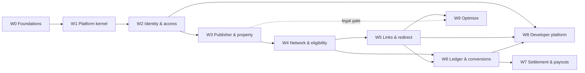

# Moneytrap — Work Waves and Parallel Lanes

**Status:** Draft for review.
**Detail:** every work package (WP) is specified in [IMPLEMENTATION_PLAN.md](IMPLEMENTATION_PLAN.md). Each wave's tests are in [test-plans/](../test-plans/).

---

## 1. How waves are grouped

A **wave** is a set of work that delivers one coherent capability and can be built by several lanes at once. Waves are sequenced by real dependencies (a later wave needs a merged port or aggregate from an earlier one), not by calendar.

Grouping rules used:

1. **One capability per wave.** Identity, publisher approval, catalog, links, ledger, payouts, and developer access are each their own wave. Mixing them would hide dependencies.
2. **Foundations first, then capabilities.** Wave 0 and Wave 1 contain no user-visible feature. They unblock everything else.
3. **Ports before implementations.** Every wave with several lanes merges its ports first (a "port-first merge point"). Then lanes can build in parallel against fakes.
4. **Pure domain can run early.** Domain logic with no I/O (ledger, eligibility policy) can start before the wave that first uses it, because it depends only on the kernel.
5. **Each lane has a single owner area.** Lanes do not share files except through merged ports.
6. **Every wave ends with a conformance gate.** A wave is done only when its test plan's exit criteria pass.

---

## 2. Wave overview

| Wave | Name | Milestone | Lanes | WPs | Gate to exit |
|---|---|---|---|---|---|
| W0 | Foundations and spikes | M0 | A Repo & tooling · B Spikes · C Decisions · (shared) | 10 | Spikes A–C recorded; CI green on macOS and Linux |
| W1 | Platform kernel | M0→M1 | A Domain primitives · B Persistence · C HTTP & contracts · D Test kit & web shell | 15 | Kernel test plan green; binary serves API and web shell |
| W2 | Identity & access | M1 | A Identity · B Access · C Persistence & adapters · D UI · E Conformance | 16 | CT-001–005, CT-008 green; security review |
| W3 | Publisher & property approval | M2 | A Publisher · B Property · C Ops console · D Publisher UI · E Conformance | 11 | CT-006, CT-007 green; ten synthetic publishers reviewed |
| W4 | Network, catalog & eligibility | M3 | A Connector · B Catalog · C Eligibility · D UI · E Conformance | 12 | Seven days simulated sync with no silent approvals |
| W5 | Links, redirect & click trace | M4 | A Links · B Redirect · C Clicks · D UI · E Conformance | 12 | Redirect SLO and revocation met; pilot gate set |
| W6 | Conversions & ledger | M5 | A Ledger core · B Import & attribution · C Balances & statements · D Finance UI · E Conformance | 13 | Ledger property tests green; sandbox month reconciles |
| W7 | Settlement & payouts | M6 | A Settlement · B Methods & provider · C Execution · D UI · E Conformance | 13 | Chaos suite green; payout runbook dry run |
| W8 | Developer platform | M7 | A Keys · B Webhooks · C Reports & API · D Reference consumer & UI | 10 | Reference consumer passes from public docs |
| W9 | Optimize beta | M8 | A Consent & exclusions · B Install · C Rules & experiments | 8 | Zero unwanted rewrites in beta |

---

## 3. Dependency graph

Reading the graph: W8 needs links, reports, and the identity model, so it can start once W6 has its report surface. W9 is blocked by a legal gate, not by engineering.

---

## 4. Early starts (pure work that can begin before its wave)

These WPs depend only on the kernel and have no UI or external dependency. Assign them to an idle lane during the wave that precedes them.

| Early WP | Can start during | Reason it is safe |
|---|---|---|
| WP-4.2 Network simulator | W2 (lane D) | Test-kit only; contract for W4 is already defined by §6.1 |
| WP-6.1, WP-6.2, WP-6.4 Ledger domain | W3 or W4 | Pure functions over `bigint`; no link or identity data |
| WP-6.3 Ledger persistence harness | W4 | Constraint and property tests run against Postgres without business flows |
| WP-7.4 Payout simulator | W5 | Test-kit only |
| WP-8.5 Cursor pagination, WP-8.8 OpenAPI skeleton | W5 | Contracts package only |
| WP-9.7 Exclusion rules (domain only) | W6 | Domain logic; no install or CMP work until W9 gate |

Rule: an early WP may merge, but its consumers may not ship before their own wave's gate.

---

## 5. Lanes inside each wave

Each lane shows the order a single owner should work, and which other lanes it must sync with.

### W0 — Foundations
- **Lane A (repo):** 0.1 → 0.2, 0.3 · 0.4 (independent)
- **Lane B (spikes):** 0.5, 0.6, 0.7 in parallel once 0.1 and 0.4 exist. Each spike is time-boxed.
- **Lane C (decisions):** 0.9 (independent) · 0.10 (independent, needs product) · 0.8 after B
- **Sync point:** ADR review after spikes.

### W1 — Platform kernel
- **Port-first merge:** 1.2 (Clock, IDs), 1.6 (transaction helper and Ctx type), 1.12 (fakes).
- **Lane A (domain):** 1.1 → 1.3
- **Lane B (persistence):** 1.4 → 1.5 → 1.6 → 1.7. Needs 0.4 Postgres and Redis.
- **Lane C (HTTP):** 1.9 → 1.8 (needs 1.3) → 1.10, 1.11
- **Lane D (test & web):** 1.12 → 1.13 · 1.14 (after 1.9) · 1.15 (after 1.4 and 1.14)
- **Sync point:** the kernel test plan is the only gate.

### W2 — Identity & access
- **Port-first merge:** 2.1 (User), 2.2 (password ports), 2.8/2.9 (Organization and policy ports), 2.13 (Notifier port).
- **Lane A (identity):** 2.3 → 2.4 → 2.5, 2.6, 2.7
- **Lane B (access):** 2.8 → 2.9 → 2.10, 2.11
- **Lane C (adapters):** 2.12 (after the port merge), 2.13, 2.14
- **Lane D (UI):** 2.15 starts after 2.4 and 2.8 have contracts; it builds against the fake API client until the server path is merged.
- **Lane E (conformance):** 2.16 runs as lanes A and B finish.
- **Sync point:** access policy table is reviewed by security before lane B closes.

### W3 — Publisher & property
- **Lane A (publisher):** 3.1 → 3.2 and 3.3
- **Lane B (property):** 3.4 → 3.5 → 3.6 → 3.7 (3.6 also needs 3.3)
- **Lane C (ops console):** 3.8 and 3.9 build against fake review API while 3.3 and 3.6 land.
- **Lane D (publisher UI):** 3.10 splits into onboarding screens (after 3.2) and property screens (after 3.5).
- **Sync point:** the verified-vs-approved distinction (CT-006) is confirmed by a shared domain test in 3.6.

### W4 — Network, catalog & eligibility
- **Port-first merge:** 4.1 (connector port and capabilities) before any other lane.
- **Lane A (connector):** 4.1 → 4.2 (simulator, can start in W2) → 4.3 (real adapter, depends on partner decision) · 4.4
- **Lane B (catalog):** 4.5 → 4.6 → 4.7
- **Lane C (eligibility):** 4.8 (pure, can start in W3) → 4.9 → 4.10
- **Lane D (UI):** 4.11 builds against the simulator.
- **Sync point:** eligibility decision inputs are agreed between lanes B and C (source facts shape).

### W5 — Links, redirect & click trace
- **Lane A (links):** 5.1 → 5.2 → 5.3
- **Lane B (redirect):** 5.4 → 5.5 → 5.7 → 5.6. 5.6 also needs 5.8 for the click enqueue.
- **Lane C (clicks):** 5.8 → 5.9, 5.10
- **Lane D (UI):** 5.11 after 5.2, 5.3, 5.9.
- **Sync point:** the route view shape (5.4) is shared by lanes A and B. Lane B owns it; lane A consumes it.
- **Performance:** WP-X.2 load test runs at the end of the wave against the built binary.

### W6 — Conversions & ledger
- **Lane A (ledger core):** 6.1 → 6.2, 6.4. Can start during W4 (early start).
- **Lane B (import):** 6.5 → 6.6 → 6.7; 6.8 uses the simulator.
- **Lane C (balances):** 6.9 → 6.10 → 6.11
- **Lane D (finance UI):** 6.12 after 6.7 and 6.10.
- **Sync point:** the ledger posting shape (6.1) is frozen before 6.9 starts. Changing it after that requires a finance review.

### W7 — Settlement & payouts
- **Lane A (settlement):** 7.1 → 7.2 → 7.3
- **Lane B (methods and provider):** 7.4 (early start in W5) → 7.5 · 7.6
- **Lane C (execution):** 7.7 → 7.8 → 7.9 → 7.12
- **Lane D (UI):** 7.10 and 7.11 build against the simulator.
- **Sync point:** the reservation key scheme (7.7) and the unknown-outcome rule (7.9) are reviewed together with finance before merge.

### W8 — Developer platform
- **Lane A (keys):** 8.1 → 8.2
- **Lane B (webhooks):** 8.3 → 8.4
- **Lane C (reports and API):** 8.5 (early start in W5) → 8.6 · 8.7 · 8.8
- **Lane D (reference consumer and UI):** 8.9 after 8.1, 8.3, 8.6. 8.10 in parallel.
- **Sync point:** 8.8 contract tests gate every other lane's merges from this wave onward.

### W9 — Optimize beta
- **Gate:** 9.0 (legal). Nothing else starts until it is signed.
- **Lane A (consent):** 9.1 → 9.2 → 9.7
- **Lane B (install):** 9.3 (UI and SDK, parallel to lane A)
- **Lane C (rules and experiments):** 9.4 → 9.5 → 9.6
- **Sync point:** the rewrite gate (9.2) is reviewed by legal before enabling for any publisher.

---

## 6. Parallelism summary

| Wave | Max concurrent lanes | Critical path (longest chain) |
|---|---|---|
| W0 | 3 | 0.1 → 0.5 → 0.8 |
| W1 | 4 | 1.4 → 1.5 → 1.6 → 1.7 |
| W2 | 4 (+ E) | 2.1 → 2.3 → 2.4 → 2.15 |
| W3 | 4 (+ E) | 3.4 → 3.5 → 3.6 → 3.10 |
| W4 | 4 (+ E) | 4.1 → 4.5 → 4.6 → 4.9 |
| W5 | 4 (+ E) | 5.1 → 5.4 → 5.5 → 5.6 |
| W6 | 4 (+ E) | 6.1 → 6.5 → 6.7 → 6.12 |
| W7 | 4 (+ E) | 7.7 → 7.8 → 7.9 |
| W8 | 4 | 8.1 → 8.9 |
| W9 | 3 | 9.0 → 9.1 → 9.2 |

The critical path in each wave is the schedule risk. Staff the critical path with the most experienced engineer and keep other lanes off it when merges collide.

---

## 7. Coordination rules

1. **Port merges are their own PRs.** A port change does not share a PR with its implementation.
2. **Shared contracts change through `contracts/` only**, with an OpenAPI diff in the PR.
3. **Finance and auth reviewers are required** on any PR touching `domain/src/ledger`, `domain/src/payouts`, `domain/src/access`, or `app/src/identity`.
4. **Conformance cases unlock, never relax.** A CT case that turns green stays green; a failing one blocks merges touching its area.
5. **Early-start WPs** need the wave owner's agreement and must not change a port that the current wave is using.
