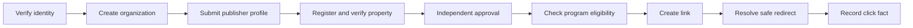
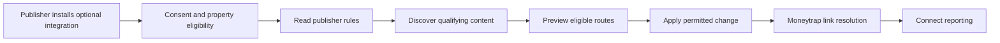

# Moneytrap — Complete Implementation-Neutral Technical Specification

**Canonical specification plus all technical appendices in one Markdown file.** No language, vendor, framework, storage engine, or deployment style is mandated.

## Contents
- Part 1: Core Technical Contract
- Part 2: Cross-Capability Interaction Contracts
- Part 3: End-to-End Use Cases
- Part 4: Logical API Operation Catalog
- Part 5: UI Experience Catalog
- Part 6: Logical Data Model
- Part 7: Conformance Test Scenarios


---

# Part 1 — Core Technical Contract

## Moneytrap — Implementation-Neutral Technical Specification

**Version:** 2.1 (implementation-neutral baseline)
**Status:** Proposed product behavior contract; not a selected implementation

**Precedence:** Where a companion contains legacy implementation details, this document governs. Suggested paths, status mappings, field names, and interaction mechanics are examples; observable behavior, security invariants and financial correctness govern conformance.  
**Coverage:** Global publisher meta-network; Connect + Optimize; MVP through planned expansion  
**Audience:** Product engineers, system designers, client application teams, integration partners, security reviewers, and QA

> **Core rule:** Specify observable behavior and data invariants, not the framework, programming language, database product, hosting platform, service vendor, deployment pattern, or UI library used to achieve them.

This is the canonical **technical specification**, not a Linear tracker and not a procurement, pricing, or partnership plan. Companion catalogs contain detailed logical resources, operations, screens, and executable scenarios. A conforming implementation can be a modular application, a distributed system, a managed application stack, or another architecture, provided it meets the same behavior and security contracts.

## 1. Meaning of "implementation-neutral"

**Normative — must hold across implementations:** permissions; data meaning and validation; state transition rules; financial invariants; API semantics; outcomes shown to users; isolation; security constraints; idempotency; safe failure behavior; lifecycle rules; and acceptance cases.

**Illustrative — can change without changing product behavior:** endpoint path spelling and transport; route names; data storage layout; method names; internal events delivery mechanism; package boundaries; background processing technology; UI rendering model; analytical engines; particular cryptographic algorithm selection if security properties are preserved; configuration storage; deploy topology and supplier selection.

Use the following requirement vocabulary:
- **MUST**: observable acceptance or safety requirement.
- **SHOULD**: strongly recommended default, changeable with documented reasoning and equivalent user outcomes.
- **MAY**: optional implementation choice or later release capability.
- **Example**: nonbinding illustration, not a vendor/stack selection.

External integrations must never be assumed to expose a particular feature. Network capabilities are discovered and configured independently. Missing capabilities are surfaced honestly, with a supported fallback or unavailable state.

### 1.1 Conformance profiles

| Profile | Scope | Minimum evidence |
|---|---|---|
| Connect Core | Identity, organizations, property approvals, program eligibility, link generation, safe redirect, click trace | Functional tests for authenticated and anonymous paths, tenant isolation, negative cases |
| Connect Finance | Conversion import, adjustments, ledger, settlement, balance, payout, statements | Replay tests, balancing proofs, reversal tests, recovery after ambiguous payout result |
| Developer Access | Scoped credentials, reports, links, subscriptions, bulk operations | Contract, rate-limit, webhook-signature, pagination, idempotency tests |
| Optimize | Consent-aware content linking, exclusions, policy-based routing, experiment/preview | Browser/app integration tests, opt-out, explicit publisher control, holdout tests |
| Commerce Expansion | Authorized product and coupon feeds and contextual experiences | Licensing checks, freshness and eligibility tests, editorial-control tests |

A conformance profile represents capability groups, not a preferred module or repository structure. Release policies decide which profiles are enabled.

## 2. Product boundaries and users

Moneytrap provides two coordinated capabilities:

**Connect:** publishers enroll properties, discover permitted affiliate programs, create trackable links, follow attributed performance, and receive statements and eligible payouts. Moneytrap obtains campaign and transaction facts from approved upstream networks and normalizes them into a single publisher experience.

**Optimize:** opted-in publishers automatically monetize permitted hyperlinks or eligible content, using policy controls and route selection. Optimize depends on Connect's eligibility, attribution, and reporting semantics. It must not bypass publisher decisions, consumer privacy preferences, or partner requirements.

Supported publisher channels: websites and editorial media, blogs and comparison sites, social accounts, mobile applications, and server-to-server or API-driven traffic. The proof, tracking, and UI experience can vary by channel; acceptance and financial accounting requirements remain consistent.

Primary actors: visitor, publisher owner, publisher editor, analyst, finance operator, organization administrator, Moneytrap reviewer, Moneytrap network operator, Moneytrap compliance operator, and external authorized provider. One individual may hold multiple roles. Permissions are bound to both role and relevant organization/publisher/property scope.

### 2.1 Non-goals and separation

- Moneytrap does not independently assert that an end-customer sale occurred merely because a click was tracked. Transaction authority normally comes from a contracted attribution source.
- It does not create program eligibility merely from a scraped catalog listing or an unknown upstream response.
- It must not set tracking in ways prohibited by browser/visitor choices or network agreement.
- It must not assume that a commission is collected or payable when only an upstream conversion is reported.
- Price scraping, unauthorized product feeds, browser-injected adware, fingerprint-based identity tracking, arbitrary cashbacks, and an ad auction are not required behaviors.
- A specific build/deployment architecture is out of scope.

## 3. Domain capabilities and boundaries

| Capability | Responsibilities | Owns truth about | Interacts with |
|---|---|---|---|
| Identity | User authentication, recovery, MFA, sessions | Identity credentials and assurance | Membership, notification, audit |
| Organization & Access | Teams, membership, scopes, invitations | Who may do what for which organization | All authenticated operations |
| Publisher Lifecycle | Publisher profile, risk/KYB state, approvals | Publisher standing | Property, finance, eligibility |
| Properties | Website/social/app/API assets and verification | Channel-specific ownership and permission to monetize | Eligibility, Connect, Optimize |
| Partnerships & Networks | Approved upstream integration, credentials, source capability | Network integration state | Catalog, conversions, settlement |
| Advertiser & Program Catalog | Normalized merchant, offers, regions, terms | Current-known and source-versioned offer data | Eligibility, link management |
| Eligibility | Combined program, property, geography, channel, consent, contract decisions | Allow/deny decisions with evidence | Routing, Optimize, admin |
| Links & Routing | Link creation, route selection, disable/revoke | Current link validity | Click tracking, eligibility |
| Attribution & Analytics | Click identity, qualified events, reconciliation windows | Observed tracking facts and report projections | Network transaction normalization |
| Conversion & Adjustments | Upstream transaction versions, reversals, exceptions | Source-reported conversions and transformations | Ledger, reporting |
| Finance | Share rules, double-entry movements, receipts, holds, payouts | Financial obligation and actual funding | Conversion, providers, publisher UI |
| Developer Platform | Credentials, rate limits, webhooks, exports | Partner-facing integration state | Every exposed capability |
| Risk & Privacy | Abuse decisions, consent, privacy requests, retention | Safety and data-use restrictions | All operations |
| Optimize | Optional rewrite rules, experiments, previews, routing reasons | Publisher's current optimization policy | Eligibility, links, analytics |
| Operations | Audit, health, recovery, launch gates | Operational readiness and traceability | All capabilities |

The rows are **logical ownership boundaries**, not required microservices or separate deployables. One runtime may contain several boundaries; separate runtimes may share a capability only if they preserve one authoritative owner for each mutable aggregate.

## 4. Cross-cutting behavior contracts

### 4.1 Identity and access

- Every protected operation MUST resolve an authenticated principal, effective permission, and target resource scope before returning private records or changing state.
- Client-selected organization IDs MUST NOT grant access. Unknown/foreign resources MUST not disclose their existence to an unauthorized caller.
- Privileged actions (funds movement, network secrets, MFA changes, suspension/reinstatement) MUST require stronger authentication and appropriate permissions.
- Long-lived authentication state MUST be revocable. Account security changes MUST invalidate or appropriately reauthorize existing access.
- Invitation and recovery links MUST be unguessable, single use, time-limited, safe to resend, and never written to routine logs or telemetry.

### 4.2 Data and concurrency

- Identifiers MUST be opaque and unique within a defined scope. Their encoding is implementation-chosen.
- Timestamps MUST represent unambiguous instants, with user-local display and time zone awareness.
- Financial values MUST have an explicit currency and exact arithmetic representation. Floating-point approximations cannot be authoritative.
- Critical state changes MUST be atomic or have equivalent compensating guarantees. Inconsistent partial results are unacceptable for permission changes, commission posting, settlement allocation, and payout reservation.
- Every externally repeated command MUST have an idempotency identity. Repeating it with identical meaning returns the same effect; replay with conflicting meaning is rejected.
- Imported source data MUST keep source identity and source revision/version to support corrections, replay, and audit.

### 4.3 Eventual consistency

- Analytics, email delivery, export preparation, and provider synchronization MAY complete later than the initial command. The UI MUST distinguish `accepted`, `processing`, `completed`, `failed`, and `data_stale` where relevant.
- Business facts MUST converge under retries, duplicate delivery, out-of-order delivery, and temporary disconnection. No money-moving operation may be duplicated because a response was lost.
- All events/commands crossing a failure boundary MUST carry traceable origin and have bounded retries, deduplication, and an inspectable failure mode.

### 4.4 Privacy, security, and evidence

- Protect passwords, recovery secrets, API credentials, provider tokens, payout credentials, and visitor identifiers. Avoid retaining raw values where references or irreversible derivations suffice.
- Redirect destinations MUST be validated to block open redirect abuse, unsafe schemes, invalid merchant routes, and revoked eligibility.
- Consent-dependent tracking or page modification MUST not occur before relevant permission is established.
- Logs, metrics, audits, analytics, and support tooling MUST not expose reusable credentials or sensitive URLs.
- Admin changes affecting money, access, risk, or approval MUST create an append-only audit fact containing actor, scope, reason, timestamp, and affected object.
- Privacy requests must honor applicable retention restrictions, including legitimate accounting and fraud-hold exceptions, with recorded legal/policy basis.

### 4.5 Configurable policy vs fixed contract

The following are **configurable policy**, not technology commitments: token expiry, resend cooldown, password requirements, rate limits, redirect latency targets, approval SLAs, revenue-share schedules, cookie/tracking lifetime, supported payment countries, export size, reconciliation windows, settlement clearance delay, payout minimum, payout hold period, experiment holdout, analytics retention, and response pagination limits.

Each policy must have a version, effective date or interval, owner, applicable scope, auditable change history, and test cases around boundaries. A policy change must not silently rewrite historical commissions.

## 5. Business and operational state machines

State is explicit and transitions are permissioned; final names may vary but underlying distinctions MUST remain.

| Aggregate | Expected states and transitions | Illegal or exceptional actions |
|---|---|---|
| User | pending verification → active → suspended / closed | No privileged action before active verification; closed account cannot silently reactivate |
| Recovery challenge | issued → consumed / expired / revoked | Reuse and out-of-window submission denied |
| Session | pending assurance → active → expired / revoked | Privileged action prohibited before required assurance |
| Publisher | draft → submitted → in review → approved / rejected / suspended | Suspension blocks new monetization; history remains auditable |
| Property | draft → verification pending → verified → review pending → approved / rejected / suspended | Verification alone is not approval; revoked proof invalidates routing |
| Program participation | discovered → eligible → requested → approved / rejected / expired / suspended | Unknown or missing approval means not monetizable |
| Link | draft → active → paused / revoked | Paused link cannot generate a monetized destination |
| Conversion source fact | observed → pending → approved / rejected / adjusted / disputed | Corrections create new revisions/evidence, not hidden overwrites |
| Funding fact | expected → reported settled → receipt matched → cleared | An approved conversion is not automatically cleared cash |
| Payout | prepared → reserved → approved → dispatched → processing → paid / failed / unknown | `unknown` cannot be blindly paid again; paid cannot be silently reversed |
| Optimize installation | disabled → configured → eligible → enabled → suspended / disabled | No rewrite without all policy gates passing |
| Privacy request | received → verified → in progress → fulfilled / partially fulfilled / denied with reason | Requests must not delete records under valid hold without evidence |

### 5.1 Financial invariants

1. A commission source fact is distinct from a company liability, a collected receipt, a publisher's available balance, and a completed payout.
2. Every financial movement is recorded as balanced entries; entries of one currency balance within that currency. No across-currency offset without a documented exchange transaction.
3. `publisher_share + platform_share + other_authorized_allocations = recognized_commission` under a versioned rounding rule.
4. Historical postings are append-only. Reversals and corrections are new movements linked to originals; never rewrite money paid out.
5. Payout availability is computed from settled and cleared eligible funds minus pending reserves, completed payouts, holds, chargebacks, and other authorized adjustments.
6. A partner import or payout response can be replayed without increasing money twice.
7. Allocation to publisher, property, advertiser, and source program is traceable from an upstream transaction through payout statement.
8. When a reversal follows a payout, expose a recoverable deficit / negative balance or authorized recovery policy; do not invent an extra payment.
9. Currency conversion uses explicit rate source, timestamp, spread/fee where applicable, and two balancing currency-specific movements.
10. Publisher reports distinguish estimated, pending, approved, collected, available, reserved, paid, and reversed amounts.

## 6. Integration capability contracts

### 6.1 Affiliate network connector

Each upstream integration MUST advertise a capability profile, not pretend universal feature parity:

| Operation | Contract |
|---|---|
| Validate connection | Check authorized account, credential validity, rate limits and permitted data access |
| Discover advertisers | Yield normalized advertiser records plus source identity and freshness watermark |
| Discover programs | Yield campaign terms, eligibility, countries, channels, and approval state if exposed |
| Resolve tracking destination | Create only allowed tracking links/sub-identifiers for approved property and program |
| List transactions | Yield transactions with stable source IDs, time range/cursor, current status and amounts |
| List adjustments | Yield changes/reversals with source revision and original transaction link |
| Retrieve settlement evidence | Yield remittance records when available; otherwise support operator reconciliation |
| Receive notifications | Verify authenticity and correlate callbacks when supported |
| Describe missing capability | Publish explicit `unsupported`, `temporarily_unavailable`, or `not_authorized` state |

An integration MUST prevent activation until commercial authorization, publisher disclosure obligations, and permitted sub-publisher tracking fields are documented. A connector MAY use any authorized protocol or ingestion method. Raw source evidence must remain reproducible without exposing credentials.

### 6.2 Payout and verification connector

External payout/verification capabilities MUST be replaceable. Define operations: obtain eligibility, securely register payment method, validate beneficiary, initiate transfer with stable request identity, inspect transfer status, receive and verify status notifications, query past transfers, reconcile final outcome, and report limits/fees/currency support.

A timeout is **unknown**, not a failed payment. Query prior request state before another transfer attempt. Store references rather than sensitive underlying documents/instruments whenever possible.

### 6.3 Notification delivery

A notification capability MUST accept a template key/version, locale, approved delivery channel, recipient reference, short-lived secure parameters, and a deduplication identity. Providers may vary; retries must avoid duplicate user-visible security messages where feasible. Support status and failure visibility.

## 7. API design rules (transport independent)

An **operation** is defined by an actor, inputs, preconditions, result, domain error codes, side effects, and idempotency semantics. Its binding to a route, RPC procedure, or another protocol is replaceable. The API companion provides a *suggested HTTP mapping* only, retained from the previous contract as a migration aid; implementations MAY expose a different interface if clients can use an equivalent documented binding.

- Commands distinguish validation failure, forbidden scope, stale/revoked state, conflict, rate limiting, and upstream unavailability.
- List operations support stable ordering, bounded page size, opaque continuation, filtering, and explicit data freshness where reporting may lag.
- Security-sensitive and financial commands must support request correlation, audit, and replay safety.
- A public API MUST separate tenant-scoped data from platform-administrative operations, regardless of transport.
- Typed machine-readable errors MUST have stable, documented meanings. UI must not infer business meaning from status code alone.
- Bulk operations report per-item success/failure, stable submission ID, and completion state; partial success is valid where the product specifies it.
- Live redirect operations must preserve quick completion but never omit eligibility or destination safety checks for speed.

### 7.1 Canonical command result (illustrative representation)

```json
{
  "operation_id": "op_example",
  "status": "accepted",
  "result": {"resource_id": "opaque-reference"},
  "correlation_id": "traceable-reference",
  "as_of": "2026-01-01T00:00:00Z"
}
```

Error category examples: `VALIDATION_FAILED`, `UNAUTHENTICATED`, `FORBIDDEN`, `RESOURCE_NOT_FOUND`, `STATE_CONFLICT`, `ALREADY_PROCESSED`, `TOKEN_EXPIRED`, `RATE_LIMITED`, `SOURCE_STALE`, `PROVIDER_UNAVAILABLE`, `PAYOUT_OUTCOME_UNKNOWN`, `CONSENT_REQUIRED`, `PROGRAM_INELIGIBLE`, `STEP_UP_REQUIRED` (privileged route without a recent second factor; 403). These are semantic error codes; particular numeric transport statuses are optional mappings.

### 7.2 Monetary value contract (illustrative representation)

```json
{"amount": "125.37", "currency": "USD"}
```

The quoted decimal amount is an **exact** canonical exchange value; a conforming implementation may use integer minor units, precise decimal representations, or another lossless encoding internally. Consumers must never sum different currencies without an explicit conversion.

## 8. User interface contract

The UI consists of experiences, not a prescribed URL framework, component tree, styling library, or rendering architecture. The companion UI catalog preserves suggested browser paths for continuity, but the required contract is the user's journey, visible statuses, navigation, and permissions.

For every interactive experience:
- Provide loading, empty, populated, editable, submitted/pending, success, validation error, permission denied, expired resource, rate-limited, and source-stale states where applicable.
- Preserve entered data after recoverable errors without echoing secrets.
- Use accessible labels, keyboard interactions, focus management, error announcements, and screen reader status updates.
- Protect private views on direct navigation, reload, copied URL, browser history, and account/organization switching; client-side hiding does not satisfy server authorization.
- Show financial totals with currency and `as_of`; a failed or stale source must not be displayed as zero.
- Provide a clear approval status separate from ownership verification, conversion approval separate from settlement, and available funds separate from estimates.
- Make sensitive actions confirmable or reversible where allowed; unauthorized actions may be hidden for convenience but MUST also be rejected at the authoritative boundary.

### 8.1 Navigation groups

**Public access:** registration, email verification, login, password recovery, pending review.  
**Publisher workspace:** overview, organizations, members, publisher onboarding, properties, advertiser/program discovery, links, reports, balances, payouts, statements, developer settings, Optimize controls.  
**Platform operations:** publisher/property review, network credentials and sync, conversion exceptions, settlement matching, payout approval/reconciliation, fraud appeals, privacy requests, audit, launch controls.  
**Developer experience:** credential issuance/rotation, webhook setup, tests, delivery logs, bulk jobs, API usage and error diagnostics.

## 9. Cross-capability interactions

A "mesh" here is **ownership and contractual interaction**, not a requirement to adopt service-mesh infrastructure.

### 9.1 Publisher onboarding → monetizable link



- Approval is evaluated from publisher standing + property review + actual program terms + geographic/channel policy.
- A property can be verified but unapproved; a program can exist but be ineligible.
- Caches or duplicated views may accelerate reads but MUST respect revocations and policy versions.
- If eligibility cannot be verified, do not invent a valid monetization route.

### 9.2 Click → transaction → payout

```mermaid
flowchart LR
A[Visitor opens link] --> B[Check route policy]
B --> C[Record click reference]
C --> D[Redirect to allowed destination]
D --> E[Source reports conversion]
E --> F[Normalize and match evidence]
F --> G[Source approval / adjustments]
G --> H[Recognize commission split]
H --> I[Match settlement receipt]
I --> J[Determine payable balance]
J --> K[Approve and dispatch payout]
K --> L[Reconcile provider outcome]
```



- The redirect path MUST not wait for the analytics projection or a conversion callback.
- Attribution may be unmatched. Preserve exceptions for investigation rather than assigning money to an arbitrary publisher.
- A source correction moves financial obligations by a new adjustment record, not by editing an already-posted journal.
- A payout remains reserved during ambiguous provider status; a second transfer must never be initiated just because the initial response was lost.

### 9.3 Optimize → Connect



- Publisher opt-in, merchant exclusions, protected existing affiliate links, visitor consent, and editorial controls are gates before rewriting.
- If no eligible program exists, preserve the original content/link.
- The resulting monetization uses the same Connect eligibility and conversion accounting rules; Optimize has no separate shortcut to earnings.

## 10. Safety, operability, and resilience

- Track conversion ingestion lag, route-resolution latency, link resolution errors, denied/unknown eligibility decisions, partner sync drift, source report freshness, unmatched conversions, ledger balance checks, settlement mismatches, payout ambiguity, consent denials, and notification failure.
- Support deterministic reprocessing of provider imports and events without adding duplicate clicks, commissions, or transfers.
- Provide bounded retries, dead-letter or quarantine inspection, operator replay with authorization, and audit trails for manual corrections.
- Implement incident response controls to disable a network, advertiser, program, publisher, property, link, geography, or monetization capability promptly.
- Recovery mechanisms must preserve evidence and financial consistency even after partial system loss. The disaster recovery method and storage technologies remain implementation-selected.
- Clearly distinguish `not applicable`, `not available`, `stale`, `blocked`, and `zero` in reports and dashboards.

### 10.1 Nonfunctional acceptance dimensions

| Dimension | Contract | Selected by implementing team |
|---|---|---|
| Redirect safety | Unsafe/ineligible destination never receives monetized redirect | Target latency, caching, routing deployment |
| Availability | Published availability and degradation behavior per operation | Infrastructure and redundancy pattern |
| Auditability | Trace identity and source revisions through every financial movement | Audit store, export format |
| Consistency | Critical financial and authorization invariants remain true under failures | Transaction coordinator and persistence topology |
| Scalability | Operations sustain measured target volumes; no unbounded blocking in click path | Load thresholds, queues, sharding/partition method |
| Data privacy | Access, minimization, erasure/hold rules verified | Regional storage, encryption method, retention jobs |
| Portability | A second implementation can pass the same public contract and scenario suite | Languages, frameworks, providers |

## 11. Release capabilities (not infrastructure milestones)

| Release | Required outcome | Gate |
|---|---|---|
| Core MVP | Approved publisher/property can build a link, redirect safely, see clicks and source-attributed conversions | End-to-end sandbox flow + authorized production partnership |
| Finance-ready | Approved conversion can be split, reversed, settled, cleared, stated, and paid | Balanced ledger, replay tests, provider outcome reconciliation |
| Developer-ready | Scoped credentials, complete resource access, webhooks and exports | Consumer contract tests and credential-revocation tests |
| Optimize beta | Opted-in websites safely monetize eligible content | Consent and exclusion tests; zero unwanted rewrites |
| Commerce expansion | Licensed feed-based products, coupons, richer recommendations | Rights and freshness checks; publisher editorial control |

The order does not dictate how teams, repositories, deployment units, or technologies are organized.

## 12. Open design decisions intentionally not locked

| Decision | Why deferred | Nonnegotiable behavior |
|---|---|---|
| Server language / framework | Multiple suitable implementations | Same public contract and security |
| Frontend framework / UI toolkit | Web and app clients may differ | Same navigability, accessible states and protected actions |
| Primary persistence system | Relational, distributed or document-based designs may work | Durable relations, uniqueness, auditable revisions, atomic money/access transitions |
| Analytics engine | Queries and scale change | Deduplicated events, freshness, tenant isolation |
| Internal communication | Direct calls or asynchronous messages may coexist | Defined ownership, retries, dedup, traceability |
| Deployment topology | One runtime or many | Reliable isolation and observed service behavior |
| Payment/verification vendor | Geography and contracts determine options | Replaceable provider adapter, reconciliation and secure data handling |
| Affiliate network partner | Subject to authorization | Capability discovery and documented data provenance |
| UI route spelling | UX and navigation choices evolve | Every experience and direct navigation state represented |
| Exact TTLs / rate quotas | Risk and market context vary | Policy-defined, consistent, testable and versioned |
| Exact API encoding | Client mix may change | Stable semantic types, errors, pagination and compatibility |
| Internal names for records | Schema style varies | Canonical conceptual identity and relationships preserved |

## 13. Requirement traceability and acceptance

For any new or replacement implementation, each capability must be traceable through: `use case → UI experience (if interactive) → operation contract → logical record → state transition/event → error cases → executable acceptance test`.

A capability is **complete** only when happy path, expected error path, unauthorized path, duplicate/retry path, concurrent submission path where relevant, stale/outage behavior, accessibility behavior, and telemetry/audit evidence are demonstrated. Implementation teams can choose how to test these, but not omit the outcomes.

**Companion references:**
- [Logical data model](MONEYTRAP_LOGICAL_DATA_MODEL.md)
- [API operation catalog](MONEYTRAP_API_OPERATIONS.md)
- [UI experience catalog](MONEYTRAP_UI_EXPERIENCES.md)
- [End-to-end use cases](MONEYTRAP_USE_CASES.md)
- [Cross-capability interaction and event contracts](MONEYTRAP_INTERACTION_CONTRACTS.md)
- [Cross-implementation conformance cases](MONEYTRAP_CONFORMANCE_CASES.md)

---


---

# Part 2 — Cross-Capability Interaction Contracts

## Moneytrap — Cross-Capability Interactions and Event Semantics

**Events describe meaningful facts.** They do **not** require a broker, a queue product, microservices, or even asynchronous transport. An implementation may notify another capability through a direct call, a durable internal event, a scheduled reconciliation, or a combination, provided the observable effects are equivalent.

## Event semantics and envelope

A cross-boundary notification SHOULD convey: `fact_type`, `fact_id`, `subject_ref`, `subject_revision`, `occurred_at`, `correlation_ref`, `causation_ref`, `policy_version`, and a privacy-minimized `facts` payload. Transport encoding and delivery strategy are not mandated. Events must not expose passwords, reset proofs, raw API keys, financial instrument details, or upstream account secrets.

**Delivery rules:** duplicates and reordering are expected; consumers deduplicate by stable fact identity and revision. A newer aggregate revision MUST not be overwritten by an older delivery. Version-breaking changes require explicit consumers migration. Failure to process a critical fact remains visible and retryable; unexpected versions are quarantined.

| Fact | Authoritative producer | Consumers / effect | Minimal data | Invariant |
|---|---|---|---|---|
| `identity.registered` | Identity | Notification | identity, locale, challenge ref | Cannot grant monetization before verification |
| `identity.verified` | Identity | Organizations/Publisher | identity, verified_at | Replay does not duplicate publisher |
| `identity.recovery_requested` | Identity | Secure notification | delivery reference | Never propagate raw proof in general event |
| `identity.password_changed` | Identity | Sessions, security notice, audit | identity, auth revision | Old session assurance invalidated |
| `organization.created` | Organization | Publisher lifecycle | org, creator | Exactly one initial owner |
| `membership.changed` | Organization | Authorization | org, principal, current role/version | Revoked access fails closed |
| `publisher.submitted` | Publisher lifecycle | Review | publisher, version, evidence refs | Pending not approved |
| `publisher.reviewed` | Review | Eligibility, notification | publisher, decision, reason | Effective deny honored promptly |
| `property.verified` | Property | Review queue | property, proof method/time | Verified not approved |
| `property.reviewed` | Review | Eligibility, routing | property, policy generation | Revoked property loses eligible routes |
| `partnership.changed` | Network operations | Catalog/eligibility | network, capabilities, authorization state | No production use without approval |
| `catalog.updated` | Network catalog | Eligibility/links | source, changed program IDs, as_of | Source freshness recorded |
| `program.eligibility_changed` | Eligibility | Link/Optimize | program, scope, terms version, reason | Unknown eligibility denies monetization |
| `network.sync_requested` | Network operations | Integration capability | source, cursor/scope | Same cursor replay safe |
| `link.created` | Links | Route views | link, property, policy version | No invalid destination published |
| `link.revoked` | Links | Route views | link, revocation version | Old cached allow does not override revoke |
| `click.observed` | Routing | Attribution/analytics | click, link, route, occurred_at | Deduped logical click; no sale assumption |
| `source.report_received` | Network integration | Conversion normalization | source, report ID, digest/version | Raw evidence reproducible |
| `conversion.changed` | Conversion | Finance and reporting | source transaction/revision, status, amount | Source revision posted once |
| `conversion.adjusted` | Conversion | Finance and reporting | adjustment ID, original ID, delta | Original money movement remains |
| `settlement.matched` | Finance | Balance and statements | receipt, allocation IDs, currency | Only actual verified receipt clears |
| `payout.approved` | Finance | Dispatch | payout/batch, approver, amount | Maker-checker policy preserved |
| `payout.dispatched` | Finance | Provider reconciliation | payout, stable transfer ref | Unknown means no new independent transfer |
| `payout.provider_state_changed` | Provider integration | Finance and notification | payout, provider event ID, status | Conflicting terminal state investigated |
| `webhook.delivery_requested` | Developer platform | External subscriber | endpoint/event ref | Signed/verified if public subscriber |
| `risk.decision_changed` | Risk | Eligibility and routing | scope/ref, decision version | Suppression overrides stale allow |
| `privacy.request_resolved` | Privacy | Audit and notification | request ref, disposition | Legal hold and redaction respected |
| `optimize.policy_changed` | Optimize | Client integrations | property, policy version | Consent/exclusion applied before rewrite |
| `country.activation_changed` | Launch control | Network/links/payout | country, capability, active version | Regions restricted independently |

## Interaction rules

### 1. Identity / permissions

A change to membership or identity assurance MUST take effect at any capability that accesses private or privileged information. The propagation technique is optional; an obsolete session or read replica cannot grant old permissions indefinitely.

### 2. Network/catalog → link generation

A fresh, authorized catalog view provides possible programs. The eligibility evaluator must combine contract and property-level constraints at the point of link creation and again where route revocation or risk requires it. Network-specific information may be fetched on demand, cached, or synchronized; unauthorized route generation is always an error.

### 3. Link resolution → click tracking

Visitor request resolves a currently approved link. Generate or identify a unique click attempt, choose an allowed destination, and make tracking evidence recoverable without delaying the response until heavy analytics completes. When tracking cannot lawfully occur, avoid it. Client retries and internal redelivery cannot turn one click attempt into multiple distinct commissions.

### 4. Conversions → ledger

A source-reported conversion is normalized with stable source transaction identity and source revision. Finance independently tests agreement, currency, amounts, attribution, status and recognition policy before posting immutable balanced movements. Revisions create adjustments linked to prior postings. Reports never determine money authority.

### 5. Settlement → payout

Receipt evidence is matched to source transactions, only eligible cleared value becomes available, and payout reservation is atomic under concurrent requests. Dispatch uses a stable transfer identity, outcome ambiguity is investigated, final provider evidence is reconciled, and the statement captures the complete financial trail.

### 6. Optimize ↔ Connect

Optimize receives property eligibility and publisher rules, proposes candidate monetization changes, and relies on Connect for the actual route and accounting. Disabled consent or exclusion returns `leave_original_unchanged`, never an unauthorized fallback campaign.

## Consistency / failure table

| Boundary | Allowed temporary state | Required recovery | Forbidden state |
|---|---|---|---|
| Identity → notification | Delivery pending | Retry safely, inspect failure | Expose recovery proof in logs |
| Review → route eligibility | Short documented propagation delay | Revalidate/deny revoked scope | Revoked property still monetized indefinitely |
| Redirect → analytics | Analytics projection behind | Replay/deduplicate evidence | Block safe redirect on reporting outage |
| Network → conversion | Source report stale | Mark `as_of`, retry and alert | Infer zero revenue from unavailable report |
| Conversion → finance | Pending finance recognition | Replay source revision | Duplicate postings |
| Settlement → balance | Receipt not fully allocated | Quarantine remainder | Clear more than received |
| Payout → provider | Ambiguous transfer outcome | Query original identity, reconcile | Blind second transfer |
| Optimize → client | Old policy cached | Version and invalidate | Bypass an active deny/opt-out |


---

# Part 3 — End-to-End Use Cases

## Moneytrap — End-to-End Use Cases (Implementation Neutral)

A use case documents a complete observable user or operator outcome. Suggested interface paths and HTTP calls are traceability examples, **not technology requirements**. Conceptual records are logical data; internal stages may be synchronous, asynchronous, or combined so long as outcomes, recovery and invariants hold.

Every use case specifies starting actor, relevant experiences and operations, a normal sequence, failure modes, and executable acceptance conditions.

## Scenarios
### UC01 — Register, verify email and create account

- **Primary actor:** New publisher.
- **Suggested UI navigation:** `/register`, `/verify-email`, `/login`. *(aliases only)*
- **Suggested API bindings:** `POST /v1/auth/register`, `POST /v1/auth/verify-email`, `POST /v1/auth/resend-verification`. *(nonbinding)*
- **Conceptual records:** `users`, `email_verification_tokens`, `notification_templates`, `notification_deliveries`, `audit_logs`.

**Nominal interaction sequence**

1. Visitor enters email/password and accepts versioned Terms on /register.
2. Browser validates fields and submits register.
3. Identity capability normalizes the email, protects the password, and creates pending user and one-time hashed email challenge.
4. Notification delivery step sends short-lived verification link with dedup_key.
5. Visitor opens /verify-email, token is exchanged via POST.
6. API atomically consumes challenge, sets verified_at, emits audit event.
7. UI links to /login and never exposes password hash.

**Failure and recovery behavior**

- Existing email returns documented generic or 409 without leaking private account data.
- Expired or replayed challenge shows resend action.
- Email provider failure remains asynchronous pending for delivery and observable.
- Bot abuse is throttled.

**Conformance acceptance**

- Valid registration + verify creates one active identity.
- Same verification token cannot be used twice.
- Email never sent with raw password.
- Cross-user verification token fails.
- Resend throttling 429.
- Mail provider retry creates no duplicate challenge.

### UC02 — Log in with sessions and mandatory MFA for privileged users

- **Primary actor:** Returning publisher or admin.
- **Suggested UI navigation:** `/login`, `/mfa/challenge`, `/dashboard`, `/settings/security`. *(aliases only)*
- **Suggested API bindings:** `POST /v1/auth/login`, `POST /v1/auth/mfa/challenge`, `GET /v1/auth/me`, `POST /v1/auth/logout`. *(nonbinding)*
- **Conceptual records:** `users`, `auth_sessions`, `mfa_factors`, `audit_logs`.

**Nominal interaction sequence**

1. Login form takes credentials over HTTPS.
2. API verifies password and account state, applies IP/account throttle.
3. If MFA required API returns challenge_id, not full session.
4. Browser moves to /mfa/challenge, submits supported second-factor method challenge.
5. API verifies proof, mints short-lived signed HttpOnly Secure SameSite session credential and request-forgery safeguards for cookie-based implementations.
6. Authorization enforcement resolves user and organization role per request.
7. /dashboard loads profile via /auth/me.
8. Logout revokes session hash and clears cookie.

**Failure and recovery behavior**

- Wrong password generic 401.
- Locked or suspended user 423.
- Stolen MFA challenge expires.
- CSRF rejected on mutation.
- User with no organization goes to onboarding.

**Conformance acceptance**

- Admin without MFA never receives privileged session.
- Browser session credentials meet secure transmission and script-access policies where applicable.
- Session fixed on login cannot be reused.
- Invalid MFA locked/throttled.
- Revoked session gives 401.
- Cross-org switch enforces roles.

### UC03 — Forgot and reset password end-to-end

- **Primary actor:** Publisher who lost account access.
- **Suggested UI navigation:** `/forgot-password`, `/reset-password?token=...&email=...`, `/login`, `/settings/security`. *(aliases only)*
- **Suggested API bindings:** `POST /v1/auth/forgot-password`, `POST /v1/auth/reset-password`, `POST /v1/auth/login`, `GET /v1/auth/sessions`. *(nonbinding)*
- **Conceptual records:** `users`, `password_reset_tokens`, `auth_sessions`, `notification_deliveries`, `audit_logs`.

**Nominal interaction sequence**

1. On /login click Forgot password to /forgot-password.
2. Enter email; API always returns 202 with same message, whether or not account exists.
3. For eligible user create random token, store only token_hash with created_at, request protected delivery of a single-use reset URL.
4. User opens /reset-password?token=...&email=...; set no-referrer and no-store, avoid third-party scripts; UI reads token and does not log it.
5. User enters new password + confirmation; client validates format but API revalidates.
6. POST /auth/reset-password atomically claims the recovery challenge, checks token hash and configured expiration, hashes new password, consumes token, increments users.auth_version, revokes auth_sessions as one indivisible operation.
7. Publish security notice, redirect to /login?reset=success; do not auto-login or bypass MFA.
8. A prior session or repeat token fails, fresh credentials work.

**Failure and recovery behavior**

- Unknown email cannot be enumerated through body or timing.
- Expired token shows request-new-link state without revealing account.
- Invalid or used token returns 410.
- Password mismatch/weak returns 422 with field codes.
- Race of two reset submissions allows exactly one.
- Email outage is retried idempotently.
- Multiple reset requests invalidate the prior token.

**Conformance acceptance**

- Stored recovery proof verification is secure, not plaintext.
- 202 indistinguishable existing vs unknown.
- A proof just before the configured expiration succeeds; immediately after it fails under a controlled clock.
- Concurrent reset attempts exactly one success.
- All previous sessions revoked.
- MFA still required after reset.
- Password and token omitted from analytics, logs and error traces.
- End-to-end UI from /login to /forgot-password to /reset-password to /login with error cases.

### UC04 — Enroll MFA, rotate recovery codes and revoke sessions

- **Primary actor:** Privileged team member.
- **Suggested UI navigation:** `/settings/security`, `/settings/security/mfa`, `/settings/security/sessions`. *(aliases only)*
- **Suggested API bindings:** `POST /v1/auth/mfa/enroll`, `POST /v1/auth/mfa/confirm`, `GET /v1/auth/sessions`, `DELETE /v1/auth/sessions/{session_id}`. *(nonbinding)*
- **Conceptual records:** `users`, `mfa_factors`, `auth_sessions`, `audit_logs`.

**Nominal interaction sequence**

1. Authenticated user re-enters password.
2. Start an approved additional-authentication method enrollment.
3. Server protects pending factor material and never marks active until proof.
4. UI presents enrollment challenge, requests valid proof.
5. Server marks factor confirmed, creates one-time recovery codes stored only as hashes.
6. User downloads recovery codes one time.
7. Sessions page lists hashed device metadata and allows remote session revocation.
8. Sensitive actions require step-up MFA.

**Failure and recovery behavior**

- Wrong factor proof does not activate.
- Recovery codes cannot be viewed again.
- Enrollment cancellation removes pending factor.
- Last admin factor removal requires alternate verified method.
- Revocation races fail closed.

**Conformance acceptance**

- One-time authentication proof replay is rejected.
- Only verified factor grants MFA.
- Recovery code consumed once.
- Remote revoked session cannot call API.
- Secret absent from logs and response after enrollment.

### UC05 — Create organization, invite members and enforce tenant RBAC

- **Primary actor:** Publisher account owner.
- **Suggested UI navigation:** `/onboarding/organization`, `/settings/organization`, `/settings/team`, `/invitations/accept?token=...`. *(aliases only)*
- **Suggested API bindings:** `POST /v1/organizations`, `POST /v1/invitations`, `POST /v1/invitations/accept`, `GET /v1/members`, `DELETE /v1/members/{member_id}`. *(nonbinding)*
- **Conceptual records:** `organizations`, `memberships`, `organization_invites`, `publishers`, `users`, `auth_sessions`, `audit_logs`.

**Nominal interaction sequence**

1. Verified user creates organization (name, country, base currency).
2. Account operation creates organization, owner membership and publisher draft.
3. Owner invites by email with role; token stored hashed.
4. Invitee accepts valid invitation in organization context.
5. Authorization enforcement derives org from validated session selection, checks membership and scoped role.
6. Settings screen shows members and allows role-appropriate removal.
7. Last owner cannot be removed; removal revokes organization-scoped access.

**Failure and recovery behavior**

- Duplicate membership returns 409.
- Expired/used invite returns 410.
- Viewer cannot invite.
- Tenant B identifier requested by Tenant A returns 404.
- Member removed while session active loses access immediately.

**Conformance acceptance**

- All list/detail queries verify membership.
- record-level authorization tests cover every protected API.
- Invite token single-use.
- Last-owner check concurrent safe.
- Invite email retries no duplicate membership.

### UC06 — Submit publisher KYB and administrative approval

- **Primary actor:** Organization owner and compliance reviewer.
- **Suggested UI navigation:** `/onboarding/publisher`, `/onboarding/review`, `/admin/publishers`, `/admin/publishers/[id]`. *(aliases only)*
- **Suggested API bindings:** `POST /v1/publishers/submit`, `GET /v1/publishers/status`, `GET /v1/admin/publishers/review-queue`, `POST /v1/admin/publishers/{id}/decision`. *(nonbinding)*
- **Conceptual records:** `publishers`, `publisher_kyb`, `audit_logs`, `notification_deliveries`.

**Nominal interaction sequence**

1. Owner submits account details and starts hosted KYB provider session if required.
2. API stores only provider reference and draft/in_review state.
3. Admin asynchronous delivery mechanism displays risk signals and evidence references, not sensitive raw documents.
4. Reviewer approves/rejects with reason and logs actor/timestamp.
5. Publisher receives status notification and dashboard state changes.
6. All link creation blocked unless publisher approved.

**Failure and recovery behavior**

- Unverified organization cannot submit.
- Reviewer without privilege denied.
- Rejected publisher gets safe explanation/resubmission route.
- Provider unavailable remains pending, never auto-approves.

**Conformance acceptance**

- Status transition draft->in_review->approved audited.
- No self-approved privilege escalation.
- Suspended publisher links fail closed.
- KYB PII never lands in application logs.

### UC07 — Verify website, social, mobile app and API properties

- **Primary actor:** Approved publisher.
- **Suggested UI navigation:** `/properties`, `/properties/new`, `/properties/[id]/verify`, `/properties/[id]/review`. *(aliases only)*
- **Suggested API bindings:** `POST /v1/properties`, `POST /v1/properties/{id}/verification-challenge`, `POST /v1/properties/{id}/verify`, `POST /v1/properties/{id}/submit`, `GET /v1/properties/{id}`. *(nonbinding)*
- **Conceptual records:** `properties`, `property_verifications`, `property_approval_reviews`, `audit_logs`.

**Nominal interaction sequence**

1. Publisher chooses website/social/app/API traffic source and enters normalized identifier.
2. Service stores canonical and normalized value with country/channel.
3. For website choose DNS TXT or HTML/meta challenge; display exact instructions.
4. Verification background processor resolves public DNS/HTTPS with initial page renderingF protection and bounded timeouts.
5. For social/app/api use documented manual or supported provider verification, not a fake website challenge.
6. Verified property submitted for independent compliance approval.
7. UI renders pending, failed, rejected, approved with recheck instructions.

**Failure and recovery behavior**

- Domain points to private IP blocked.
- DNS rebinding blocked.
- Unicode homograph/duplicate host normalization.
- Social property no unsupported automated approval.
- Challenge expired/incorrect remains pending.

**Conformance acceptance**

- Three valid website ownership methods pass when applicable.
- Private/loopback fetch rejected.
- Duplicate normalized property unique.
- Verification not equivalent to advertiser eligibility.
- Cross-tenant verify forbidden.

### UC08 — Review, approve, suspend and revoke publisher properties

- **Primary actor:** Compliance reviewer.
- **Suggested UI navigation:** `/admin/properties`, `/admin/properties/[id]`, `/properties/[id]`. *(aliases only)*
- **Suggested API bindings:** `GET /v1/admin/properties/review-queue`, `POST /v1/admin/properties/{id}/decision`, `POST /v1/properties/{id}/disable`. *(nonbinding)*
- **Conceptual records:** `properties`, `property_approval_reviews`, `link_routes`, `outbox_events`, `audit_logs`.

**Nominal interaction sequence**

1. Reviewer opens asynchronous delivery mechanism filtered by channel, country and source.
2. Inspects verification evidence and upstream permitted traffic methods.
3. Approves or rejects with reason and records terms snapshot.
4. Policy engine updates property state and emits route eligibility invalidation.
5. Suspended properties lose ability to create links or redirect monetized traffic <=60s.
6. Publisher sees actionable status.

**Failure and recovery behavior**

- Unknown channel is denied.
- Suspended property cannot bypass via stale fast-access state cache.
- Reject without reason blocked.
- Reviewer cannot approve forbidden upstream channel.

**Conformance acceptance**

- Every decision has audit actor and reason.
- Route kill-switch integration test <=60s.
- Duplicate approval replay idempotent.
- Reviewer permissions enforced.

### UC09 — Configure affiliate network account and authorize adapter

- **Primary actor:** Internal integration administrator.
- **Suggested UI navigation:** `/admin/integrations`, `/admin/integrations/[id]`. *(aliases only)*
- **Suggested API bindings:** `GET /v1/admin/integrations`, `POST /v1/admin/integrations/{id}/sync`. *(nonbinding)*
- **Conceptual records:** `networks`, `network_partnerships`, `network_accounts`, `network_sync_cursors`, `audit_logs`.

**Nominal interaction sequence**

1. Commercial uploads signed approval evidence and permitted scopes.
2. Admin configures network account with vault secret reference, not raw secret in persistent state.
3. Adapter validates auth and capability matrix in sandbox.
4. Production flag remains disabled until partnership active and country/channel activation approved.
5. Sync schedules initialize cursors and collect partner API health.
6. Admin UI shows last success/error and disabled capabilities.

**Failure and recovery behavior**

- Missing written permission stops production activation.
- Revoked API token disables sync and route templates.
- Unsupported settlement capability never appears as supported.
- Partner 429 uses backoff.

**Conformance acceptance**

- No upstream secret saved in logs/persistent state.
- Invalid partner agreement cannot be enabled.
- Contract expiry cancels eligible routes.
- Adapter contract mocks pass on failure/retry.

### UC10 — Synchronize advertisers, programs and source eligibility

- **Primary actor:** Publisher browsing offer catalog.
- **Suggested UI navigation:** `/advertisers`, `/advertisers/[id]`, `/programs/[id]`, `/admin/integrations/[id]`. *(aliases only)*
- **Suggested API bindings:** `GET /v1/advertisers`, `GET /v1/programs`, `GET /v1/programs/{id}`, `POST /v1/programs/{id}/request-approval`. *(nonbinding)*
- **Conceptual records:** `advertisers`, `advertiser_domains`, `network_advertisers`, `programs`, `program_eligibility`, `publisher_program_approvals`, `network_sync_cursors`.

**Nominal interaction sequence**

1. Adapter reads program pages using cursor/rate limits.
2. Normalize advertiser identity and verified merchant domains.
3. Upsert external IDs, catalog terms, validity, deep-link permissions, supported countries/channels.
4. Publisher searches offers filtered by own approved property.
5. Eligibility service intersects contract country/channel, publisher property, program approval and fresh sync.
6. Publisher requests per-program approval when required.
7. UI shows eligibility reason and last sync timestamp.

**Failure and recovery behavior**

- Empty/stale approval unknown -> denied.
- Duplicate external IDs update expected row.
- Renamed network advertiser does not split catalog.
- Deactivated program invalidates routes.

**Conformance acceptance**

- Fixture sync converges after two replays.
- Unauthorized catalog offer not advertised as monetizable.
- Every route decision cites terms version.
- Provider pagination and 429 handled.

### UC11 — Create, preview, edit and revoke deep links

- **Primary actor:** Publisher/content editor.
- **Suggested UI navigation:** `/links`, `/links/new`, `/links/[id]`, `/advertisers/[id]`. *(aliases only)*
- **Suggested API bindings:** `POST /v1/links`, `GET /v1/links`, `GET /v1/links/{id}`, `PATCH /v1/links/{id}`, `POST /v1/links/{id}/disable`. *(nonbinding)*
- **Conceptual records:** `links`, `link_routes`, `publisher_program_approvals`, `program_eligibility`, `idempotency_requests`, `outbox_events`, `audit_logs`.

**Nominal interaction sequence**

1. Publisher opens /links/new selecting approved property and destination URL.
2. UI validates http/https, previews normalized merchant and program eligibility.
3. API independently verifies ownership, partnership, channel, merchant hostname, current terms and deep-link capability.
4. Transaction stores link, route generation and idempotency result.
5. UI displays copyable short URL and preview without exposing partner secrets.
6. Revoke action changes status and publishes cache invalidation.
7. Old short link no longer monetizes after propagation deadline.

**Failure and recovery behavior**

- Invalid scheme, credentialed URL, localhost/private IP, redirect chain to denied host -> 422.
- Unapproved program -> 403.
- Concurrent same Idempotency-Key+payload -> one link.
- Same key different payload -> 409.
- Network unavailable cannot invent live tracking URL.

**Conformance acceptance**

- Owner can make exactly one link with retry.
- Foreign property 404.
- URL sanitizer fuzz cases.
- Revoked route never monetizes after 60s.
- UI copy link disabled on rejected draft.

### UC12 — Bulk CSV link creation with per-row failure reporting

- **Primary actor:** Bulk publisher/editor.
- **Suggested UI navigation:** `/links/import`, `/links/import/[jobId]`. *(aliases only)*
- **Suggested API bindings:** `POST /v1/links/bulk`, `GET /v1/links/bulk/{id}`, `GET /v1/reports/exports/{id}`. *(nonbinding)*
- **Conceptual records:** `link_bulk_jobs`, `links`, `link_routes`, `scheduled_exports`, `idempotency_requests`.

**Nominal interaction sequence**

1. Publisher uploads sanitized CSV to signed object storage, chooses property and mapping columns.
2. API validates media type/size and schedule for deliverys bulk job.
3. Worker streams rows, validates each URL with same link service (never a bypass).
4. Valid rows create routes under idempotent row key.
5. Invalid rows accumulate reason codes in downloadable errors CSV.
6. Progress screen polls job and offers successful link export.

**Failure and recovery behavior**

- Oversized CSV 413.
- Formula-injection output escaped.
- Worker crash resumes without duplicate links.
- Cross-tenant upload reference rejected.
- Network eligibility change during job produces row-level rejected state.

**Conformance acceptance**

- Mixed CSV creates expected success and failure counts.
- Replay same job no duplicate routes.
- CSV export safe against formula injection.
- Job cannot read another tenant object.

### UC13 — Redirect visitor safely through approved tracking route

- **Primary actor:** Anonymous visitor clicking a publisher link.
- **Suggested UI navigation:** `/r/[token] (visitor redirect experience)`. *(aliases only)*
- **Suggested API bindings:** `GET /r/{token}`, `POST /internal/v1/events/click`. *(nonbinding)*
- **Conceptual records:** `links`, `link_routes`, `program_eligibility`, `network_partnerships`, `click_attributions`, `outbox_events`.

**Nominal interaction sequence**

1. Visitor GET /r/opaque_token.
2. redirect service parses bounded opaque token; looks up signed cached preapproved route.
3. Validate route generation, network contract, property activation, country/channel and deny list.
4. Generate globally unique click_id, insert required attribution reference through durable async ingest (never block beyond budget).
5. Render authorized adapter tracking URL with approved subpublisher/click fields.
6. Respond 302 with Location allowlisted network tracking host, Cache-Control no-store, no sensitive cookie.
7. Ingest click event and derive raw/qualified reporting asynchronously.

**Failure and recovery behavior**

- Missing/invalid token 410.
- fast-access state unavailable -> approved unmonetized destination only if safe policy explicitly allows or 503.
- Revoked link cache invalid <=60s.
- No user-supplied ?url= override.
- Queue outage never routes to arbitrary host.

**Conformance acceptance**

- p95 service <=100ms and p99 <=250ms under documented workload.
- fuzz host and token.
- stale permission/kill switch fails closed.
- 302 never points to loopback/private host.
- duplicate click ingestion not duplicated in analytics.

### UC14 — Ingest click events and show qualified analytics

- **Primary actor:** Publisher and analytics operator.
- **Suggested UI navigation:** `/reports/clicks`, `/admin/operations/queues`. *(aliases only)*
- **Suggested API bindings:** `POST /internal/v1/events/click`, `GET /v1/reports/clicks`. *(nonbinding)*
- **Conceptual records:** `click_attributions`, `outbox_events`, `inbox_processed_events`, `click_events`, `publisher_daily_click_rollup`.

**Nominal interaction sequence**

1. Redirect emits event_id/click_id/route/policy version.
2. Trusted collector durably persists or asynchronous delivery mechanisms, returns 202.
3. analytical view consumer validates event schema and version, classifies bot/qualified.
4. Report query deduplicates by click_id and scopes publisher/property/time.
5. UI labels raw vs qualified and as_of timestamp.
6. Admin monitors lag/replays gaps.

**Failure and recovery behavior**

- Duplicate recovery handler delivery must not double count.
- Queue lag displays stale reports.
- Missing schema version goes DLQ.
- Raw IP and identifiers not stored beyond configured privacy policy.
- Browser does not directly call internal collector.

**Conformance acceptance**

- 100 duplicate events count as 1 unique click.
- Property scope enforced at read.
- Stale data visible in UI.
- 24h replay/backfill target measurable.

### UC15 — Import upstream conversions and match allowed attribution

- **Primary actor:** Network integration/finance worker.
- **Suggested UI navigation:** `/admin/integrations/[id]/imports`, `/admin/conversions/exceptions`, `/reports/conversions`. *(aliases only)*
- **Suggested API bindings:** `POST /v1/admin/integrations/{id}/sync`, `GET /v1/admin/conversions/exceptions`, `GET /v1/reports/conversions`. *(nonbinding)*
- **Conceptual records:** `network_import_batches`, `conversion_import_rows`, `conversions`, `conversion_status_events`, `click_attributions`, `attribution_exceptions`.

**Nominal interaction sequence**

1. Scheduler requests partner transactions with permitted range and cursor.
2. Store original file/blob encrypted, SHA256 digest, parser version and partner timestamps.
3. Parser normalizes source status, money/currency, external transaction+line IDs.
4. Map allowed sub-ID/click reference to click_attributions within retention, otherwise create attribution exception.
5. Upsert by unique network/external_txn/line and record versioned status events.
6. UI shows pending/approved/rejected, reason and partner sync time without fabricating conversions.

**Failure and recovery behavior**

- Duplicate file digest yields no new effects.
- Missing click/sub-id left unallocated.
- Provider out-of-order revision reconciled by source version/time.
- Unexpected currency/status enters exception not ledger.
- Malformed row isolated from batch.

**Conformance acceptance**

- Same batch 3x => one normalized transaction and financial effect.
- No click attribution guessed.
- Foreign publisher cannot read conversion.
- Parser drift reported.
- Late conversion recognized by correct event time.

### UC16 — Process commission approval, share split and reversal

- **Primary actor:** Finance service.
- **Suggested UI navigation:** `/admin/conversions/exceptions`, `/reports/earnings`, `/finance/statements`. *(aliases only)*
- **Suggested API bindings:** `GET /v1/reports/earnings`, `GET /v1/admin/conversions/exceptions`. *(nonbinding)*
- **Conceptual records:** `conversions`, `conversion_adjustments`, `share_rules`, `commission_splits`, `ledger_accounts`, `ledger_journals`, `ledger_postings`.

**Nominal interaction sequence**

1. On authoritative approved event verify agreed finance recognition criteria.
2. Select effective-dated share_rules at conversion occurrence time; store immutable ppm snapshot.
3. Compute gross publisher/platform integer minor amounts with deterministic rounding remainder policy.
4. Finance writer posts atomic balanced journal debiting network receivable, crediting publisher payable and platform revenue.
5. On adjusted/reversed event create new signed adjustment split and offset journal linked to original.
6. Publisher UI shows original and adjustment line items, not silent overwrite.

**Failure and recovery behavior**

- Unknown currency exponent rejected.
- Rate overlap prevented by exclusion constraint.
- Pending does not post receivable.
- Negative publisher liability after payout becomes receivable/hold, never delete history.
- Two consumers cannot post same source_version.

**Conformance acceptance**

- 100 USD gross split 75 USD publisher, 25 USD platform under default 25 percent fee.
- 20 USD reversal produces -15/-5 effect.
- Duplicate event leaves one journal.
- All journal debit/credit sums equal per currency.
- Historical rate changes do not alter old split.

### UC17 — Reconcile upstream settlement receipts and clear publisher funds

- **Primary actor:** Finance operator.
- **Suggested UI navigation:** `/admin/settlements`, `/admin/settlements/import`, `/finance/balance`. *(aliases only)*
- **Suggested API bindings:** `POST /v1/admin/settlements/import`, `GET /v1/admin/settlements`, `GET /v1/balances`. *(nonbinding)*
- **Conceptual records:** `settlement_receipts`, `settlement_allocations`, `reconciliation_exceptions`, `ledger_journals`, `ledger_postings`, `publisher_balances`.

**Nominal interaction sequence**

1. Import actual network remittance/settlement statement with source digest.
2. Match receipt against network, currency and known approved transaction balances.
3. Lock receipt and conversion allocations; prohibit allocation.
4. remaining receipt or conversion amount.
5. Post cash receipt and receivable clearing journals using finance writer.
6. Recompute available funded liability per publisher/currency minus holds and in-flight.
7. Admin resolves unmatched differences before clearing; publisher balance shows estimated vs settled vs available.

**Failure and recovery behavior**

- No bank evidence -> not payable.
- Partial payment allocates partially without overdraw.
- Different currency cannot be netted.
- Double upload leaves one receipt.
- Unmatched difference stays in exception asynchronous delivery mechanism.

**Conformance acceptance**

- Every cleared publisher amount traces to receipt ID.
- 80 USD received for 100 USD approved caps payable proportionally or per documented allocation.
- Concurrent allocators never exceed receipt.
- Zero unexplained reconciliation variance at gate.

### UC18 — Add payout method and confirm provider eligibility

- **Primary actor:** Publisher finance user.
- **Suggested UI navigation:** `/finance/payout-methods`, `/finance/payout-methods/new`, `/finance/balance`. *(aliases only)*
- **Suggested API bindings:** `GET /v1/payout-methods`, `POST /v1/payout-methods`, `DELETE /v1/payout-methods/{id}`. *(nonbinding)*
- **Conceptual records:** `publisher_kyb`, `payout_methods`, `publishers`, `audit_logs`.

**Nominal interaction sequence**

1. Finance user selects supported country/currency/provider.
2. Browser opens tokenized provider onboarding (no raw bank data through Moneytrap).
3. Provider returns opaque account token.
4. API verifies publisher KYB + country/currency support and stores provider_account_ref.
5. UI shows pending/verified or rejected provider status.
6. Deleting in-use method forbidden until transfers terminal.

**Failure and recovery behavior**

- Unsupported country blocked.
- Malformed provider token rejected.
- Other publisher method ID 404.
- Provider verification pending disables payout.

**Conformance acceptance**

- No bank number in network logs/persistent state.
- Verified provider callback scoped to correct publisher.
- Payout with foreign method blocked.
- Failed status can be retried safely.

### UC19 — Prepare, approve, send and reconcile publisher payouts

- **Primary actor:** Finance maker and checker.
- **Suggested UI navigation:** `/admin/payout-batches`, `/admin/payout-batches/new`, `/admin/payout-batches/[id]`, `/finance/payouts`. *(aliases only)*
- **Suggested API bindings:** `POST /v1/admin/payout-batches`, `POST /v1/admin/payout-batches/{id}/approve`, `POST /v1/admin/payout-batches/{id}/release`, `GET /v1/payouts`. *(nonbinding)*
- **Conceptual records:** `payout_batches`, `payouts`, `payout_attempts`, `publisher_balances`, `payout_holds`, `ledger_journals`, `ledger_postings`.

**Nominal interaction sequence**

1. Maker selects settled eligible balances and checks default USD50 equivalent threshold/country risk gates.
2. atomic state change locks currency balances and reserves payout amount.
3. Creates draft batch and payout instructions with unique idempotency key.
4. Another authorized MFA-verified person approves batch after reviewing evidence.
5. Release background processor calls provider using stable key.
6. Provider success/failed/unknown callbacks update payout_attempts and journal clearing.
7. On timeout reconcile provider status before retry.
8. Publisher sees pending/processing/paid/failed with receipt and statement reconciliation.

**Failure and recovery behavior**

- Same person approval denied 409.
- Unknown provider result must not be resent with fresh key.
- Available balance insufficient -> no batch.
- No KYB or payout route -> hold.
- Negative or reserved funds never transferred.

**Conformance acceptance**

- Two concurrent batches cannot spend same amount.
- Maker!=checker enforced persistent state and service.
- Provider timeout + callback does not duplicate transfer.
- Paid amount equals posted clearing and provider receipt.
- Failed transfer releases reservation once.

### UC20 — Generate statements and immutable earnings reports

- **Primary actor:** Publisher finance owner.
- **Suggested UI navigation:** `/finance/statements`, `/finance/statements/[id]`, `/reports/earnings`. *(aliases only)*
- **Suggested API bindings:** `GET /v1/statements`, `GET /v1/statements/{id}/download`, `GET /v1/reports/earnings`, `POST /v1/reports/exports`. *(nonbinding)*
- **Conceptual records:** `statements`, `commission_splits`, `ledger_postings`, `conversions`, `scheduled_exports`.

**Nominal interaction sequence**

1. Publisher selects reporting period and currency.
2. API builds income lines from canonical conversion and journal sources, separates pending, approved, cleared, available, paid.
3. Worker renders immutable versioned statement CSV/PDF and stores encrypted object.
4. API issues short-lived owner-scoped download URL.
5. Late adjustments produce revision or adjustment statement with referenced original.
6. UI shows stale network sync warning and effective money semantics.

**Failure and recovery behavior**

- Cross-currency arithmetic prohibited.
- URL expires.
- Pending not labeled payable.
- Incorrect rounding flagged.
- Large exports streamed async without HTTP timeout.

**Conformance acceptance**

- Period sums match ledger in minor units.
- Reversal reference visible.
- Signed URL scoped and expires.
- Source event timestamps and reporting as_of shown.

### UC21 — Create, scope, rotate and revoke API credentials

- **Primary actor:** Developer user.
- **Suggested UI navigation:** `/developers/api-keys`, `/developers/api-keys/new`, `/developers/api-keys/[id]`. *(aliases only)*
- **Suggested API bindings:** `GET /v1/api-keys`, `POST /v1/api-keys`, `POST /v1/api-keys/{id}/rotate`, `DELETE /v1/api-keys/{id}`. *(nonbinding)*
- **Conceptual records:** `api_keys`, `organizations`, `properties`, `audit_logs`.

**Nominal interaction sequence**

1. Org owner enters key name, property scope, minimal permissions and expiry.
2. API authorizes scopes and makes crypto random secret, stores prefix+hash only.
3. UI displays secret exactly once with copy warning.
4. integration package uses bearer token and server checks org/property scopes.
5. Rotate creates replacement and documented short overlap.
6. Revoke immediately rejects key and records audit metadata.

**Failure and recovery behavior**

- Secrets never appear in list response.
- Browser script cannot use server secret.
- Expired/revoked key 401.
- Over-scoped request 403.
- Different org key inaccessible.

**Conformance acceptance**

- Plaintext secret exists only create response.
- Rotation overlap expiry tested.
- Least-privilege denied scopes.
- All endpoints inspect organization context.

### UC22 — Configure signed webhooks with test delivery and retries

- **Primary actor:** Developer user.
- **Suggested UI navigation:** `/developers/webhooks`, `/developers/webhooks/new`, `/developers/webhooks/[id]/deliveries`. *(aliases only)*
- **Suggested API bindings:** `POST /v1/webhooks`, `PATCH /v1/webhooks/{id}`, `GET /v1/webhooks/{id}/deliveries`, `POST /v1/webhooks/{id}/test`, `POST /v1/webhooks/{id}/rotate-secret`. *(nonbinding)*
- **Conceptual records:** `webhook_endpoints`, `webhook_deliveries`, `outbox_events`, `job_failures`.

**Nominal interaction sequence**

1. Owner saves HTTPS callback and event filters.
2. Service checks syntax and DNS/IP allowlist, creates vault-held signing secret shown once.
3. Verification request proves reachable endpoint.
4. Delivery record event fans out once per subscribed endpoint.
5. Worker signs raw JSON with timestamp and HMAC-SHA256, attempts delivery, records HTTP code and duration.
6. Retry 5xx/timeout with capped exponential delay, DLQ after max attempts.
7. Developer UI can inspect redacted history, rotate secret and trigger sandbox test.

**Failure and recovery behavior**

- initial page renderingF via DNS rebinding blocked at actual connect.
- Redirect to private address blocked.
- HTTP URLs denied.
- Duplicate event keeps one logical delivery.
- Consumer replay nonce/time docs supplied.

**Conformance acceptance**

- Client verifies signature + timestamp.
- At least once delivery documented.
- Retries do not create duplicate logical event.
- Secret not logged.
- 2xx terminal.
- DLQ replay available.

### UC23 — Serve performance reports, filters and paginated APIs

- **Primary actor:** Publisher analyst.
- **Suggested UI navigation:** `/dashboard`, `/reports/clicks`, `/reports/conversions`, `/reports/earnings`, `/reports/exports`. *(aliases only)*
- **Suggested API bindings:** `GET /v1/reports/clicks`, `GET /v1/reports/conversions`, `GET /v1/reports/earnings`, `POST /v1/reports/exports`. *(nonbinding)*
- **Conceptual records:** `conversions`, `commission_splits`, `ledger_postings`, `click_events`, `scheduled_exports`.

**Nominal interaction sequence**

1. Publisher chooses property, UTC window, timezone display and reporting category.
2. UI uses schema-typed API client with cursor paging, retry on safe GET.
3. Analytics reads analytical view qualified clicks and canonical conversions by event time.
4. Earnings reads finance source of truth, separates available from pending.
5. API returns source freshness and request_id.
6. CSV export job executes filtered, tenant-safe server query.
7. UI handles empty, stale, error and partial data without false zero earnings.

**Failure and recovery behavior**

- No leakage across tenant filters or cursors.
- Large date range asynchronously exported.
- analytical view unavailable shows unknown/stale not falsely $0.
- Currency separation maintained.

**Conformance acceptance**

- API schema contract passes.
- p95 simple reads <500ms defined workload.
- 100 max page size.
- Fuzz filters produce bounded query costs.
- Console shows source freshness and monetary states.

### UC24 — Review click fraud, suspend and resolve appeals

- **Primary actor:** Risk analyst and publisher.
- **Suggested UI navigation:** `/admin/risk`, `/admin/risk/[id]`, `/settings/compliance/appeals`. *(aliases only)*
- **Suggested API bindings:** `GET /v1/admin/risk-flags`, `POST /v1/admin/risk-flags/{id}/decision`, `POST /v1/admin/kill-switch`. *(nonbinding)*
- **Conceptual records:** `risk_flags`, `risk_appeals`, `properties`, `links`, `payout_holds`, `audit_logs`.

**Nominal interaction sequence**

1. Risk background processor detects configurable traffic burst/bot/reversal anomalies.
2. Creates evidence-linked risk flag with severity and policy version.
3. Analyst reviews traffic and decides hold, warn, suspend, or dismiss.
4. Severe suspension updates property/link policy generation and payout hold independently.
5. Publisher sees reason and can submit appeal.
6. Reviewer logs resolution, lift holds only through authorized finance path.

**Failure and recovery behavior**

- False positives never silently delete valid commission.
- Kill switch must propagate <=60s.
- User cannot dismiss own risk flag.
- Abuse signal cannot be based solely on unreliable geo/referrer.

**Conformance acceptance**

- Each suspension traceable to evidence.
- Appeals audit retained.
- Risk hold not double-reserved.
- Revoked route fails closed.
- Reversal spikes tracked separately from click bot spikes.

### UC25 — Handle privacy requests, consent and data retention

- **Primary actor:** Privacy officer and publisher.
- **Suggested UI navigation:** `/settings/privacy`, `/admin/privacy-requests`, `/settings/compliance`. *(aliases only)*
- **Suggested API bindings:** `GET /v1/admin/privacy-requests`, `POST /v1/admin/privacy-requests/{id}/resolve`. *(nonbinding)*
- **Conceptual records:** `privacy_requests`, `consent_configs`, `audit_logs`, `click_attributions`, `notification_deliveries`.

**Nominal interaction sequence**

1. Publisher configures country-aware consent mode and receives integration disclosure instructions.
2. Privacy officer records access/export/delete request with verified subject proof.
3. System identifies raw click and account personal data separately from legally retained finance journal.
4. Worker exports or deletes/pseudonymizes eligible data with retention lock checks.
5. API marks resolution and evidence reference; requester receives completion notice.
6. Audit records who accessed which data and why.

**Failure and recovery behavior**

- Unverified subject gets no data.
- Legal preservation exception does not erase ledger evidence.
- Missing lawful basis disables optional tracking.
- Deadline escalation alerts operator.

**Conformance acceptance**

- No visitor email in sub-ID.
- Privacy request export correctly scoped.
- Click retention job removes expired events.
- Financial records retained only per legal schedule.
- CMP absent nonessential tracking off.

### UC26 — Install website JavaScript integration package and activate Opt-in Optimize

- **Primary actor:** Website publisher.
- **Suggested UI navigation:** `/optimize`, `/optimize/install`, `/optimize/rules`, `/properties/[id]/integration`. *(aliases only)*
- **Suggested API bindings:** `POST /v1/optimize/installations`, `GET /v1/optimize/config/{public_key}`, `POST /v1/optimize/resolve-batch`, `POST /v1/optimize/installations/{id}/disable`. *(nonbinding)*
- **Conceptual records:** `sdk_installations`, `properties`, `consent_configs`, `monetization_rules`, `links`, `link_routes`.

**Nominal interaction sequence**

1. Owner opts in approved website property and registers allowed origins.
2. UI renders copy/paste public script snippet (no API secret) with CSP docs.
3. Script loads async, checks mode/consent and scans allowed anchors, skips existing tracked links and excluded DOM.
4. integration package batches <=50 eligible link URLs and calls resolve-batch.
5. Server checks normalized host, property enabled, terms and consent before returning route.
6. integration package changes href only for allowed links; documents rel=sponsored and disclosure requirements.
7. SPA MutationObserver uses debounce and idempotent element markers; destroy/disable restores original href.

**Failure and recovery behavior**

- Unapproved origin gets safe no-op.
- Offline API leaves original links untouched.
- Repeated DOM scans do not double rewrite.
- Suspended property kill switch disables decisions.
- Existing affiliate link not overwritten.

**Conformance acceptance**

- No credentials in JS bundle.
- Existing affiliate tags untouched.
- Page remains functional when integration package fails.
- origin/CSP tests.
- <=20KB gzip target measurable.
- No per-anchor blocking network round trip.

### UC27 — Enforce CMP consent and publisher exclusions during link rewriting

- **Primary actor:** Website publisher and visitor.
- **Suggested UI navigation:** `/optimize/consent`, `/optimize/rules`, `/properties/[id]/integration`. *(aliases only)*
- **Suggested API bindings:** `GET /v1/optimize/rules`, `PUT /v1/optimize/rules`, `GET /v1/optimize/config/{public_key}`. *(nonbinding)*
- **Conceptual records:** `consent_configs`, `monetization_rules`, `sdk_installations`, `outbox_events`.

**Nominal interaction sequence**

1. Publisher chooses strict non-tracking default and CMP integration.
2. UI creates per-property inclusion/exclusion selectors, merchant blocks and consent policy version.
3. authorized state transition validates rules and expected version, emits invalidation.
4. integration package reads live CMP state and only changes permitted links under policy.
5. Consent withdrawal runs destroy or restores prior href and stops optional tracking.
6. UI offers preview/test mode with reason codes.

**Failure and recovery behavior**

- No CMP event means deny nonessential processing.
- Conflicting selectors resolved deny-first.
- Stale policy version 409.
- UGC/comments/auth forms skipped.
- Consent withdrawal clears integration package caches.

**Conformance acceptance**

- No unconsented nonessential storage.
- No orphaned rewritten links on opt-out.
- Rule updates <=60s.
- Document and test consent across supported jurisdictions and CSP.

### UC28 — Optimize route selection with explainability and holdout

- **Primary actor:** Publisher analyst.
- **Suggested UI navigation:** `/optimize/experiments`, `/optimize/experiments/[id]`, `/optimize/decisions`. *(aliases only)*
- **Suggested API bindings:** `POST /v1/optimize/experiments`, `GET /v1/optimize/decisions`, `POST /v1/optimize/resolve-batch`. *(nonbinding)*
- **Conceptual records:** `experiments`, `route_decisions`, `link_routes`, `program_eligibility`, `conversions`, `click_events`.

**Nominal interaction sequence**

1. For approved eligible URL, hard filter country/channel/program/network eligibility and publisher exclusions.
2. Compute route metrics from qualified clicks, approved/reversed commission and latency in observation window.
3. Use minimum 100 qualified clicks/route over 30d or flagged conservative prior.
4. Calculate explainable score eCPC 60%, reliability 20%, approval/reversal 15%, latency 5% as proposed policy.
5. Assign 10% deterministic link-level holdout where experiment authorized.
6. Return reason_code, route_id, policy_version and sample_count.
7. Dashboard compares treatment/holdout without peeking-bias claims.

**Failure and recovery behavior**

- Insufficient data chooses default instead of fabricated eCPC.
- Restricted route never chosen despite higher commission.
- Disabled experiment returns safe default.
- FX comparison uses normalized recorded basis only.

**Conformance acceptance**

- Candidate deny-first tests.
- Stable deterministic holdout.
- Score reproducible from metrics snapshot.
- Manual override audited.
- Old policy revision still attributable.

### UC29 — Ship admin operations dashboards, alerts, restore and incident workflow

- **Primary actor:** On-call engineer.
- **Suggested UI navigation:** `/admin/operations`, `/admin/operations/queues`, `/admin/operations/network-health`, `/admin/audit`. *(aliases only)*
- **Suggested API bindings:** `GET /v1/admin/integrations`, `GET /v1/admin/audit-logs`, `POST /internal/v1/jobs/replay`, `GET /internal/health/ready`. *(nonbinding)*
- **Conceptual records:** `network_sync_cursors`, `job_failures`, `inbox_processed_events`, `audit_logs`, `feature_flags`.

**Nominal interaction sequence**

1. Instrument each request with trace_id/request_id; dashboards show redirect latency, asynchronous delivery mechanism lag, import freshness, unmatched receipt counts and journal imbalance.
2. Alert rules page on sustained threshold breaches, route revocation failure or unauthorized integration.
3. Operator identifies dead-letter failure and performs dry-run then controlled replay.
4. Restore drill reconstructs operational state from encrypted backup and replays durable events.
5. Publish runbook with incident classification and reversible kill switch.

**Failure and recovery behavior**

- Delivery record publication outage alerts.
- Replay job cannot create duplicate journal.
- Backup restore validation checks ledger totals.
- Alert test does not page customers without gating.

**Conformance acceptance**

- Trace can follow link->click->conversion->journal.
- Queues recover with no duplicate money.
- Document RTO/RPO measured.
- SLO error budget visible.
- Kill switch works during network adapter outage.

### UC30 — Activate country/channel and execute controlled launch gates

- **Primary actor:** Launch operator.
- **Suggested UI navigation:** `/admin/launch`, `/admin/integrations`, `/admin/properties`. *(aliases only)*
- **Suggested API bindings:** `POST /v1/admin/kill-switch`, `GET /v1/admin/integrations`, `GET /internal/health/ready`. *(nonbinding)*
- **Conceptual records:** `country_activations`, `network_partnerships`, `feature_flags`, `properties`, `program_eligibility`, `audit_logs`.

**Nominal interaction sequence**

1. Commercial team confirms written network permission, settlement support, tax and disclosure for selected country/channel.
2. Admin stores evidence refs and independent approval.
3. Country activation remains disabled until all gates satisfied.
4. Canary enables approved publisher cohort behind feature flag.
5. Synthetic click verifies legal route and report ingestion.
6. Monitor latency, network error and payout ledger gates.
7. Expand cohort or rollback to nonmonetized fallback/deny within 60s.

**Failure and recovery behavior**

- Missing payout provider route cannot be advertised as payable.
- Expired contract disallows country activation.
- Rollback does not delete conversion or financial history.
- Unsupported channel never enabled.

**Conformance acceptance**

- All launch gates have evidence references.
- 0 unauthorized routes in synthetic tests.
- Rollback <=60s.
- Canary held until go/no-go signed.

### UC31 — Create approved product feed and coupon publication pipeline

- **Primary actor:** Publisher commerce editor.
- **Suggested UI navigation:** `/commerce/feeds`, `/commerce/coupons`, `/commerce/products`. *(aliases only)*
- **Suggested API bindings:** `GET /v1/programs`, `GET /v1/advertisers`. *(nonbinding)*
- **Conceptual records:** `programs`, `advertisers`, `program_eligibility`, `network_import_batches`.

**Nominal interaction sequence**

1. Commercial team obtains explicit rights for merchant product/coupon feeds.
2. Adapter capability matrix records license, refresh frequency, supported countries and attribution rules.
3. Ingest validated feed into isolated extension read model after schema approval.
4. Publisher filters available deals and sees source timestamp/expiry.
5. Expired or unapproved feed entries never rendered as active coupon.

**Failure and recovery behavior**

- Rights missing means research-only.
- Stale deal removed.
- Coupon attribution not invented.
- Cross-border terms respected.

**Conformance acceptance**

- Prototype uses licensed fixture and business approval.
- Feed invalidation tested.
- No publisher-owned coupon scraping.
- Dedicated data tables must be formally designed before production.

### UC32 — Invite and support social creators and mobile/API publishers

- **Primary actor:** Social creator/mobile developer.
- **Suggested UI navigation:** `/properties/new`, `/properties/[id]/verify`, `/links/new`, `/developers/api-keys`. *(aliases only)*
- **Suggested API bindings:** `POST /v1/properties`, `POST /v1/properties/{id}/submit`, `POST /v1/links`, `POST /v1/api-keys`. *(nonbinding)*
- **Conceptual records:** `properties`, `property_approval_reviews`, `links`, `api_keys`, `network_publishers`.

**Nominal interaction sequence**

1. Creator submits a social profile URL or app store identifier and promotion channel.
2. System canonicalizes platform handle/app bundle and routes to appropriate manual verification.
3. Reviewer checks content/category, traffic terms and any platform restrictions.
4. On approval creator builds compliant short monetized URL for bio/video or developer creates property-scoped server API key.
5. Reporting labels property channel and allowed attribution scope.
6. Suspected forbidden traffic triggers risk review.

**Failure and recovery behavior**

- Cannot pretend domain DNS verifies a social account.
- Unauthorized mobile in-app redirect blocked.
- API secret never embedded in mobile app binary.
- Self-disclosed and linked destination transparency enforced.

**Conformance acceptance**

- Creator and mobile property approval required before monetization.
- Tracking URL only for eligible channel.
- API-only clients have least-privilege key.
- Preview visible in UI.

## Implementation-independence checks for scenarios

When reviewing each scenario, replace references to "insert a table row", "call framework helper", "start a job", or "navigate to this exact URL" with the observable condition those steps achieve. Implementations may use those mechanisms, but they are not part of this agreement. The acceptance conditions and domain transitions remain normative.


---

# Part 4 — Logical API Operation Catalog

## Moneytrap — Technology-Neutral API Operation Catalog

**Contract is the operation, not the route.** Each API entry preserves a suggested HTTP binding from the legacy technical blueprint to help transition, but clients may use equivalent RPC, local application functions, messages, or future transports. HTTP status codes are illustrative mappings. The binding is not a requirement to use a particular server framework or network topology.

A conforming operation defines: principal and scope, preconditions, required inputs, outputs, domain error classes, side effects, idempotency/replay semantics, and observable consistency. A UI must not depend on an undocumented implementation-only property.

## Common operation contract

- All protected reads and writes enforce organization, publisher and property scope.
- Commands validate inputs at the authoritative boundary; interface validation is advisory.
- Retries of the same logical command must be safe; conditional state transitions reject stale revisions.
- A successful response may be immediate or accepted/pending where the operation is intentionally asynchronous. Declare which.
- Read operations return a freshness marker where results are delayed or based on upstream data.
- Filtered collections provide deterministic order, bounded pagination, and opaque continuation.
- Errors use stable semantic codes independently of transport-specific status codes.
- For any mutation involving finances, permissions, credentials, approvals or compliance, record actor, effective policy and audit evidence.
- Provider-specific source operations must validate signature or equivalent authenticity and cannot create permissions merely because a provider sent a new value.

## Logical operations

### API-001 — Register identity

- **Suggested binding (optional):** `POST /v1/auth/register`
- **Capability:** `auth`; **caller/security scope:** `public`.
- **Input contract:** `{email,password,display_name,locale,accept_terms_version}`
- **Outcome contract:** `202 {message: "Check email"}`
- **Logical entities touched:** `users`, `email_verification_tokens`, `notification_deliveries`.
- **Expected domain event:** `user.registered`
- **Legacy transport error mapping (illustrative):** `400,409,422,429`.
- **Acceptance:** Correct permission and state checks, typed validation failures, tenant isolation, replay safety for commands, and expected result under transient failure. Normalize the email consistently and protect the password with approved credential hashing; no token in application logs; account activation email verification required.

### API-002 — Verify email

- **Suggested binding (optional):** `POST /v1/auth/verify-email`
- **Capability:** `auth`; **caller/security scope:** `public`.
- **Input contract:** `{token}`
- **Outcome contract:** `200 {verified:true}`
- **Logical entities touched:** `users`, `email_verification_tokens`, `audit_logs`.
- **Expected domain event:** `user.email_verified`
- **Legacy transport error mapping (illustrative):** `400,410,422,429`.
- **Acceptance:** Correct permission and state checks, typed validation failures, tenant isolation, replay safety for commands, and expected result under transient failure. Single-use hash compare, update verified_at transactionally, replay returns 410.

### API-003 — Resend verification

- **Suggested binding (optional):** `POST /v1/auth/resend-verification`
- **Capability:** `auth`; **caller/security scope:** `public`.
- **Input contract:** `{email}`
- **Outcome contract:** `202 {message: "If eligible, email sent"}`
- **Logical entities touched:** `users`, `email_verification_tokens`, `notification_deliveries`.
- **Expected domain event:** `email.verification_requested`
- **Legacy transport error mapping (illustrative):** `422,429`.
- **Acceptance:** Correct permission and state checks, typed validation failures, tenant isolation, replay safety for commands, and expected result under transient failure. Non-enumerating result, cooldown per IP/email.

### API-004 — Authenticate

- **Suggested binding (optional):** `POST /v1/auth/login`
- **Capability:** `auth`; **caller/security scope:** `public`.
- **Input contract:** `{email,password}`
- **Outcome contract:** `200 {session?,mfa_required?,challenge_id?}`
- **Logical entities touched:** `users`, `auth_sessions`, `mfa_factors`.
- **Expected domain event:** `user.login_attempted`
- **Legacy transport error mapping (illustrative):** `400,401,423,429`.
- **Acceptance:** Correct permission and state checks, typed validation failures, tenant isolation, replay safety for commands, and expected result under transient failure. Verify password using approved credential hashing; generic bad credentials; MFA challenge for privileged accounts; if a browser cookie session is used, enforce secure cookie attributes and request-forgery protection.

### API-005 — Complete MFA challenge

- **Suggested binding (optional):** `POST /v1/auth/mfa/challenge`
- **Capability:** `auth`; **caller/security scope:** `user:mfa-pending`.
- **Input contract:** `{challenge_id,otp_or_webauthn_response}`
- **Outcome contract:** `200 {authenticated:true}`
- **Logical entities touched:** `mfa_factors`, `auth_sessions`, `audit_logs`.
- **Expected domain event:** `user.mfa_completed`
- **Legacy transport error mapping (illustrative):** `401,403,410,429`.
- **Acceptance:** Correct permission and state checks, typed validation failures, tenant isolation, replay safety for commands, and expected result under transient failure. Validate input, active scope and current state; document response and failure behavior.

### API-006 — Log out

- **Suggested binding (optional):** `POST /v1/auth/logout`
- **Capability:** `auth`; **caller/security scope:** `session`.
- **Input contract:** `{}`
- **Outcome contract:** `204`
- **Logical entities touched:** `auth_sessions`.
- **Expected domain event:** `user.session_revoked`
- **Legacy transport error mapping (illustrative):** `401,403`.
- **Acceptance:** Correct permission and state checks, typed validation failures, tenant isolation, replay safety for commands, and expected result under transient failure. Validate input, active scope and current state; document response and failure behavior.

### API-007 — Read current identity

- **Suggested binding (optional):** `GET /v1/auth/me`
- **Capability:** `auth`; **caller/security scope:** `session`.
- **Input contract:** `none`
- **Outcome contract:** `200 {id,email,memberships,capabilities}`
- **Logical entities touched:** `users`, `memberships`, `organizations`.
- **Expected domain event:** `none`
- **Legacy transport error mapping (illustrative):** `401`.
- **Acceptance:** Correct permission and state checks, typed validation failures, tenant isolation, replay safety for commands, and expected result under transient failure. Validate input, active scope and current state; document response and failure behavior.

### API-008 — Request password recovery

- **Suggested binding (optional):** `POST /v1/auth/forgot-password`
- **Capability:** `auth`; **caller/security scope:** `public`.
- **Input contract:** `{email}`
- **Outcome contract:** `202 {message:"If account exists, instructions sent"}`
- **Logical entities touched:** `users`, `password_reset_tokens`, `notification_deliveries`, `audit_logs`.
- **Expected domain event:** `auth.password_reset_requested`
- **Legacy transport error mapping (illustrative):** `422,429`.
- **Acceptance:** Correct permission and state checks, typed validation failures, tenant isolation, replay safety for commands, and expected result under transient failure. Constant-shape response, reset token hash configured expiration, asynchronous delivery mechanism email with provider dedup; rate limit by IP and normalized email.

### API-009 — Complete password recovery

- **Suggested binding (optional):** `POST /v1/auth/reset-password`
- **Capability:** `auth`; **caller/security scope:** `public`.
- **Input contract:** `{email,token,new_password,new_password_confirmation}`
- **Outcome contract:** `204`
- **Logical entities touched:** `users`, `password_reset_tokens`, `auth_sessions`, `audit_logs`.
- **Expected domain event:** `auth.password_reset_completed`
- **Legacy transport error mapping (illustrative):** `400,410,422,429`.
- **Acceptance:** Correct permission and state checks, typed validation failures, tenant isolation, replay safety for commands, and expected result under transient failure. Transaction atomically claims the recovery challenge; verify hash/age; password an approved password hashing scheme; token one-time delete; bump auth_version and revoke existing sessions; do NOT skip MFA or auto-login.

### API-010 — Change password

- **Suggested binding (optional):** `PUT /v1/auth/password`
- **Capability:** `auth`; **caller/security scope:** `session:reauth`.
- **Input contract:** `{current_password,new_password,new_password_confirmation}`
- **Outcome contract:** `204`
- **Logical entities touched:** `users`, `auth_sessions`, `audit_logs`.
- **Expected domain event:** `auth.password_changed`
- **Legacy transport error mapping (illustrative):** `401,403,422,429`.
- **Acceptance:** Correct permission and state checks, typed validation failures, tenant isolation, replay safety for commands, and expected result under transient failure. Validate input, active scope and current state; document response and failure behavior.

### API-011 — List active sessions

- **Suggested binding (optional):** `GET /v1/auth/sessions`
- **Capability:** `auth`; **caller/security scope:** `session`.
- **Input contract:** `none`
- **Outcome contract:** `200 {data:[{id,device_label,created_at,expires_at}]}`
- **Logical entities touched:** `auth_sessions`.
- **Expected domain event:** `none`
- **Legacy transport error mapping (illustrative):** `401`.
- **Acceptance:** Correct permission and state checks, typed validation failures, tenant isolation, replay safety for commands, and expected result under transient failure. Validate input, active scope and current state; document response and failure behavior.

### API-012 — Revoke active session

- **Suggested binding (optional):** `DELETE /v1/auth/sessions/{session_id}`
- **Capability:** `auth`; **caller/security scope:** `session`.
- **Input contract:** `none`
- **Outcome contract:** `204`
- **Logical entities touched:** `auth_sessions`, `audit_logs`.
- **Expected domain event:** `user.session_revoked`
- **Legacy transport error mapping (illustrative):** `401,403,404`.
- **Acceptance:** Correct permission and state checks, typed validation failures, tenant isolation, replay safety for commands, and expected result under transient failure. Validate input, active scope and current state; document response and failure behavior.

### API-013 — Begin MFA enrollment

- **Suggested binding (optional):** `POST /v1/auth/mfa/enroll`
- **Capability:** `auth`; **caller/security scope:** `session:reauth`.
- **Input contract:** `{type}`
- **Outcome contract:** `200 {challenge_or_registration_options}`
- **Logical entities touched:** `mfa_factors`, `audit_logs`.
- **Expected domain event:** `none`
- **Legacy transport error mapping (illustrative):** `401,403,422`.
- **Acceptance:** Correct permission and state checks, typed validation failures, tenant isolation, replay safety for commands, and expected result under transient failure. Validate input, active scope and current state; document response and failure behavior.

### API-014 — Confirm MFA enrollment

- **Suggested binding (optional):** `POST /v1/auth/mfa/confirm`
- **Capability:** `auth`; **caller/security scope:** `session:reauth`.
- **Input contract:** `{factor_id,proof}`
- **Outcome contract:** `200 {recovery_codes_once}`
- **Logical entities touched:** `mfa_factors`, `audit_logs`.
- **Expected domain event:** `user.mfa_enabled`
- **Legacy transport error mapping (illustrative):** `401,403,422`.
- **Acceptance:** Correct permission and state checks, typed validation failures, tenant isolation, replay safety for commands, and expected result under transient failure. Validate input, active scope and current state; document response and failure behavior.

### API-015 — Create organization

- **Suggested binding (optional):** `POST /v1/organizations`
- **Capability:** `org`; **caller/security scope:** `session`.
- **Input contract:** `{name,country,base_currency}`
- **Outcome contract:** `201 {id,status}`
- **Logical entities touched:** `organizations`, `memberships`, `publishers`, `audit_logs`.
- **Expected domain event:** `organization.created`
- **Legacy transport error mapping (illustrative):** `401,409,422`.
- **Acceptance:** Correct permission and state checks, typed validation failures, tenant isolation, replay safety for commands, and expected result under transient failure. Validate input, active scope and current state; document response and failure behavior.

### API-016 — Read organization

- **Suggested binding (optional):** `GET /v1/organizations/current`
- **Capability:** `org`; **caller/security scope:** `session:member`.
- **Input contract:** `none`
- **Outcome contract:** `200 {organization,publisher,roles}`
- **Logical entities touched:** `organizations`, `memberships`, `publishers`.
- **Expected domain event:** `none`
- **Legacy transport error mapping (illustrative):** `401,403`.
- **Acceptance:** Correct permission and state checks, typed validation failures, tenant isolation, replay safety for commands, and expected result under transient failure. Validate input, active scope and current state; document response and failure behavior.

### API-017 — Update current (organizations)

- **Suggested binding (optional):** `PATCH /v1/organizations/current`
- **Capability:** `org`; **caller/security scope:** `session:owner`.
- **Input contract:** `{name,legal_name?,base_currency?}`
- **Outcome contract:** `200 {organization}`
- **Logical entities touched:** `organizations`, `audit_logs`.
- **Expected domain event:** `organization.updated`
- **Legacy transport error mapping (illustrative):** `401,403,422`.
- **Acceptance:** Correct permission and state checks, typed validation failures, tenant isolation, replay safety for commands, and expected result under transient failure. Validate input, active scope and current state; document response and failure behavior.

### API-018 — List/read members (members)

- **Suggested binding (optional):** `GET /v1/members`
- **Capability:** `org`; **caller/security scope:** `session:member`.
- **Input contract:** `none`
- **Outcome contract:** `200 {data:[member]}`
- **Logical entities touched:** `memberships`, `users`.
- **Expected domain event:** `none`
- **Legacy transport error mapping (illustrative):** `401,403`.
- **Acceptance:** Correct permission and state checks, typed validation failures, tenant isolation, replay safety for commands, and expected result under transient failure. Validate input, active scope and current state; document response and failure behavior.

### API-019 — Create/execute invitations (invitations)

- **Suggested binding (optional):** `POST /v1/invitations`
- **Capability:** `org`; **caller/security scope:** `session:owner`.
- **Input contract:** `{email,role}`
- **Outcome contract:** `201 {id,expires_at}`
- **Logical entities touched:** `organization_invites`, `notification_deliveries`, `audit_logs`.
- **Expected domain event:** `membership.invited`
- **Legacy transport error mapping (illustrative):** `401,403,409,422`.
- **Acceptance:** Correct permission and state checks, typed validation failures, tenant isolation, replay safety for commands, and expected result under transient failure. Validate input, active scope and current state; document response and failure behavior.

### API-020 — Create/execute accept (invitations)

- **Suggested binding (optional):** `POST /v1/invitations/accept`
- **Capability:** `org`; **caller/security scope:** `session`.
- **Input contract:** `{token}`
- **Outcome contract:** `200 {organization_id}`
- **Logical entities touched:** `organization_invites`, `memberships`, `audit_logs`.
- **Expected domain event:** `membership.joined`
- **Legacy transport error mapping (illustrative):** `401,404,410,409`.
- **Acceptance:** Correct permission and state checks, typed validation failures, tenant isolation, replay safety for commands, and expected result under transient failure. Validate input, active scope and current state; document response and failure behavior.

### API-021 — Revoke/remove members resource

- **Suggested binding (optional):** `DELETE /v1/members/{member_id}`
- **Capability:** `org`; **caller/security scope:** `session:owner`.
- **Input contract:** `none`
- **Outcome contract:** `204`
- **Logical entities touched:** `memberships`, `auth_sessions`, `audit_logs`.
- **Expected domain event:** `membership.removed`
- **Legacy transport error mapping (illustrative):** `401,403,404,409`.
- **Acceptance:** Correct permission and state checks, typed validation failures, tenant isolation, replay safety for commands, and expected result under transient failure. Cannot remove last owner. Revoke access/sessions and API keys under affected scopes.

### API-022 — Submit publisher for review

- **Suggested binding (optional):** `POST /v1/publishers/submit`
- **Capability:** `publisher`; **caller/security scope:** `session:owner`.
- **Input contract:** `{entity_type,company_reference?}`
- **Outcome contract:** `202 {status:"in_review"}`
- **Logical entities touched:** `publishers`, `publisher_kyb`, `audit_logs`.
- **Expected domain event:** `publisher.submitted`
- **Legacy transport error mapping (illustrative):** `401,403,409,422`.
- **Acceptance:** Correct permission and state checks, typed validation failures, tenant isolation, replay safety for commands, and expected result under transient failure. Validate input, active scope and current state; document response and failure behavior.

### API-023 — Read publisher review status

- **Suggested binding (optional):** `GET /v1/publishers/status`
- **Capability:** `publisher`; **caller/security scope:** `session:member`.
- **Input contract:** `none`
- **Outcome contract:** `200 {status,review_reason?}`
- **Logical entities touched:** `publishers`, `publisher_kyb`.
- **Expected domain event:** `none`
- **Legacy transport error mapping (illustrative):** `401,403`.
- **Acceptance:** Correct permission and state checks, typed validation failures, tenant isolation, replay safety for commands, and expected result under transient failure. Validate input, active scope and current state; document response and failure behavior.

### API-024 — Create/execute properties (properties)

- **Suggested binding (optional):** `POST /v1/properties`
- **Capability:** `publisher`; **caller/security scope:** `properties:write`.
- **Input contract:** `{type,identifier,country,channel}`
- **Outcome contract:** `201 {id,status,verification_methods}`
- **Logical entities touched:** `properties`, `property_verifications`, `audit_logs`.
- **Expected domain event:** `property.created`
- **Legacy transport error mapping (illustrative):** `401,403,409,422`.
- **Acceptance:** Correct permission and state checks, typed validation failures, tenant isolation, replay safety for commands, and expected result under transient failure. Validate input, active scope and current state; document response and failure behavior.

### API-025 — List/read properties (properties)

- **Suggested binding (optional):** `GET /v1/properties`
- **Capability:** `publisher`; **caller/security scope:** `properties:read`.
- **Input contract:** `page[size],page[after]`
- **Outcome contract:** `200 {data,meta:{next_cursor}}`
- **Logical entities touched:** `properties`.
- **Expected domain event:** `none`
- **Legacy transport error mapping (illustrative):** `401,403`.
- **Acceptance:** Correct permission and state checks, typed validation failures, tenant isolation, replay safety for commands, and expected result under transient failure. Validate input, active scope and current state; document response and failure behavior.

### API-026 — List/read properties resource

- **Suggested binding (optional):** `GET /v1/properties/{id}`
- **Capability:** `publisher`; **caller/security scope:** `properties:read`.
- **Input contract:** `none`
- **Outcome contract:** `200 {property,verification}`
- **Logical entities touched:** `properties`, `property_verifications`.
- **Expected domain event:** `none`
- **Legacy transport error mapping (illustrative):** `401,403,404`.
- **Acceptance:** Correct permission and state checks, typed validation failures, tenant isolation, replay safety for commands, and expected result under transient failure. Validate input, active scope and current state; document response and failure behavior.

### API-027 — Create/execute verification challenge (properties)

- **Suggested binding (optional):** `POST /v1/properties/{id}/verification-challenge`
- **Capability:** `publisher`; **caller/security scope:** `properties:write`.
- **Input contract:** `{method:"dns"|"html"|"meta"|"manual"}`
- **Outcome contract:** `201 {challenge_text,expires_at}`
- **Logical entities touched:** `property_verifications`, `audit_logs`.
- **Expected domain event:** `property.verification_challenged`
- **Legacy transport error mapping (illustrative):** `401,403,404,429`.
- **Acceptance:** Correct permission and state checks, typed validation failures, tenant isolation, replay safety for commands, and expected result under transient failure. Validate input, active scope and current state; document response and failure behavior.

### API-028 — Create/execute verify (properties)

- **Suggested binding (optional):** `POST /v1/properties/{id}/verify`
- **Capability:** `publisher`; **caller/security scope:** `properties:write`.
- **Input contract:** `{challenge_id}`
- **Outcome contract:** `200 {verification_status}`
- **Logical entities touched:** `property_verifications`, `properties`, `audit_logs`.
- **Expected domain event:** `property.verified`
- **Legacy transport error mapping (illustrative):** `401,403,404,409,422`.
- **Acceptance:** Correct permission and state checks, typed validation failures, tenant isolation, replay safety for commands, and expected result under transient failure. DNS TXT/HTTPS meta fetch initial page renderingF-safe; manual social/app review. Verification != approval.

### API-029 — Create/execute submit (properties)

- **Suggested binding (optional):** `POST /v1/properties/{id}/submit`
- **Capability:** `publisher`; **caller/security scope:** `properties:write`.
- **Input contract:** `{}`
- **Outcome contract:** `202 {approval_status:"in_review"}`
- **Logical entities touched:** `properties`, `property_approval_reviews`, `audit_logs`.
- **Expected domain event:** `property.review_requested`
- **Legacy transport error mapping (illustrative):** `401,403,404,409`.
- **Acceptance:** Correct permission and state checks, typed validation failures, tenant isolation, replay safety for commands, and expected result under transient failure. Validate input, active scope and current state; document response and failure behavior.

### API-030 — Update properties resource

- **Suggested binding (optional):** `PATCH /v1/properties/{id}`
- **Capability:** `publisher`; **caller/security scope:** `properties:write`.
- **Input contract:** `{label?,country?}`
- **Outcome contract:** `200 {property}`
- **Logical entities touched:** `properties`, `audit_logs`.
- **Expected domain event:** `property.updated`
- **Legacy transport error mapping (illustrative):** `401,403,404,409,422`.
- **Acceptance:** Correct permission and state checks, typed validation failures, tenant isolation, replay safety for commands, and expected result under transient failure. Validate input, active scope and current state; document response and failure behavior.

### API-031 — Create/execute disable (properties)

- **Suggested binding (optional):** `POST /v1/properties/{id}/disable`
- **Capability:** `publisher`; **caller/security scope:** `properties:write`.
- **Input contract:** `{reason}`
- **Outcome contract:** `202 {status:"suspended"}`
- **Logical entities touched:** `properties`, `link_routes`, `outbox_events`, `audit_logs`.
- **Expected domain event:** `property.disabled`
- **Legacy transport error mapping (illustrative):** `401,403,404,409`.
- **Acceptance:** Correct permission and state checks, typed validation failures, tenant isolation, replay safety for commands, and expected result under transient failure. Validate input, active scope and current state; document response and failure behavior.

### API-032 — List/read advertisers (advertisers)

- **Suggested binding (optional):** `GET /v1/advertisers`
- **Capability:** `catalog`; **caller/security scope:** `catalog:read`.
- **Input contract:** `q?,country?,channel?,page[after]?`
- **Outcome contract:** `200 {data:[advertiser],meta}`
- **Logical entities touched:** `advertisers`, `network_advertisers`, `programs`, `program_eligibility`.
- **Expected domain event:** `none`
- **Legacy transport error mapping (illustrative):** `401,403`.
- **Acceptance:** Correct permission and state checks, typed validation failures, tenant isolation, replay safety for commands, and expected result under transient failure. Validate input, active scope and current state; document response and failure behavior.

### API-033 — List/read programs (programs)

- **Suggested binding (optional):** `GET /v1/programs`
- **Capability:** `catalog`; **caller/security scope:** `catalog:read`.
- **Input contract:** `property_id,advertiser_id?,page[after]?`
- **Outcome contract:** `200 {data:[program],meta}`
- **Logical entities touched:** `programs`, `program_eligibility`, `publisher_program_approvals`.
- **Expected domain event:** `none`
- **Legacy transport error mapping (illustrative):** `401,403,422`.
- **Acceptance:** Correct permission and state checks, typed validation failures, tenant isolation, replay safety for commands, and expected result under transient failure. Validate input, active scope and current state; document response and failure behavior.

### API-034 — List/read programs resource

- **Suggested binding (optional):** `GET /v1/programs/{id}`
- **Capability:** `catalog`; **caller/security scope:** `catalog:read`.
- **Input contract:** `none`
- **Outcome contract:** `200 {program,eligibility,terms_version}`
- **Logical entities touched:** `programs`, `program_eligibility`.
- **Expected domain event:** `none`
- **Legacy transport error mapping (illustrative):** `401,403,404`.
- **Acceptance:** Correct permission and state checks, typed validation failures, tenant isolation, replay safety for commands, and expected result under transient failure. Validate input, active scope and current state; document response and failure behavior.

### API-035 — Create/execute request approval (programs)

- **Suggested binding (optional):** `POST /v1/programs/{id}/request-approval`
- **Capability:** `catalog`; **caller/security scope:** `catalog:write`.
- **Input contract:** `{property_id}`
- **Outcome contract:** `202 {state:"pending"}`
- **Logical entities touched:** `publisher_program_approvals`, `audit_logs`.
- **Expected domain event:** `program.approval_requested`
- **Legacy transport error mapping (illustrative):** `401,403,404,409`.
- **Acceptance:** Correct permission and state checks, typed validation failures, tenant isolation, replay safety for commands, and expected result under transient failure. Validate input, active scope and current state; document response and failure behavior.

### API-036 — Create affiliate link

- **Suggested binding (optional):** `POST /v1/links`
- **Capability:** `link`; **caller/security scope:** `links:write`.
- **Input contract:** `{property_id,destination_url,program_id?,expires_at?}`
- **Outcome contract:** `201 {id,short_url,status}`
- **Logical entities touched:** `links`, `link_routes`, `publisher_program_approvals`, `idempotency_requests`, `outbox_events`.
- **Expected domain event:** `link.created`
- **Legacy transport error mapping (illustrative):** `400,401,403,409,422,429`.
- **Acceptance:** Correct permission and state checks, typed validation failures, tenant isolation, replay safety for commands, and expected result under transient failure. Idempotency-Key required; normalize merchant host; forbid initial page renderingF, redirects to private IP, bypass, and unapproved deep link.

### API-037 — List/read links (links)

- **Suggested binding (optional):** `GET /v1/links`
- **Capability:** `link`; **caller/security scope:** `links:read`.
- **Input contract:** `property_id?,page[size]?,page[after]?`
- **Outcome contract:** `200 {data:[link],meta}`
- **Logical entities touched:** `links`, `link_routes`.
- **Expected domain event:** `none`
- **Legacy transport error mapping (illustrative):** `401,403`.
- **Acceptance:** Correct permission and state checks, typed validation failures, tenant isolation, replay safety for commands, and expected result under transient failure. Validate input, active scope and current state; document response and failure behavior.

### API-038 — List/read links resource

- **Suggested binding (optional):** `GET /v1/links/{id}`
- **Capability:** `link`; **caller/security scope:** `links:read`.
- **Input contract:** `none`
- **Outcome contract:** `200 {link,routes}`
- **Logical entities touched:** `links`, `link_routes`.
- **Expected domain event:** `none`
- **Legacy transport error mapping (illustrative):** `401,403,404`.
- **Acceptance:** Correct permission and state checks, typed validation failures, tenant isolation, replay safety for commands, and expected result under transient failure. Validate input, active scope and current state; document response and failure behavior.

### API-039 — Update links resource

- **Suggested binding (optional):** `PATCH /v1/links/{id}`
- **Capability:** `link`; **caller/security scope:** `links:write`.
- **Input contract:** `{expires_at?,status?}`
- **Outcome contract:** `200 {link}`
- **Logical entities touched:** `links`, `outbox_events`, `audit_logs`.
- **Expected domain event:** `link.updated`
- **Legacy transport error mapping (illustrative):** `401,403,404,409,422`.
- **Acceptance:** Correct permission and state checks, typed validation failures, tenant isolation, replay safety for commands, and expected result under transient failure. Validate input, active scope and current state; document response and failure behavior.

### API-040 — Create/execute disable (links)

- **Suggested binding (optional):** `POST /v1/links/{id}/disable`
- **Capability:** `link`; **caller/security scope:** `links:write`.
- **Input contract:** `{reason}`
- **Outcome contract:** `202 {status:"disabled"}`
- **Logical entities touched:** `links`, `link_routes`, `outbox_events`, `audit_logs`.
- **Expected domain event:** `link.disabled`
- **Legacy transport error mapping (illustrative):** `401,403,404`.
- **Acceptance:** Correct permission and state checks, typed validation failures, tenant isolation, replay safety for commands, and expected result under transient failure. Validate input, active scope and current state; document response and failure behavior.

### API-041 — Create/execute bulk (links)

- **Suggested binding (optional):** `POST /v1/links/bulk`
- **Capability:** `link`; **caller/security scope:** `links:write`.
- **Input contract:** `{property_id,upload_ref}`
- **Outcome contract:** `202 {job_id,status}`
- **Logical entities touched:** `link_bulk_jobs`, `idempotency_requests`.
- **Expected domain event:** `link.bulk_requested`
- **Legacy transport error mapping (illustrative):** `400,401,403,409,422`.
- **Acceptance:** Correct permission and state checks, typed validation failures, tenant isolation, replay safety for commands, and expected result under transient failure. Validate input, active scope and current state; document response and failure behavior.

### API-042 — List/read links resource

- **Suggested binding (optional):** `GET /v1/links/bulk/{id}`
- **Capability:** `link`; **caller/security scope:** `links:read`.
- **Input contract:** `none`
- **Outcome contract:** `200 {state,processed,failed,error_export_url?}`
- **Logical entities touched:** `link_bulk_jobs`.
- **Expected domain event:** `none`
- **Legacy transport error mapping (illustrative):** `401,403,404`.
- **Acceptance:** Correct permission and state checks, typed validation failures, tenant isolation, replay safety for commands, and expected result under transient failure. Validate input, active scope and current state; document response and failure behavior.

### API-043 — Resolve visitor redirect

- **Suggested binding (optional):** `GET /r/{token}`
- **Capability:** `link`; **caller/security scope:** `public`.
- **Input contract:** `opaque token only`
- **Outcome contract:** `302 Location approved tracking URL or 410/503`
- **Logical entities touched:** `links`, `link_routes`, `program_eligibility`, `click_attributions`.
- **Expected domain event:** `click.recorded`
- **Legacy transport error mapping (illustrative):** `410,429,503`.
- **Acceptance:** Correct permission and state checks, typed validation failures, tenant isolation, replay safety for commands, and expected result under transient failure. redirect runtime, fast-access state-cached signed immutable route; never trust arbitrary query destination; no primary persistent state request in hot path.

### API-044 — Create/execute click (events)

- **Suggested binding (optional):** `POST /internal/v1/events/click`
- **Capability:** `tracking`; **caller/security scope:** `service:mtls`.
- **Input contract:** `{event_id,click_id,link_id,route_id,at,consent_mode,status}`
- **Outcome contract:** `202 {accepted:true}`
- **Logical entities touched:** `click_attributions`, `outbox_events`.
- **Expected domain event:** `click.ingested`
- **Legacy transport error mapping (illustrative):** `400,401,403,409,429`.
- **Acceptance:** Correct permission and state checks, typed validation failures, tenant isolation, replay safety for commands, and expected result under transient failure. Service-only mTLS/HMAC, minimal trusted fields; durable ingest before 202. Redirect never blocks indefinitely on ingestion.

### API-045 — List/read clicks (reports)

- **Suggested binding (optional):** `GET /v1/reports/clicks`
- **Capability:** `reports`; **caller/security scope:** `reports:read`.
- **Input contract:** `property_id?,from,to,granularity`
- **Outcome contract:** `200 {series,raw_count,qualified_count,as_of}`
- **Logical entities touched:** `click_events`.
- **Expected domain event:** `none`
- **Legacy transport error mapping (illustrative):** `401,403,422`.
- **Acceptance:** Correct permission and state checks, typed validation failures, tenant isolation, replay safety for commands, and expected result under transient failure. Validate input, active scope and current state; document response and failure behavior.

### API-046 — List/read conversions (reports)

- **Suggested binding (optional):** `GET /v1/reports/conversions`
- **Capability:** `reports`; **caller/security scope:** `reports:read`.
- **Input contract:** `property_id?,from,to,status?`
- **Outcome contract:** `200 {data,meta,source_freshness}`
- **Logical entities touched:** `conversions`, `conversion_status_events`.
- **Expected domain event:** `none`
- **Legacy transport error mapping (illustrative):** `401,403`.
- **Acceptance:** Correct permission and state checks, typed validation failures, tenant isolation, replay safety for commands, and expected result under transient failure. Validate input, active scope and current state; document response and failure behavior.

### API-047 — List/read earnings (reports)

- **Suggested binding (optional):** `GET /v1/reports/earnings`
- **Capability:** `reports`; **caller/security scope:** `reports:read`.
- **Input contract:** `property_id?,from,to,currency`
- **Outcome contract:** `200 {pending,approved,cleared,payable,paid,currency}`
- **Logical entities touched:** `commission_splits`, `ledger_postings`, `settlement_allocations`.
- **Expected domain event:** `none`
- **Legacy transport error mapping (illustrative):** `401,403,422`.
- **Acceptance:** Correct permission and state checks, typed validation failures, tenant isolation, replay safety for commands, and expected result under transient failure. Validate input, active scope and current state; document response and failure behavior.

### API-048 — Create/execute exports (reports)

- **Suggested binding (optional):** `POST /v1/reports/exports`
- **Capability:** `reports`; **caller/security scope:** `reports:write`.
- **Input contract:** `{type,filters,format:"csv"}`
- **Outcome contract:** `202 {job_id}`
- **Logical entities touched:** `scheduled_exports`, `idempotency_requests`.
- **Expected domain event:** `export.requested`
- **Legacy transport error mapping (illustrative):** `401,403,409,422`.
- **Acceptance:** Correct permission and state checks, typed validation failures, tenant isolation, replay safety for commands, and expected result under transient failure. Validate input, active scope and current state; document response and failure behavior.

### API-049 — List/read reports resource

- **Suggested binding (optional):** `GET /v1/reports/exports/{id}`
- **Capability:** `reports`; **caller/security scope:** `reports:read`.
- **Input contract:** `none`
- **Outcome contract:** `200 {state,download_url?,expires_at?}`
- **Logical entities touched:** `scheduled_exports`.
- **Expected domain event:** `none`
- **Legacy transport error mapping (illustrative):** `401,403,404`.
- **Acceptance:** Correct permission and state checks, typed validation failures, tenant isolation, replay safety for commands, and expected result under transient failure. Validate input, active scope and current state; document response and failure behavior.

### API-050 — List source conversions

- **Suggested binding (optional):** `GET /v1/conversions`
- **Capability:** `finance`; **caller/security scope:** `conversions:read`.
- **Input contract:** `from,to,status?,page[after]?`
- **Outcome contract:** `200 {data:[conversion],meta}`
- **Logical entities touched:** `conversions`, `conversion_adjustments`.
- **Expected domain event:** `none`
- **Legacy transport error mapping (illustrative):** `401,403`.
- **Acceptance:** Correct permission and state checks, typed validation failures, tenant isolation, replay safety for commands, and expected result under transient failure. Validate input, active scope and current state; document response and failure behavior.

### API-051 — Read publisher balance

- **Suggested binding (optional):** `GET /v1/balances`
- **Capability:** `finance`; **caller/security scope:** `balances:read`.
- **Input contract:** `none`
- **Outcome contract:** `200 {currency_balances:[{currency,pending,cleared,held,inflight,available}]}`
- **Logical entities touched:** `publisher_balances`, `ledger_postings`, `settlement_allocations`, `payout_holds`.
- **Expected domain event:** `none`
- **Legacy transport error mapping (illustrative):** `401,403`.
- **Acceptance:** Correct permission and state checks, typed validation failures, tenant isolation, replay safety for commands, and expected result under transient failure. Validate input, active scope and current state; document response and failure behavior.

### API-052 — List/read statements (statements)

- **Suggested binding (optional):** `GET /v1/statements`
- **Capability:** `finance`; **caller/security scope:** `balances:read`.
- **Input contract:** `year?,month?,currency?`
- **Outcome contract:** `200 {data:[statement]}`
- **Logical entities touched:** `statements`.
- **Expected domain event:** `none`
- **Legacy transport error mapping (illustrative):** `401,403`.
- **Acceptance:** Correct permission and state checks, typed validation failures, tenant isolation, replay safety for commands, and expected result under transient failure. Validate input, active scope and current state; document response and failure behavior.

### API-053 — List/read download (statements)

- **Suggested binding (optional):** `GET /v1/statements/{id}/download`
- **Capability:** `finance`; **caller/security scope:** `balances:read`.
- **Input contract:** `none`
- **Outcome contract:** `302 short-lived signed object URL`
- **Logical entities touched:** `statements`.
- **Expected domain event:** `none`
- **Legacy transport error mapping (illustrative):** `401,403,404`.
- **Acceptance:** Correct permission and state checks, typed validation failures, tenant isolation, replay safety for commands, and expected result under transient failure. Validate input, active scope and current state; document response and failure behavior.

### API-054 — List/read payout methods (payout methods)

- **Suggested binding (optional):** `GET /v1/payout-methods`
- **Capability:** `finance`; **caller/security scope:** `payouts:read`.
- **Input contract:** `none`
- **Outcome contract:** `200 {data:[method]}`
- **Logical entities touched:** `payout_methods`.
- **Expected domain event:** `none`
- **Legacy transport error mapping (illustrative):** `401,403`.
- **Acceptance:** Correct permission and state checks, typed validation failures, tenant isolation, replay safety for commands, and expected result under transient failure. Validate input, active scope and current state; document response and failure behavior.

### API-055 — Create/execute payout methods (payout methods)

- **Suggested binding (optional):** `POST /v1/payout-methods`
- **Capability:** `finance`; **caller/security scope:** `payouts:write`.
- **Input contract:** `{provider,provider_token,country,currency}`
- **Outcome contract:** `201 {id,state:"pending"}`
- **Logical entities touched:** `payout_methods`, `audit_logs`.
- **Expected domain event:** `payout_method.created`
- **Legacy transport error mapping (illustrative):** `401,403,422`.
- **Acceptance:** Correct permission and state checks, typed validation failures, tenant isolation, replay safety for commands, and expected result under transient failure. Provider token only, no bank/card data; supported country+currency+KYB status check.

### API-056 — Revoke/remove payout methods resource

- **Suggested binding (optional):** `DELETE /v1/payout-methods/{id}`
- **Capability:** `finance`; **caller/security scope:** `payouts:write`.
- **Input contract:** `none`
- **Outcome contract:** `204`
- **Logical entities touched:** `payout_methods`, `payouts`, `audit_logs`.
- **Expected domain event:** `payout_method.deleted`
- **Legacy transport error mapping (illustrative):** `401,403,404,409`.
- **Acceptance:** Correct permission and state checks, typed validation failures, tenant isolation, replay safety for commands, and expected result under transient failure. Validate input, active scope and current state; document response and failure behavior.

### API-057 — List/read payouts (payouts)

- **Suggested binding (optional):** `GET /v1/payouts`
- **Capability:** `finance`; **caller/security scope:** `payouts:read`.
- **Input contract:** `page[after]?`
- **Outcome contract:** `200 {data,meta}`
- **Logical entities touched:** `payouts`, `payout_batches`.
- **Expected domain event:** `none`
- **Legacy transport error mapping (illustrative):** `401,403`.
- **Acceptance:** Correct permission and state checks, typed validation failures, tenant isolation, replay safety for commands, and expected result under transient failure. Validate input, active scope and current state; document response and failure behavior.

### API-058 — Request publisher payout

- **Suggested binding (optional):** `POST /v1/payouts/request`
- **Capability:** `finance`; **caller/security scope:** `payouts:write`.
- **Input contract:** `{currency,amount_minor,method_id}`
- **Outcome contract:** `202 {payout_id,state:"requested"}`
- **Logical entities touched:** `publisher_balances`, `payouts`, `idempotency_requests`, `payout_holds`.
- **Expected domain event:** `payout.requested`
- **Legacy transport error mapping (illustrative):** `401,403,409,422`.
- **Acceptance:** Correct permission and state checks, typed validation failures, tenant isolation, replay safety for commands, and expected result under transient failure. If self-service enabled; must be funded, reserve atomically, hard enforce threshold and country eligibility.

### API-059 — List/read api keys (api keys)

- **Suggested binding (optional):** `GET /v1/api-keys`
- **Capability:** `developer`; **caller/security scope:** `session:owner`.
- **Input contract:** `none`
- **Outcome contract:** `200 {data:[metadata_only]}`
- **Logical entities touched:** `api_keys`.
- **Expected domain event:** `none`
- **Legacy transport error mapping (illustrative):** `401,403`.
- **Acceptance:** Correct permission and state checks, typed validation failures, tenant isolation, replay safety for commands, and expected result under transient failure. Validate input, active scope and current state; document response and failure behavior.

### API-060 — Create/execute api keys (api keys)

- **Suggested binding (optional):** `POST /v1/api-keys`
- **Capability:** `developer`; **caller/security scope:** `session:owner`.
- **Input contract:** `{name,property_id?,scopes,expires_at?}`
- **Outcome contract:** `201 {id,prefix,secret_once}`
- **Logical entities touched:** `api_keys`, `audit_logs`.
- **Expected domain event:** `api_key.created`
- **Legacy transport error mapping (illustrative):** `401,403,422`.
- **Acceptance:** Correct permission and state checks, typed validation failures, tenant isolation, replay safety for commands, and expected result under transient failure. Secret visible once only, stored as hash; rate limit and owner MFA.

### API-061 — Revoke/remove api keys resource

- **Suggested binding (optional):** `DELETE /v1/api-keys/{id}`
- **Capability:** `developer`; **caller/security scope:** `session:owner`.
- **Input contract:** `none`
- **Outcome contract:** `204`
- **Logical entities touched:** `api_keys`, `audit_logs`.
- **Expected domain event:** `api_key.revoked`
- **Legacy transport error mapping (illustrative):** `401,403,404`.
- **Acceptance:** Correct permission and state checks, typed validation failures, tenant isolation, replay safety for commands, and expected result under transient failure. Validate input, active scope and current state; document response and failure behavior.

### API-062 — Create/execute rotate (api keys)

- **Suggested binding (optional):** `POST /v1/api-keys/{id}/rotate`
- **Capability:** `developer`; **caller/security scope:** `session:owner`.
- **Input contract:** `{overlap_seconds?}`
- **Outcome contract:** `201 {new_key_secret_once}`
- **Logical entities touched:** `api_keys`, `audit_logs`.
- **Expected domain event:** `api_key.rotated`
- **Legacy transport error mapping (illustrative):** `401,403,404,409`.
- **Acceptance:** Correct permission and state checks, typed validation failures, tenant isolation, replay safety for commands, and expected result under transient failure. Validate input, active scope and current state; document response and failure behavior.

### API-063 — List/read webhooks (webhooks)

- **Suggested binding (optional):** `GET /v1/webhooks`
- **Capability:** `developer`; **caller/security scope:** `session:owner`.
- **Input contract:** `none`
- **Outcome contract:** `200 {data:[endpoint]}`
- **Logical entities touched:** `webhook_endpoints`.
- **Expected domain event:** `none`
- **Legacy transport error mapping (illustrative):** `401,403`.
- **Acceptance:** Correct permission and state checks, typed validation failures, tenant isolation, replay safety for commands, and expected result under transient failure. Validate input, active scope and current state; document response and failure behavior.

### API-064 — Create/execute webhooks (webhooks)

- **Suggested binding (optional):** `POST /v1/webhooks`
- **Capability:** `developer`; **caller/security scope:** `session:owner`.
- **Input contract:** `{url,event_types}`
- **Outcome contract:** `201 {id,signing_secret_once,state:"pending"}`
- **Logical entities touched:** `webhook_endpoints`, `audit_logs`.
- **Expected domain event:** `webhook.created`
- **Legacy transport error mapping (illustrative):** `401,403,422`.
- **Acceptance:** Correct permission and state checks, typed validation failures, tenant isolation, replay safety for commands, and expected result under transient failure. HTTPS, DNS resolution at dispatch time plus private IP blocking; challenge callback to activate.

### API-065 — Update webhooks resource

- **Suggested binding (optional):** `PATCH /v1/webhooks/{id}`
- **Capability:** `developer`; **caller/security scope:** `session:owner`.
- **Input contract:** `{url?,events?,state?}`
- **Outcome contract:** `200 {endpoint}`
- **Logical entities touched:** `webhook_endpoints`, `audit_logs`.
- **Expected domain event:** `webhook.updated`
- **Legacy transport error mapping (illustrative):** `401,403,404,422`.
- **Acceptance:** Correct permission and state checks, typed validation failures, tenant isolation, replay safety for commands, and expected result under transient failure. Validate input, active scope and current state; document response and failure behavior.

### API-066 — List/read deliveries (webhooks)

- **Suggested binding (optional):** `GET /v1/webhooks/{id}/deliveries`
- **Capability:** `developer`; **caller/security scope:** `session:owner`.
- **Input contract:** `page[after]?`
- **Outcome contract:** `200 {data:[delivery]}`
- **Logical entities touched:** `webhook_deliveries`.
- **Expected domain event:** `none`
- **Legacy transport error mapping (illustrative):** `401,403,404`.
- **Acceptance:** Correct permission and state checks, typed validation failures, tenant isolation, replay safety for commands, and expected result under transient failure. Validate input, active scope and current state; document response and failure behavior.

### API-067 — Create/execute test (webhooks)

- **Suggested binding (optional):** `POST /v1/webhooks/{id}/test`
- **Capability:** `developer`; **caller/security scope:** `session:owner`.
- **Input contract:** `{event_type}`
- **Outcome contract:** `202 {delivery_id}`
- **Logical entities touched:** `webhook_deliveries`.
- **Expected domain event:** `webhook.test_requested`
- **Legacy transport error mapping (illustrative):** `401,403,404,429`.
- **Acceptance:** Correct permission and state checks, typed validation failures, tenant isolation, replay safety for commands, and expected result under transient failure. Validate input, active scope and current state; document response and failure behavior.

### API-068 — Create/execute rotate secret (webhooks)

- **Suggested binding (optional):** `POST /v1/webhooks/{id}/rotate-secret`
- **Capability:** `developer`; **caller/security scope:** `session:owner`.
- **Input contract:** `{}`
- **Outcome contract:** `201 {secret_once,overlap_until}`
- **Logical entities touched:** `webhook_endpoints`, `audit_logs`.
- **Expected domain event:** `webhook.secret_rotated`
- **Legacy transport error mapping (illustrative):** `401,403,404`.
- **Acceptance:** Correct permission and state checks, typed validation failures, tenant isolation, replay safety for commands, and expected result under transient failure. Validate input, active scope and current state; document response and failure behavior.

### API-069 — List/read review queue (admin)

- **Suggested binding (optional):** `GET /v1/admin/publishers/review-queue`
- **Capability:** `admin`; **caller/security scope:** `admin:reviewer`.
- **Input contract:** `page[after]?`
- **Outcome contract:** `200 {data,meta}`
- **Logical entities touched:** `publishers`, `publisher_kyb`, `properties`.
- **Expected domain event:** `none`
- **Legacy transport error mapping (illustrative):** `401,403`.
- **Acceptance:** Correct permission and state checks, typed validation failures, tenant isolation, replay safety for commands, and expected result under transient failure. Validate input, active scope and current state; document response and failure behavior.

### API-070 — Create/execute decision (admin)

- **Suggested binding (optional):** `POST /v1/admin/publishers/{id}/decision`
- **Capability:** `admin`; **caller/security scope:** `admin:reviewer`.
- **Input contract:** `{decision:"approve"|"reject",reason_code,evidence_ref}`
- **Outcome contract:** `200 {status}`
- **Logical entities touched:** `publishers`, `audit_logs`, `outbox_events`.
- **Expected domain event:** `publisher.reviewed`
- **Legacy transport error mapping (illustrative):** `401,403,404,409`.
- **Acceptance:** Correct permission and state checks, typed validation failures, tenant isolation, replay safety for commands, and expected result under transient failure. Validate input, active scope and current state; document response and failure behavior.

### API-071 — List/read review queue (admin)

- **Suggested binding (optional):** `GET /v1/admin/properties/review-queue`
- **Capability:** `admin`; **caller/security scope:** `admin:reviewer`.
- **Input contract:** `page[after]?`
- **Outcome contract:** `200 {data,meta}`
- **Logical entities touched:** `properties`, `property_approval_reviews`.
- **Expected domain event:** `none`
- **Legacy transport error mapping (illustrative):** `401,403`.
- **Acceptance:** Correct permission and state checks, typed validation failures, tenant isolation, replay safety for commands, and expected result under transient failure. Validate input, active scope and current state; document response and failure behavior.

### API-072 — Create/execute decision (admin)

- **Suggested binding (optional):** `POST /v1/admin/properties/{id}/decision`
- **Capability:** `admin`; **caller/security scope:** `admin:reviewer`.
- **Input contract:** `{decision,reason_code,evidence_ref}`
- **Outcome contract:** `200 {approval_status}`
- **Logical entities touched:** `properties`, `property_approval_reviews`, `audit_logs`, `outbox_events`.
- **Expected domain event:** `property.reviewed`
- **Legacy transport error mapping (illustrative):** `401,403,404,409`.
- **Acceptance:** Correct permission and state checks, typed validation failures, tenant isolation, replay safety for commands, and expected result under transient failure. Validate input, active scope and current state; document response and failure behavior.

### API-073 — List/read integrations (admin)

- **Suggested binding (optional):** `GET /v1/admin/integrations`
- **Capability:** `admin`; **caller/security scope:** `admin:ops`.
- **Input contract:** `none`
- **Outcome contract:** `200 {data:[integration_health]}`
- **Logical entities touched:** `networks`, `network_partnerships`, `network_accounts`, `network_sync_cursors`.
- **Expected domain event:** `none`
- **Legacy transport error mapping (illustrative):** `401,403`.
- **Acceptance:** Correct permission and state checks, typed validation failures, tenant isolation, replay safety for commands, and expected result under transient failure. Validate input, active scope and current state; document response and failure behavior.

### API-074 — Create/execute sync (admin)

- **Suggested binding (optional):** `POST /v1/admin/integrations/{id}/sync`
- **Capability:** `admin`; **caller/security scope:** `admin:ops`.
- **Input contract:** `{resource,dry_run?}`
- **Outcome contract:** `202 {job_id}`
- **Logical entities touched:** `network_import_batches`, `network_sync_cursors`.
- **Expected domain event:** `network.sync_requested`
- **Legacy transport error mapping (illustrative):** `401,403,404,409`.
- **Acceptance:** Correct permission and state checks, typed validation failures, tenant isolation, replay safety for commands, and expected result under transient failure. Validate input, active scope and current state; document response and failure behavior.

### API-075 — List/read exceptions (admin)

- **Suggested binding (optional):** `GET /v1/admin/conversions/exceptions`
- **Capability:** `admin`; **caller/security scope:** `admin:finance`.
- **Input contract:** `page[after]?`
- **Outcome contract:** `200 {data,meta}`
- **Logical entities touched:** `attribution_exceptions`, `reconciliation_exceptions`.
- **Expected domain event:** `none`
- **Legacy transport error mapping (illustrative):** `401,403`.
- **Acceptance:** Correct permission and state checks, typed validation failures, tenant isolation, replay safety for commands, and expected result under transient failure. Validate input, active scope and current state; document response and failure behavior.

### API-076 — Create/execute resolve (admin)

- **Suggested binding (optional):** `POST /v1/admin/conversions/exceptions/{id}/resolve`
- **Capability:** `admin`; **caller/security scope:** `admin:finance`.
- **Input contract:** `{resolution,evidence_ref}`
- **Outcome contract:** `200 {state}`
- **Logical entities touched:** `attribution_exceptions`, `conversions`, `audit_logs`.
- **Expected domain event:** `attribution.resolved`
- **Legacy transport error mapping (illustrative):** `401,403,404,409`.
- **Acceptance:** Correct permission and state checks, typed validation failures, tenant isolation, replay safety for commands, and expected result under transient failure. Validate input, active scope and current state; document response and failure behavior.

### API-077 — List/read settlements (admin)

- **Suggested binding (optional):** `GET /v1/admin/settlements`
- **Capability:** `admin`; **caller/security scope:** `admin:finance`.
- **Input contract:** `page[after]?`
- **Outcome contract:** `200 {data,meta}`
- **Logical entities touched:** `settlement_receipts`, `settlement_allocations`, `reconciliation_exceptions`.
- **Expected domain event:** `none`
- **Legacy transport error mapping (illustrative):** `401,403`.
- **Acceptance:** Correct permission and state checks, typed validation failures, tenant isolation, replay safety for commands, and expected result under transient failure. Validate input, active scope and current state; document response and failure behavior.

### API-078 — Create/execute import (admin)

- **Suggested binding (optional):** `POST /v1/admin/settlements/import`
- **Capability:** `admin`; **caller/security scope:** `admin:finance`.
- **Input contract:** `{network_id,object_ref,sha256_digest}`
- **Outcome contract:** `202 {batch_id}`
- **Logical entities touched:** `network_import_batches`, `settlement_receipts`, `idempotency_requests`.
- **Expected domain event:** `settlement.import_requested`
- **Legacy transport error mapping (illustrative):** `401,403,409,422`.
- **Acceptance:** Correct permission and state checks, typed validation failures, tenant isolation, replay safety for commands, and expected result under transient failure. Validate input, active scope and current state; document response and failure behavior.

### API-079 — List/read payout batches (admin)

- **Suggested binding (optional):** `GET /v1/admin/payout-batches`
- **Capability:** `admin`; **caller/security scope:** `admin:finance`.
- **Input contract:** `page[after]?`
- **Outcome contract:** `200 {data,meta}`
- **Logical entities touched:** `payout_batches`, `payouts`.
- **Expected domain event:** `none`
- **Legacy transport error mapping (illustrative):** `401,403`.
- **Acceptance:** Correct permission and state checks, typed validation failures, tenant isolation, replay safety for commands, and expected result under transient failure. Validate input, active scope and current state; document response and failure behavior.

### API-080 — Create/execute payout batches (admin)

- **Suggested binding (optional):** `POST /v1/admin/payout-batches`
- **Capability:** `admin`; **caller/security scope:** `admin:finance`.
- **Input contract:** `{currency,period_start,period_end}`
- **Outcome contract:** `201 {batch_id,state:"draft"}`
- **Logical entities touched:** `payout_batches`, `payouts`, `publisher_balances`, `idempotency_requests`.
- **Expected domain event:** `payout_batch.prepared`
- **Legacy transport error mapping (illustrative):** `401,403,409,422`.
- **Acceptance:** Correct permission and state checks, typed validation failures, tenant isolation, replay safety for commands, and expected result under transient failure. Validate input, active scope and current state; document response and failure behavior.

### API-081 — Create/execute approve (admin)

- **Suggested binding (optional):** `POST /v1/admin/payout-batches/{id}/approve`
- **Capability:** `admin`; **caller/security scope:** `admin:finance-approver:mfa`.
- **Input contract:** `{approval_reason}`
- **Outcome contract:** `200 {state:"approved"}`
- **Logical entities touched:** `payout_batches`, `payouts`, `audit_logs`.
- **Expected domain event:** `payout_batch.approved`
- **Legacy transport error mapping (illustrative):** `401,403,404,409`.
- **Acceptance:** Correct permission and state checks, typed validation failures, tenant isolation, replay safety for commands, and expected result under transient failure. Approver cannot be batch creator; second person with MFA; enforce no self-approval in persistent state and service layer.

### API-082 — Create/execute release (admin)

- **Suggested binding (optional):** `POST /v1/admin/payout-batches/{id}/release`
- **Capability:** `admin`; **caller/security scope:** `admin:finance-approver:mfa`.
- **Input contract:** `{}`
- **Outcome contract:** `202 {state:"processing"}`
- **Logical entities touched:** `payout_batches`, `payouts`, `payout_attempts`, `outbox_events`.
- **Expected domain event:** `payout_batch.released`
- **Legacy transport error mapping (illustrative):** `401,403,404,409`.
- **Acceptance:** Correct permission and state checks, typed validation failures, tenant isolation, replay safety for commands, and expected result under transient failure. Validate input, active scope and current state; document response and failure behavior.

### API-083 — List/read risk flags (admin)

- **Suggested binding (optional):** `GET /v1/admin/risk-flags`
- **Capability:** `admin`; **caller/security scope:** `admin:risk`.
- **Input contract:** `page[after]?`
- **Outcome contract:** `200 {data,meta}`
- **Logical entities touched:** `risk_flags`, `risk_appeals`.
- **Expected domain event:** `none`
- **Legacy transport error mapping (illustrative):** `401,403`.
- **Acceptance:** Correct permission and state checks, typed validation failures, tenant isolation, replay safety for commands, and expected result under transient failure. Validate input, active scope and current state; document response and failure behavior.

### API-084 — Create/execute decision (admin)

- **Suggested binding (optional):** `POST /v1/admin/risk-flags/{id}/decision`
- **Capability:** `admin`; **caller/security scope:** `admin:risk`.
- **Input contract:** `{decision,reason,evidence_ref}`
- **Outcome contract:** `200 {state}`
- **Logical entities touched:** `risk_flags`, `properties`, `links`, `outbox_events`, `audit_logs`.
- **Expected domain event:** `risk.flag_resolved`
- **Legacy transport error mapping (illustrative):** `401,403,404,409`.
- **Acceptance:** Correct permission and state checks, typed validation failures, tenant isolation, replay safety for commands, and expected result under transient failure. Validate input, active scope and current state; document response and failure behavior.

### API-085 — Create/execute kill switch (admin)

- **Suggested binding (optional):** `POST /v1/admin/kill-switch`
- **Capability:** `admin`; **caller/security scope:** `admin:security:mfa`.
- **Input contract:** `{scope,scope_id,enabled,reason}`
- **Outcome contract:** `202 {generation,propagation_expected_within_seconds:60}`
- **Logical entities touched:** `feature_flags`, `links`, `link_routes`, `outbox_events`, `audit_logs`.
- **Expected domain event:** `routing.revoked`
- **Legacy transport error mapping (illustrative):** `401,403,422`.
- **Acceptance:** Correct permission and state checks, typed validation failures, tenant isolation, replay safety for commands, and expected result under transient failure. Validate input, active scope and current state; document response and failure behavior.

### API-086 — List/read audit logs (admin)

- **Suggested binding (optional):** `GET /v1/admin/audit-logs`
- **Capability:** `admin`; **caller/security scope:** `admin:auditor`.
- **Input contract:** `entity_type?,actor_id?,from,to,page[after]?`
- **Outcome contract:** `200 {data,meta}`
- **Logical entities touched:** `audit_logs`.
- **Expected domain event:** `none`
- **Legacy transport error mapping (illustrative):** `401,403`.
- **Acceptance:** Correct permission and state checks, typed validation failures, tenant isolation, replay safety for commands, and expected result under transient failure. Validate input, active scope and current state; document response and failure behavior.

### API-087 — List/read privacy requests (admin)

- **Suggested binding (optional):** `GET /v1/admin/privacy-requests`
- **Capability:** `admin`; **caller/security scope:** `admin:privacy`.
- **Input contract:** `page[after]?`
- **Outcome contract:** `200 {data,meta}`
- **Logical entities touched:** `privacy_requests`.
- **Expected domain event:** `none`
- **Legacy transport error mapping (illustrative):** `401,403`.
- **Acceptance:** Correct permission and state checks, typed validation failures, tenant isolation, replay safety for commands, and expected result under transient failure. Validate input, active scope and current state; document response and failure behavior.

### API-088 — Create/execute resolve (admin)

- **Suggested binding (optional):** `POST /v1/admin/privacy-requests/{id}/resolve`
- **Capability:** `admin`; **caller/security scope:** `admin:privacy`.
- **Input contract:** `{disposition,evidence_ref}`
- **Outcome contract:** `200 {state}`
- **Logical entities touched:** `privacy_requests`, `audit_logs`.
- **Expected domain event:** `privacy.request_resolved`
- **Legacy transport error mapping (illustrative):** `401,403,404,409`.
- **Acceptance:** Correct permission and state checks, typed validation failures, tenant isolation, replay safety for commands, and expected result under transient failure. Validate input, active scope and current state; document response and failure behavior.

### API-089 — List/read optimize resource

- **Suggested binding (optional):** `GET /v1/optimize/config/{public_key}`
- **Capability:** `optimize`; **caller/security scope:** `public:origin-limited`.
- **Input contract:** `origin header, cache validators`
- **Outcome contract:** `200 {policy_version,approved_hosts,selectors,consent_mode}`
- **Logical entities touched:** `sdk_installations`, `consent_configs`, `monetization_rules`, `properties`.
- **Expected domain event:** `none`
- **Legacy transport error mapping (illustrative):** `400,403,410,429`.
- **Acceptance:** Correct permission and state checks, typed validation failures, tenant isolation, replay safety for commands, and expected result under transient failure. No API secret; validate registered property origin against allowed origins. Origin alone is not identity proof.

### API-090 — Create/execute resolve batch (optimize)

- **Suggested binding (optional):** `POST /v1/optimize/resolve-batch`
- **Capability:** `optimize`; **caller/security scope:** `public:origin-limited`.
- **Input contract:** `{public_key,links:[{url,element_id}],consent_mode}`
- **Outcome contract:** `200 {decisions:[{element_id,action,url?,reason}]}`
- **Logical entities touched:** `monetization_rules`, `program_eligibility`, `links`, `link_routes`.
- **Expected domain event:** `optimize.decision_made`
- **Legacy transport error mapping (illustrative):** `400,403,422,429`.
- **Acceptance:** Correct permission and state checks, typed validation failures, tenant isolation, replay safety for commands, and expected result under transient failure. Max batch 50, reject >32KB; only merchant allowlist; no raw page content, no visitor tracking cookies unless consent.

### API-091 — List/read rules (optimize)

- **Suggested binding (optional):** `GET /v1/optimize/rules`
- **Capability:** `optimize`; **caller/security scope:** `session:editor`.
- **Input contract:** `property_id`
- **Outcome contract:** `200 {data,policy_version}`
- **Logical entities touched:** `monetization_rules`, `consent_configs`.
- **Expected domain event:** `none`
- **Legacy transport error mapping (illustrative):** `401,403`.
- **Acceptance:** Correct permission and state checks, typed validation failures, tenant isolation, replay safety for commands, and expected result under transient failure. Validate input, active scope and current state; document response and failure behavior.

### API-092 — Replace rules (optimize)

- **Suggested binding (optional):** `PUT /v1/optimize/rules`
- **Capability:** `optimize`; **caller/security scope:** `session:editor`.
- **Input contract:** `{property_id,rules,expected_policy_version}`
- **Outcome contract:** `200 {policy_version}`
- **Logical entities touched:** `monetization_rules`, `consent_configs`, `outbox_events`.
- **Expected domain event:** `optimize.policy_updated`
- **Legacy transport error mapping (illustrative):** `401,403,409,422`.
- **Acceptance:** Correct permission and state checks, typed validation failures, tenant isolation, replay safety for commands, and expected result under transient failure. Validate input, active scope and current state; document response and failure behavior.

### API-093 — Create/execute installations (optimize)

- **Suggested binding (optional):** `POST /v1/optimize/installations`
- **Capability:** `optimize`; **caller/security scope:** `session:editor`.
- **Input contract:** `{property_id,allowed_origins}`
- **Outcome contract:** `201 {public_key,script_snippet}`
- **Logical entities touched:** `sdk_installations`, `properties`.
- **Expected domain event:** `optimize.installation_created`
- **Legacy transport error mapping (illustrative):** `401,403,409,422`.
- **Acceptance:** Correct permission and state checks, typed validation failures, tenant isolation, replay safety for commands, and expected result under transient failure. Validate input, active scope and current state; document response and failure behavior.

### API-094 — Create/execute disable (optimize)

- **Suggested binding (optional):** `POST /v1/optimize/installations/{id}/disable`
- **Capability:** `optimize`; **caller/security scope:** `session:editor`.
- **Input contract:** `{}`
- **Outcome contract:** `202 {status:"disabled"}`
- **Logical entities touched:** `sdk_installations`, `outbox_events`.
- **Expected domain event:** `optimize.installation_disabled`
- **Legacy transport error mapping (illustrative):** `401,403,404`.
- **Acceptance:** Correct permission and state checks, typed validation failures, tenant isolation, replay safety for commands, and expected result under transient failure. Validate input, active scope and current state; document response and failure behavior.

### API-095 — Create/execute experiments (optimize)

- **Suggested binding (optional):** `POST /v1/optimize/experiments`
- **Capability:** `optimize`; **caller/security scope:** `session:editor`.
- **Input contract:** `{property_id,name,holdout_pct,policy_version}`
- **Outcome contract:** `201 {experiment_id}`
- **Logical entities touched:** `experiments`, `route_decisions`.
- **Expected domain event:** `optimize.experiment_created`
- **Legacy transport error mapping (illustrative):** `401,403,409,422`.
- **Acceptance:** Correct permission and state checks, typed validation failures, tenant isolation, replay safety for commands, and expected result under transient failure. Validate input, active scope and current state; document response and failure behavior.

### API-096 — List/read decisions (optimize)

- **Suggested binding (optional):** `GET /v1/optimize/decisions`
- **Capability:** `optimize`; **caller/security scope:** `session:analyst`.
- **Input contract:** `property_id,from,to`
- **Outcome contract:** `200 {data:[reason_summary]}`
- **Logical entities touched:** `route_decisions`, `experiments`.
- **Expected domain event:** `none`
- **Legacy transport error mapping (illustrative):** `401,403`.
- **Acceptance:** Correct permission and state checks, typed validation failures, tenant isolation, replay safety for commands, and expected result under transient failure. Validate input, active scope and current state; document response and failure behavior.

### API-097 — List/read live (health)

- **Suggested binding (optional):** `GET /internal/health/live`
- **Capability:** `ops`; **caller/security scope:** `internal`.
- **Input contract:** `none`
- **Outcome contract:** `200 {status:"alive"}`
- **Logical entities touched:** `none`.
- **Expected domain event:** `none`
- **Legacy transport error mapping (illustrative):** `503`.
- **Acceptance:** Correct permission and state checks, typed validation failures, tenant isolation, replay safety for commands, and expected result under transient failure. Validate input, active scope and current state; document response and failure behavior.

### API-098 — List/read ready (health)

- **Suggested binding (optional):** `GET /internal/health/ready`
- **Capability:** `ops`; **caller/security scope:** `internal`.
- **Input contract:** `none`
- **Outcome contract:** `200 {status:"ready",dependencies}`
- **Logical entities touched:** `none`.
- **Expected domain event:** `none`
- **Legacy transport error mapping (illustrative):** `503`.
- **Acceptance:** Correct permission and state checks, typed validation failures, tenant isolation, replay safety for commands, and expected result under transient failure. Validate input, active scope and current state; document response and failure behavior.

### API-099 — Create/execute replay (jobs)

- **Suggested binding (optional):** `POST /internal/v1/jobs/replay`
- **Capability:** `ops`; **caller/security scope:** `service:ops`.
- **Input contract:** `{failure_ids,dry_run}`
- **Outcome contract:** `202 {job_ids}`
- **Logical entities touched:** `job_failures`, `inbox_processed_events`.
- **Expected domain event:** `job.replay_requested`
- **Legacy transport error mapping (illustrative):** `401,403,409`.
- **Acceptance:** Correct permission and state checks, typed validation failures, tenant isolation, replay safety for commands, and expected result under transient failure. Validate input, active scope and current state; document response and failure behavior.

### API-100 — Create/execute risk appeals (risk appeals)

- **Suggested binding (optional):** `POST /v1/risk-appeals`
- **Capability:** `publisher`; **caller/security scope:** `session:publisher`.
- **Input contract:** `{risk_flag_id,statement,evidence_ref?}`
- **Outcome contract:** `201 {appeal_id,state:"open"}`
- **Logical entities touched:** `risk_appeals`, `risk_flags`, `audit_logs`.
- **Expected domain event:** `risk.appeal_submitted`
- **Legacy transport error mapping (illustrative):** `401,403,404,409,422`.
- **Acceptance:** Correct permission and state checks, typed validation failures, tenant isolation, replay safety for commands, and expected result under transient failure. Validate input, active scope and current state; document response and failure behavior.

### API-101 — List/read risk appeals (risk appeals)

- **Suggested binding (optional):** `GET /v1/risk-appeals`
- **Capability:** `publisher`; **caller/security scope:** `session:publisher`.
- **Input contract:** `page[after]?`
- **Outcome contract:** `200 {data:[appeal]}`
- **Logical entities touched:** `risk_appeals`, `risk_flags`.
- **Expected domain event:** `none`
- **Legacy transport error mapping (illustrative):** `401,403`.
- **Acceptance:** Correct permission and state checks, typed validation failures, tenant isolation, replay safety for commands, and expected result under transient failure. Validate input, active scope and current state; document response and failure behavior.

### API-102 — List/read activations (admin)

- **Suggested binding (optional):** `GET /v1/admin/launch/activations`
- **Capability:** `admin`; **caller/security scope:** `admin:ops`.
- **Input contract:** `country?,channel?`
- **Outcome contract:** `200 {data:[activation]}`
- **Logical entities touched:** `country_activations`, `network_partnerships`.
- **Expected domain event:** `none`
- **Legacy transport error mapping (illustrative):** `401,403`.
- **Acceptance:** Correct permission and state checks, typed validation failures, tenant isolation, replay safety for commands, and expected result under transient failure. Validate input, active scope and current state; document response and failure behavior.

### API-103 — Create/execute activations (admin)

- **Suggested binding (optional):** `POST /v1/admin/launch/activations`
- **Capability:** `admin`; **caller/security scope:** `admin:ops:mfa`.
- **Input contract:** `{country,channel,network_id,legal_evidence_ref,payout_evidence_ref,approved_by}`
- **Outcome contract:** `201 {id,enabled:false}`
- **Logical entities touched:** `country_activations`, `network_partnerships`, `audit_logs`.
- **Expected domain event:** `launch.activation_requested`
- **Legacy transport error mapping (illustrative):** `401,403,409,422`.
- **Acceptance:** Correct permission and state checks, typed validation failures, tenant isolation, replay safety for commands, and expected result under transient failure. Approval actor must be a different authorized reviewer; require evidence and verify in server rules.

### API-104 — Create/execute enable (admin)

- **Suggested binding (optional):** `POST /v1/admin/launch/activations/{id}/enable`
- **Capability:** `admin`; **caller/security scope:** `admin:release-approver:mfa`.
- **Input contract:** `{approval_reason}`
- **Outcome contract:** `202 {enabled:true,policy_generation}`
- **Logical entities touched:** `country_activations`, `feature_flags`, `outbox_events`, `audit_logs`.
- **Expected domain event:** `launch.country_enabled`
- **Legacy transport error mapping (illustrative):** `401,403,404,409`.
- **Acceptance:** Correct permission and state checks, typed validation failures, tenant isolation, replay safety for commands, and expected result under transient failure. Validate input, active scope and current state; document response and failure behavior.

### API-105 — Create/execute disable (admin)

- **Suggested binding (optional):** `POST /v1/admin/launch/activations/{id}/disable`
- **Capability:** `admin`; **caller/security scope:** `admin:security:mfa`.
- **Input contract:** `{reason}`
- **Outcome contract:** `202 {enabled:false}`
- **Logical entities touched:** `country_activations`, `feature_flags`, `outbox_events`, `audit_logs`.
- **Expected domain event:** `launch.country_disabled`
- **Legacy transport error mapping (illustrative):** `401,403,404`.
- **Acceptance:** Correct permission and state checks, typed validation failures, tenant isolation, replay safety for commands, and expected result under transient failure. Validate input, active scope and current state; document response and failure behavior.

### API-106 — Create/execute provider webhook (admin)

- **Suggested binding (optional):** `POST /v1/admin/kyb/provider-webhook`
- **Capability:** `admin`; **caller/security scope:** `provider:webhook`.
- **Input contract:** `signed provider callback event`
- **Outcome contract:** `202`
- **Logical entities touched:** `publisher_kyb`, `publishers`, `audit_logs`.
- **Expected domain event:** `kyb.provider_status_changed`
- **Legacy transport error mapping (illustrative):** `400,401,409`.
- **Acceptance:** Correct permission and state checks, typed validation failures, tenant isolation, replay safety for commands, and expected result under transient failure. Validate input, active scope and current state; document response and failure behavior.

### API-107 — Create/execute webhook (admin)

- **Suggested binding (optional):** `POST /v1/admin/payout-provider/webhook`
- **Capability:** `admin`; **caller/security scope:** `provider:webhook`.
- **Input contract:** `signed provider event with external event id`
- **Outcome contract:** `202`
- **Logical entities touched:** `payouts`, `payout_attempts`, `ledger_journals`, `ledger_postings`.
- **Expected domain event:** `payout.provider_updated`
- **Legacy transport error mapping (illustrative):** `400,401,409`.
- **Acceptance:** Correct permission and state checks, typed validation failures, tenant isolation, replay safety for commands, and expected result under transient failure. Validate input, active scope and current state; document response and failure behavior.

### API-108 — Create/execute webhook (admin)

- **Suggested binding (optional):** `POST /v1/admin/network-provider/webhook`
- **Capability:** `admin`; **caller/security scope:** `provider:webhook`.
- **Input contract:** `signed network callback if adapter supports`
- **Outcome contract:** `202`
- **Logical entities touched:** `network_import_batches`, `conversion_import_rows`, `conversions`.
- **Expected domain event:** `network.report_received`
- **Legacy transport error mapping (illustrative):** `400,401,409`.
- **Acceptance:** Correct permission and state checks, typed validation failures, tenant isolation, replay safety for commands, and expected result under transient failure. Validate input, active scope and current state; document response and failure behavior.

### API-109 — Update preferences (publishers)

- **Suggested binding (optional):** `PATCH /v1/publishers/preferences`
- **Capability:** `publisher`; **caller/security scope:** `session:owner`.
- **Input contract:** `{notification_preferences?,default_country?,display_currency?}`
- **Outcome contract:** `200 {preferences}`
- **Logical entities touched:** `publishers`, `audit_logs`.
- **Expected domain event:** `publisher.preferences_updated`
- **Legacy transport error mapping (illustrative):** `401,403,422`.
- **Acceptance:** Correct permission and state checks, typed validation failures, tenant isolation, replay safety for commands, and expected result under transient failure. Validate input, active scope and current state; document response and failure behavior.

### API-110 — Preview monetization decision

- **Suggested binding (optional):** `POST /v1/optimize/preview`
- **Capability:** `optimize`; **caller/security scope:** `session:editor`.
- **Input contract:** `{property_id,merchant_url,consent_mode}`
- **Outcome contract:** `200 {action,reason,eligible_routes}`
- **Logical entities touched:** `monetization_rules`, `program_eligibility`, `programs`, `link_routes`.
- **Expected domain event:** `none`
- **Legacy transport error mapping (illustrative):** `401,403,422`.
- **Acceptance:** Correct permission and state checks, typed validation failures, tenant isolation, replay safety for commands, and expected result under transient failure. Preview must not make monetized clicks, may use dry-run policy evaluator only.

## Semantic contract examples

### Password recovery — request

```json
{"identity_hint":"publisher@example.invalid"}
```

**Result:** `accepted` with identical visible messaging for known and unknown identities. The service may issue one time-limited single-use proof for eligible identities and request protected delivery. The caller must not learn whether the identity exists.

### Password recovery — completion

```json
{"identity_hint":"publisher@example.invalid", "recovery_proof":"opaque-one-time-proof", "new_secret":"redacted"}
```

**Result:** credential updated, recovery proof invalidated, prior sessions revoked or re-authorized according to security policy; fresh login required. A replay returns `TOKEN_EXPIRED_OR_USED`. UI confirmation of the password is a local UI validation and need not be an API field.

### Create monetization link

```json
{"property_ref":"property-opaque", "destination":"https://merchant.example/item", "program_ref":"program-opaque"}
```

**Result:** stable link identity, activation state, generated link to Moneytrap's redirect capability, applicable eligibility/policy version. Reject unapproved properties, invalid destinations, blocked programs, and disallowed channel/country combinations.

### Convert and reconcile source transaction

```json
{"source_account_ref":"account-opaque", "source_transaction_ref":"tx-123", "source_revision":2, "commission":{"amount":"12.34","currency":"USD"}, "source_status":"approved"}
```

**Result:** source version persisted once, attribution resolved or marked exception, authorized financial effects posted once. A later change is represented as a new revision and reversing/adjusting movements—not destructive overwrite.

### Payout request

```json
{"publisher_ref":"publisher-opaque", "amount":{"amount":"75.00","currency":"USD"}, "payout_destination_ref":"verified-destination", "request_ref":"stable-idempotency-identity"}
```

**Result:** eligibility and funds checked, funds reserved, explicit approval/review if required. A provider timeout produces `outcome_unknown` with reference to the original request, never an automatic second independent payment.

## Public contract lifecycle

- Publish supported operations, capability flags, semantic types, privacy purposes, errors, and deprecation notice.
- Additive changes are compatible; breaking state semantics or removing response meaning require version migration.
- Consumer tests must validate both successful results and error/retry/authorization behavior.
- The suggested paths can be retained for compatibility even when internal architecture changes completely.


---

# Part 5 — UI Experience Catalog

## Moneytrap — Technology-Neutral UI Experience Catalog

A UI experience is defined by what users can see and do. Listed paths are **suggested navigational aliases** from the earlier blueprint, not required framework routes. Native app navigation, web routing, server-rendered views, and other interaction methods may expose the same experience.

## Shared interaction requirements

- Every experience has accessible focus/labels/keyboard support, loading and failure feedback, direct-entry authorization, and clear empty/stale states.
- The display must not imply monetization approval from property ownership verification alone.
- Money must be currency-aware and source-freshness-aware; `unknown` is not shown as `0`.
- A browser/client must not be trusted as the permission authority. All operations are checked again by the authoritative capability.
- Secrets and one-time proofs should not be exposed in telemetry, browser URLs beyond unavoidable short-lived handoff, third-party scripts, referers, error reports, or persisted client state.
- Actions such as deny, suspend, payout approval or network disable must display consequences and require permissions.

## Experiences
### UI-001 — Public account creation.

- **Suggested navigation alias (optional):** `/register`
- **User goal:** Public account creation.
- **Controls / submitted values:** email, password, confirm password, terms version, locale.
- **Required visible states:** validated entry -> submitting -> check-your-email; reused email throttled; keyboard and accessible errors.
- **Related operation examples:** `POST /v1/auth/register`, `POST /v1/auth/verify-email`, `POST /v1/auth/resend-verification`.
- **Scenario references:** `UC01`.
- **Acceptance:** A user with required permission can reach and complete the experience, with explicit loading/error/success states; an unauthorized or suspended user cannot access protected data; retry and direct navigation preserve correctness; input remains accessible and responsive.

### UI-002 — Email verification landing.

- **Suggested navigation alias (optional):** `/verify-email`
- **User goal:** Email verification landing.
- **Controls / submitted values:** signed token from inbound link; no user-entered secret.
- **Required visible states:** verifying -> confirmed -> /login; expired/replayed -> resend verification.
- **Related operation examples:** `POST /v1/auth/register`, `POST /v1/auth/verify-email`, `POST /v1/auth/resend-verification`.
- **Scenario references:** `UC01`.
- **Acceptance:** A user with required permission can reach and complete the experience, with explicit loading/error/success states; an unauthorized or suspended user cannot access protected data; retry and direct navigation preserve correctness; input remains accessible and responsive.

### UI-003 — Session login.

- **Suggested navigation alias (optional):** `/login`
- **User goal:** Session login.
- **Controls / submitted values:** email, password, remember device?.
- **Required visible states:** submitting -> MFA challenge or dashboard; unknown credentials generic; Forgot password link.
- **Related operation examples:** `POST /v1/auth/register`, `POST /v1/auth/verify-email`, `POST /v1/auth/resend-verification`, `POST /v1/auth/login`, `POST /v1/auth/mfa/challenge`, `GET /v1/auth/me`, `POST /v1/auth/logout`, `POST /v1/auth/forgot-password`, `POST /v1/auth/reset-password`, `GET /v1/auth/sessions`.
- **Scenario references:** `UC01`, `UC02`, `UC03`.
- **Acceptance:** A user with required permission can reach and complete the experience, with explicit loading/error/success states; an unauthorized or suspended user cannot access protected data; retry and direct navigation preserve correctness; input remains accessible and responsive.

### UI-004 — Complete step-up authentication.

- **Suggested navigation alias (optional):** `/mfa/challenge`
- **User goal:** Complete step-up authentication.
- **Controls / submitted values:** challenge_id, supported second-factor or recovery method assertion.
- **Required visible states:** pending -> verifying -> logged-in; expiration or lockout -> /login.
- **Related operation examples:** `POST /v1/auth/login`, `POST /v1/auth/mfa/challenge`, `GET /v1/auth/me`, `POST /v1/auth/logout`.
- **Scenario references:** `UC02`.
- **Acceptance:** A user with required permission can reach and complete the experience, with explicit loading/error/success states; an unauthorized or suspended user cannot access protected data; retry and direct navigation preserve correctness; input remains accessible and responsive.

### UI-005 — Publisher overview and onboarding status.

- **Suggested navigation alias (optional):** `/dashboard`
- **User goal:** Publisher overview and onboarding status.
- **Controls / submitted values:** organization selection, reports summary, onboarding CTA.
- **Required visible states:** authenticated loading, no-org onboarding, suspended restricted, stale data marked.
- **Related operation examples:** `POST /v1/auth/login`, `POST /v1/auth/mfa/challenge`, `GET /v1/auth/me`, `POST /v1/auth/logout`, `GET /v1/reports/clicks`, `GET /v1/reports/conversions`, `GET /v1/reports/earnings`, `POST /v1/reports/exports`.
- **Scenario references:** `UC02`, `UC23`.
- **Acceptance:** A user with required permission can reach and complete the experience, with explicit loading/error/success states; an unauthorized or suspended user cannot access protected data; retry and direct navigation preserve correctness; input remains accessible and responsive.

### UI-006 — Account security overview.

- **Suggested navigation alias (optional):** `/settings/security`
- **User goal:** Account security overview.
- **Controls / submitted values:** password change; MFA factor status; session list.
- **Required visible states:** requires re-auth for sensitive actions; success notice; session expiry routing.
- **Related operation examples:** `POST /v1/auth/login`, `POST /v1/auth/mfa/challenge`, `GET /v1/auth/me`, `POST /v1/auth/logout`, `POST /v1/auth/forgot-password`, `POST /v1/auth/reset-password`, `GET /v1/auth/sessions`, `POST /v1/auth/mfa/enroll`, `POST /v1/auth/mfa/confirm`, `DELETE /v1/auth/sessions/{session_id}`.
- **Scenario references:** `UC02`, `UC03`, `UC04`.
- **Acceptance:** A user with required permission can reach and complete the experience, with explicit loading/error/success states; an unauthorized or suspended user cannot access protected data; retry and direct navigation preserve correctness; input remains accessible and responsive.

### UI-007 — Request recovery email.

- **Suggested navigation alias (optional):** `/forgot-password`
- **User goal:** Request recovery email.
- **Controls / submitted values:** email.
- **Required visible states:** always show neutral success after 202; network failure shows retry; cooldown visible.
- **Related operation examples:** `POST /v1/auth/forgot-password`, `POST /v1/auth/reset-password`, `POST /v1/auth/login`, `GET /v1/auth/sessions`.
- **Scenario references:** `UC03`.
- **Acceptance:** A user with required permission can reach and complete the experience, with explicit loading/error/success states; an unauthorized or suspended user cannot access protected data; retry and direct navigation preserve correctness; input remains accessible and responsive.

### UI-008 — Use single-use password recovery token.

- **Suggested navigation alias (optional):** `/reset-password?token=...&email=...`
- **User goal:** Use single-use password recovery token.
- **Controls / submitted values:** new_password, new_password_confirmation, token/email URL parameters.
- **Required visible states:** initial -> form -> submitting -> /login?reset=success; invalid/expired -> /forgot-password; Referrer-Policy no-referrer; no analytics.
- **Related operation examples:** `POST /v1/auth/forgot-password`, `POST /v1/auth/reset-password`, `POST /v1/auth/login`, `GET /v1/auth/sessions`.
- **Scenario references:** `UC03`.
- **Acceptance:** A user with required permission can reach and complete the experience, with explicit loading/error/success states; an unauthorized or suspended user cannot access protected data; retry and direct navigation preserve correctness; input remains accessible and responsive.

### UI-009 — MFA setup and recovery.

- **Suggested navigation alias (optional):** `/settings/security/mfa`
- **User goal:** MFA setup and recovery.
- **Controls / submitted values:** enrollment method, proof, recovery codes shown once.
- **Required visible states:** pending QR -> proof -> recovery backup -> complete; invalid code retry.
- **Related operation examples:** `POST /v1/auth/mfa/enroll`, `POST /v1/auth/mfa/confirm`, `GET /v1/auth/sessions`, `DELETE /v1/auth/sessions/{session_id}`.
- **Scenario references:** `UC04`.
- **Acceptance:** A user with required permission can reach and complete the experience, with explicit loading/error/success states; an unauthorized or suspended user cannot access protected data; retry and direct navigation preserve correctness; input remains accessible and responsive.

### UI-010 — Manage authenticated devices.

- **Suggested navigation alias (optional):** `/settings/security/sessions`
- **User goal:** Manage authenticated devices.
- **Controls / submitted values:** revoke session ID, optional revoke all.
- **Required visible states:** current and remote sessions, confirm revoke, 401 after own session revoked.
- **Related operation examples:** `POST /v1/auth/mfa/enroll`, `POST /v1/auth/mfa/confirm`, `GET /v1/auth/sessions`, `DELETE /v1/auth/sessions/{session_id}`.
- **Scenario references:** `UC04`.
- **Acceptance:** A user with required permission can reach and complete the experience, with explicit loading/error/success states; an unauthorized or suspended user cannot access protected data; retry and direct navigation preserve correctness; input remains accessible and responsive.

### UI-011 — Initial publisher organization.

- **Suggested navigation alias (optional):** `/onboarding/organization`
- **User goal:** Initial publisher organization.
- **Controls / submitted values:** name, country ISO2, base currency ISO3.
- **Required visible states:** empty -> valid -> create -> /onboarding/publisher; validation and retry errors.
- **Related operation examples:** `POST /v1/organizations`, `POST /v1/invitations`, `POST /v1/invitations/accept`, `GET /v1/members`, `DELETE /v1/members/{member_id}`.
- **Scenario references:** `UC05`.
- **Acceptance:** A user with required permission can reach and complete the experience, with explicit loading/error/success states; an unauthorized or suspended user cannot access protected data; retry and direct navigation preserve correctness; input remains accessible and responsive.

### UI-012 — Org legal/business settings.

- **Suggested navigation alias (optional):** `/settings/organization`
- **User goal:** Org legal/business settings.
- **Controls / submitted values:** trade name, legal name, currency policy.
- **Required visible states:** read-only for viewer; owner update with audit and confirmation.
- **Related operation examples:** `POST /v1/organizations`, `POST /v1/invitations`, `POST /v1/invitations/accept`, `GET /v1/members`, `DELETE /v1/members/{member_id}`.
- **Scenario references:** `UC05`.
- **Acceptance:** A user with required permission can reach and complete the experience, with explicit loading/error/success states; an unauthorized or suspended user cannot access protected data; retry and direct navigation preserve correctness; input remains accessible and responsive.

### UI-013 — Membership management.

- **Suggested navigation alias (optional):** `/settings/team`
- **User goal:** Membership management.
- **Controls / submitted values:** invite email, role, removal action.
- **Required visible states:** send invitation, status pending/accepted, duplicate and last-owner errors.
- **Related operation examples:** `POST /v1/organizations`, `POST /v1/invitations`, `POST /v1/invitations/accept`, `GET /v1/members`, `DELETE /v1/members/{member_id}`.
- **Scenario references:** `UC05`.
- **Acceptance:** A user with required permission can reach and complete the experience, with explicit loading/error/success states; an unauthorized or suspended user cannot access protected data; retry and direct navigation preserve correctness; input remains accessible and responsive.

### UI-014 — Invitation acceptance.

- **Suggested navigation alias (optional):** `/invitations/accept?token=...`
- **User goal:** Invitation acceptance.
- **Controls / submitted values:** invite token.
- **Required visible states:** validate -> accept -> selected org; expiry and unauthorized states.
- **Related operation examples:** `POST /v1/organizations`, `POST /v1/invitations`, `POST /v1/invitations/accept`, `GET /v1/members`, `DELETE /v1/members/{member_id}`.
- **Scenario references:** `UC05`.
- **Acceptance:** A user with required permission can reach and complete the experience, with explicit loading/error/success states; an unauthorized or suspended user cannot access protected data; retry and direct navigation preserve correctness; input remains accessible and responsive.

### UI-015 — Publisher compliance onboarding.

- **Suggested navigation alias (optional):** `/onboarding/publisher`
- **User goal:** Publisher compliance onboarding.
- **Controls / submitted values:** business type, provider reference and consent acknowledgement.
- **Required visible states:** draft -> submitted -> under review; rejection guidance.
- **Related operation examples:** `POST /v1/publishers/submit`, `GET /v1/publishers/status`, `GET /v1/admin/publishers/review-queue`, `POST /v1/admin/publishers/{id}/decision`.
- **Scenario references:** `UC06`.
- **Acceptance:** A user with required permission can reach and complete the experience, with explicit loading/error/success states; an unauthorized or suspended user cannot access protected data; retry and direct navigation preserve correctness; input remains accessible and responsive.

### UI-016 — Account approval progress.

- **Suggested navigation alias (optional):** `/onboarding/review`
- **User goal:** Account approval progress.
- **Controls / submitted values:** none; status polling.
- **Required visible states:** in_review/approved/rejected/suspended with reason and support route.
- **Related operation examples:** `POST /v1/publishers/submit`, `GET /v1/publishers/status`, `GET /v1/admin/publishers/review-queue`, `POST /v1/admin/publishers/{id}/decision`.
- **Scenario references:** `UC06`.
- **Acceptance:** A user with required permission can reach and complete the experience, with explicit loading/error/success states; an unauthorized or suspended user cannot access protected data; retry and direct navigation preserve correctness; input remains accessible and responsive.

### UI-017 — Reviewer list.

- **Suggested navigation alias (optional):** `/admin/publishers`
- **User goal:** Reviewer list.
- **Controls / submitted values:** status, country, risk and cursor filters.
- **Required visible states:** approve/reject accessible only to reviewer; audit notes.
- **Related operation examples:** `POST /v1/publishers/submit`, `GET /v1/publishers/status`, `GET /v1/admin/publishers/review-queue`, `POST /v1/admin/publishers/{id}/decision`.
- **Scenario references:** `UC06`.
- **Acceptance:** A user with required permission can reach and complete the experience, with explicit loading/error/success states; an unauthorized or suspended user cannot access protected data; retry and direct navigation preserve correctness; input remains accessible and responsive.

### UI-018 — Publisher KYB decision.

- **Suggested navigation alias (optional):** `/admin/publishers/[id]`
- **User goal:** Publisher KYB decision.
- **Controls / submitted values:** decision, reason_code, evidence_ref.
- **Required visible states:** history timeline, approve/reject, non-self-review policy.
- **Related operation examples:** `POST /v1/publishers/submit`, `GET /v1/publishers/status`, `GET /v1/admin/publishers/review-queue`, `POST /v1/admin/publishers/{id}/decision`.
- **Scenario references:** `UC06`.
- **Acceptance:** A user with required permission can reach and complete the experience, with explicit loading/error/success states; an unauthorized or suspended user cannot access protected data; retry and direct navigation preserve correctness; input remains accessible and responsive.

### UI-019 — Property inventory.

- **Suggested navigation alias (optional):** `/properties`
- **User goal:** Property inventory.
- **Controls / submitted values:** type, country, status filters.
- **Required visible states:** cursor list, empty create CTA, pause/unpause guarded.
- **Related operation examples:** `POST /v1/properties`, `POST /v1/properties/{id}/verification-challenge`, `POST /v1/properties/{id}/verify`, `POST /v1/properties/{id}/submit`, `GET /v1/properties/{id}`.
- **Scenario references:** `UC07`.
- **Acceptance:** A user with required permission can reach and complete the experience, with explicit loading/error/success states; an unauthorized or suspended user cannot access protected data; retry and direct navigation preserve correctness; input remains accessible and responsive.

### UI-020 — Register traffic source.

- **Suggested navigation alias (optional):** `/properties/new`
- **User goal:** Register traffic source.
- **Controls / submitted values:** property type, identifier, country, channel.
- **Required visible states:** conditional website/social/app/API fields; preview normalization before submit.
- **Related operation examples:** `POST /v1/properties`, `POST /v1/properties/{id}/verification-challenge`, `POST /v1/properties/{id}/verify`, `POST /v1/properties/{id}/submit`, `GET /v1/properties/{id}`, `POST /v1/links`, `POST /v1/api-keys`.
- **Scenario references:** `UC07`, `UC32`.
- **Acceptance:** A user with required permission can reach and complete the experience, with explicit loading/error/success states; an unauthorized or suspended user cannot access protected data; retry and direct navigation preserve correctness; input remains accessible and responsive.

### UI-021 — Traffic source verification instructions.

- **Suggested navigation alias (optional):** `/properties/[id]/verify`
- **User goal:** Traffic source verification instructions.
- **Controls / submitted values:** DNS TXT, HTML/meta challenge or manual evidence.
- **Required visible states:** show exact challenge and check progress; initial page renderingF-safe validation; expiry/retry.
- **Related operation examples:** `POST /v1/properties`, `POST /v1/properties/{id}/verification-challenge`, `POST /v1/properties/{id}/verify`, `POST /v1/properties/{id}/submit`, `GET /v1/properties/{id}`, `POST /v1/links`, `POST /v1/api-keys`.
- **Scenario references:** `UC07`, `UC32`.
- **Acceptance:** A user with required permission can reach and complete the experience, with explicit loading/error/success states; an unauthorized or suspended user cannot access protected data; retry and direct navigation preserve correctness; input remains accessible and responsive.

### UI-022 — Property review progress.

- **Suggested navigation alias (optional):** `/properties/[id]/review`
- **User goal:** Property review progress.
- **Controls / submitted values:** none.
- **Required visible states:** pending/approved/rejected/suspended states; failed verification explanation.
- **Related operation examples:** `POST /v1/properties`, `POST /v1/properties/{id}/verification-challenge`, `POST /v1/properties/{id}/verify`, `POST /v1/properties/{id}/submit`, `GET /v1/properties/{id}`.
- **Scenario references:** `UC07`.
- **Acceptance:** A user with required permission can reach and complete the experience, with explicit loading/error/success states; an unauthorized or suspended user cannot access protected data; retry and direct navigation preserve correctness; input remains accessible and responsive.

### UI-023 — Compliance property review.

- **Suggested navigation alias (optional):** `/admin/properties`
- **User goal:** Compliance property review.
- **Controls / submitted values:** status, source, country.
- **Required visible states:** asynchronous delivery workflow, split detail, approve/reject reason and audit history.
- **Related operation examples:** `GET /v1/admin/properties/review-queue`, `POST /v1/admin/properties/{id}/decision`, `POST /v1/properties/{id}/disable`, `POST /v1/admin/kill-switch`, `GET /v1/admin/integrations`, `GET /internal/health/ready`.
- **Scenario references:** `UC08`, `UC30`.
- **Acceptance:** A user with required permission can reach and complete the experience, with explicit loading/error/success states; an unauthorized or suspended user cannot access protected data; retry and direct navigation preserve correctness; input remains accessible and responsive.

### UI-024 — Property evidence and decision.

- **Suggested navigation alias (optional):** `/admin/properties/[id]`
- **User goal:** Property evidence and decision.
- **Controls / submitted values:** decision, reason_code, evidence_ref.
- **Required visible states:** review approval or suspension; network terms cross-check.
- **Related operation examples:** `GET /v1/admin/properties/review-queue`, `POST /v1/admin/properties/{id}/decision`, `POST /v1/properties/{id}/disable`.
- **Scenario references:** `UC08`.
- **Acceptance:** A user with required permission can reach and complete the experience, with explicit loading/error/success states; an unauthorized or suspended user cannot access protected data; retry and direct navigation preserve correctness; input remains accessible and responsive.

### UI-025 — Property details and integration status.

- **Suggested navigation alias (optional):** `/properties/[id]`
- **User goal:** Property details and integration status.
- **Controls / submitted values:** property details, verify/review controls, disable confirmation.
- **Required visible states:** pending/approved/rejected/suspended, approved channel and links summary.
- **Related operation examples:** `GET /v1/admin/properties/review-queue`, `POST /v1/admin/properties/{id}/decision`, `POST /v1/properties/{id}/disable`.
- **Scenario references:** `UC08`.
- **Acceptance:** A user with required permission can reach and complete the experience, with explicit loading/error/success states; an unauthorized or suspended user cannot access protected data; retry and direct navigation preserve correctness; input remains accessible and responsive.

### UI-026 — Network connector status.

- **Suggested navigation alias (optional):** `/admin/integrations`
- **User goal:** Network connector status.
- **Controls / submitted values:** network selection.
- **Required visible states:** contract gate, account health, last sync and sync error.
- **Related operation examples:** `GET /v1/admin/integrations`, `POST /v1/admin/integrations/{id}/sync`, `POST /v1/admin/kill-switch`, `GET /internal/health/ready`.
- **Scenario references:** `UC09`, `UC30`.
- **Acceptance:** A user with required permission can reach and complete the experience, with explicit loading/error/success states; an unauthorized or suspended user cannot access protected data; retry and direct navigation preserve correctness; input remains accessible and responsive.

### UI-027 — Partner adapter and import history.

- **Suggested navigation alias (optional):** `/admin/integrations/[id]`
- **User goal:** Partner adapter and import history.
- **Controls / submitted values:** network resource, dry_run.
- **Required visible states:** no secret in UI, sync cursors, failure replay.
- **Related operation examples:** `GET /v1/admin/integrations`, `POST /v1/admin/integrations/{id}/sync`, `GET /v1/advertisers`, `GET /v1/programs`, `GET /v1/programs/{id}`, `POST /v1/programs/{id}/request-approval`.
- **Scenario references:** `UC09`, `UC10`.
- **Acceptance:** A user with required permission can reach and complete the experience, with explicit loading/error/success states; an unauthorized or suspended user cannot access protected data; retry and direct navigation preserve correctness; input remains accessible and responsive.

### UI-028 — Search merchant directory.

- **Suggested navigation alias (optional):** `/advertisers`
- **User goal:** Search merchant directory.
- **Controls / submitted values:** q, country, channel, property selector.
- **Required visible states:** only eligible programs clickable; freshness disclosure.
- **Related operation examples:** `GET /v1/advertisers`, `GET /v1/programs`, `GET /v1/programs/{id}`, `POST /v1/programs/{id}/request-approval`.
- **Scenario references:** `UC10`.
- **Acceptance:** A user with required permission can reach and complete the experience, with explicit loading/error/success states; an unauthorized or suspended user cannot access protected data; retry and direct navigation preserve correctness; input remains accessible and responsive.

### UI-029 — Merchant details.

- **Suggested navigation alias (optional):** `/advertisers/[id]`
- **User goal:** Merchant details.
- **Controls / submitted values:** property selector, link CTA.
- **Required visible states:** program list with approved/pending/restricted and policy reason.
- **Related operation examples:** `GET /v1/advertisers`, `GET /v1/programs`, `GET /v1/programs/{id}`, `POST /v1/programs/{id}/request-approval`, `POST /v1/links`, `GET /v1/links`, `GET /v1/links/{id}`, `PATCH /v1/links/{id}`, `POST /v1/links/{id}/disable`.
- **Scenario references:** `UC10`, `UC11`.
- **Acceptance:** A user with required permission can reach and complete the experience, with explicit loading/error/success states; an unauthorized or suspended user cannot access protected data; retry and direct navigation preserve correctness; input remains accessible and responsive.

### UI-030 — Program terms and eligibility.

- **Suggested navigation alias (optional):** `/programs/[id]`
- **User goal:** Program terms and eligibility.
- **Controls / submitted values:** property selector, approval request.
- **Required visible states:** terms version, accepted channels, unknown/ineligible denied.
- **Related operation examples:** `GET /v1/advertisers`, `GET /v1/programs`, `GET /v1/programs/{id}`, `POST /v1/programs/{id}/request-approval`.
- **Scenario references:** `UC10`.
- **Acceptance:** A user with required permission can reach and complete the experience, with explicit loading/error/success states; an unauthorized or suspended user cannot access protected data; retry and direct navigation preserve correctness; input remains accessible and responsive.

### UI-031 — Manage manual affiliate links.

- **Suggested navigation alias (optional):** `/links`
- **User goal:** Manage manual affiliate links.
- **Controls / submitted values:** status, property, search, cursor.
- **Required visible states:** copy short URL, disable, link details and click summary.
- **Related operation examples:** `POST /v1/links`, `GET /v1/links`, `GET /v1/links/{id}`, `PATCH /v1/links/{id}`, `POST /v1/links/{id}/disable`.
- **Scenario references:** `UC11`.
- **Acceptance:** A user with required permission can reach and complete the experience, with explicit loading/error/success states; an unauthorized or suspended user cannot access protected data; retry and direct navigation preserve correctness; input remains accessible and responsive.

### UI-032 — Create deep link.

- **Suggested navigation alias (optional):** `/links/new`
- **User goal:** Create deep link.
- **Controls / submitted values:** property_id, destination_url, optional program_id, expiry.
- **Required visible states:** validate -> eligibility preview -> create -> copy short URL; errors preserve fields.
- **Related operation examples:** `POST /v1/links`, `GET /v1/links`, `GET /v1/links/{id}`, `PATCH /v1/links/{id}`, `POST /v1/links/{id}/disable`, `POST /v1/properties`, `POST /v1/properties/{id}/submit`, `POST /v1/api-keys`.
- **Scenario references:** `UC11`, `UC32`.
- **Acceptance:** A user with required permission can reach and complete the experience, with explicit loading/error/success states; an unauthorized or suspended user cannot access protected data; retry and direct navigation preserve correctness; input remains accessible and responsive.

### UI-033 — Link detail.

- **Suggested navigation alias (optional):** `/links/[id]`
- **User goal:** Link detail.
- **Controls / submitted values:** disable action, expires_at optional.
- **Required visible states:** route eligibility, click summary, copy, revocation confirmation.
- **Related operation examples:** `POST /v1/links`, `GET /v1/links`, `GET /v1/links/{id}`, `PATCH /v1/links/{id}`, `POST /v1/links/{id}/disable`.
- **Scenario references:** `UC11`.
- **Acceptance:** A user with required permission can reach and complete the experience, with explicit loading/error/success states; an unauthorized or suspended user cannot access protected data; retry and direct navigation preserve correctness; input remains accessible and responsive.

### UI-034 — CSV link generator.

- **Suggested navigation alias (optional):** `/links/import`
- **User goal:** CSV link generator.
- **Controls / submitted values:** upload_ref, property_id, column mapping.
- **Required visible states:** upload -> asynchronous pending for delivery -> progress -> result, per-row failures downloadable.
- **Related operation examples:** `POST /v1/links/bulk`, `GET /v1/links/bulk/{id}`, `GET /v1/reports/exports/{id}`.
- **Scenario references:** `UC12`.
- **Acceptance:** A user with required permission can reach and complete the experience, with explicit loading/error/success states; an unauthorized or suspended user cannot access protected data; retry and direct navigation preserve correctness; input remains accessible and responsive.

### UI-035 — Bulk import detail.

- **Suggested navigation alias (optional):** `/links/import/[jobId]`
- **User goal:** Bulk import detail.
- **Controls / submitted values:** job ID and export actions.
- **Required visible states:** asynchronous pending for delivery/running/done/partial/failed, safe CSV download.
- **Related operation examples:** `POST /v1/links/bulk`, `GET /v1/links/bulk/{id}`, `GET /v1/reports/exports/{id}`.
- **Scenario references:** `UC12`.
- **Acceptance:** A user with required permission can reach and complete the experience, with explicit loading/error/success states; an unauthorized or suspended user cannot access protected data; retry and direct navigation preserve correctness; input remains accessible and responsive.

### UI-036 — Public redirect-only endpoint served by Go.

- **Suggested navigation alias (optional):** `/r/[token] (visitor redirect experience)`
- **User goal:** Public redirect-only endpoint served by Go.
- **Controls / submitted values:** opaque link token only; no dashboard page or form.
- **Required visible states:** 302 approved network URL; 410 revoked/unknown; 503 safely unavailable.
- **Related operation examples:** `GET /r/{token}`, `POST /internal/v1/events/click`.
- **Scenario references:** `UC13`.
- **Acceptance:** A user with required permission can reach and complete the experience, with explicit loading/error/success states; an unauthorized or suspended user cannot access protected data; retry and direct navigation preserve correctness; input remains accessible and responsive.

### UI-037 — Click analytics.

- **Suggested navigation alias (optional):** `/reports/clicks`
- **User goal:** Click analytics.
- **Controls / submitted values:** date range, group interval, property.
- **Required visible states:** raw vs qualified, source freshness; empty vs stale vs unavailable.
- **Related operation examples:** `POST /internal/v1/events/click`, `GET /v1/reports/clicks`, `GET /v1/reports/conversions`, `GET /v1/reports/earnings`, `POST /v1/reports/exports`.
- **Scenario references:** `UC14`, `UC23`.
- **Acceptance:** A user with required permission can reach and complete the experience, with explicit loading/error/success states; an unauthorized or suspended user cannot access protected data; retry and direct navigation preserve correctness; input remains accessible and responsive.

### UI-038 — Queue health and dead letters.

- **Suggested navigation alias (optional):** `/admin/operations/queues`
- **User goal:** Queue health and dead letters.
- **Controls / submitted values:** asynchronous delivery workflow, failure ID.
- **Required visible states:** dry-run and controlled replay.
- **Related operation examples:** `POST /internal/v1/events/click`, `GET /v1/reports/clicks`, `GET /v1/admin/integrations`, `GET /v1/admin/audit-logs`, `POST /internal/v1/jobs/replay`, `GET /internal/health/ready`.
- **Scenario references:** `UC14`, `UC29`.
- **Acceptance:** A user with required permission can reach and complete the experience, with explicit loading/error/success states; an unauthorized or suspended user cannot access protected data; retry and direct navigation preserve correctness; input remains accessible and responsive.

### UI-039 — Upstream report import list.

- **Suggested navigation alias (optional):** `/admin/integrations/[id]/imports`
- **User goal:** Upstream report import list.
- **Controls / submitted values:** period, import state.
- **Required visible states:** digest, parser version, matched/unmatched count.
- **Related operation examples:** `POST /v1/admin/integrations/{id}/sync`, `GET /v1/admin/conversions/exceptions`, `GET /v1/reports/conversions`.
- **Scenario references:** `UC15`.
- **Acceptance:** A user with required permission can reach and complete the experience, with explicit loading/error/success states; an unauthorized or suspended user cannot access protected data; retry and direct navigation preserve correctness; input remains accessible and responsive.

### UI-040 — Unmatched attribution and conversion exceptions.

- **Suggested navigation alias (optional):** `/admin/conversions/exceptions`
- **User goal:** Unmatched attribution and conversion exceptions.
- **Controls / submitted values:** network, reason, age.
- **Required visible states:** resolve with evidence and only permitted manual mapping.
- **Related operation examples:** `POST /v1/admin/integrations/{id}/sync`, `GET /v1/admin/conversions/exceptions`, `GET /v1/reports/conversions`, `GET /v1/reports/earnings`.
- **Scenario references:** `UC15`, `UC16`.
- **Acceptance:** A user with required permission can reach and complete the experience, with explicit loading/error/success states; an unauthorized or suspended user cannot access protected data; retry and direct navigation preserve correctness; input remains accessible and responsive.

### UI-041 — Partner-reported conversions.

- **Suggested navigation alias (optional):** `/reports/conversions`
- **User goal:** Partner-reported conversions.
- **Controls / submitted values:** date range, property, status.
- **Required visible states:** tracked/pending/approved/reversed with reported-at and source.
- **Related operation examples:** `POST /v1/admin/integrations/{id}/sync`, `GET /v1/admin/conversions/exceptions`, `GET /v1/reports/conversions`, `GET /v1/reports/clicks`, `GET /v1/reports/earnings`, `POST /v1/reports/exports`.
- **Scenario references:** `UC15`, `UC23`.
- **Acceptance:** A user with required permission can reach and complete the experience, with explicit loading/error/success states; an unauthorized or suspended user cannot access protected data; retry and direct navigation preserve correctness; input remains accessible and responsive.

### UI-042 — Publisher financial reporting.

- **Suggested navigation alias (optional):** `/reports/earnings`
- **User goal:** Publisher financial reporting.
- **Controls / submitted values:** period, currency, property.
- **Required visible states:** separate pending/approved/cleared/payable/paid and adjustment rows.
- **Related operation examples:** `GET /v1/reports/earnings`, `GET /v1/admin/conversions/exceptions`, `GET /v1/statements`, `GET /v1/statements/{id}/download`, `POST /v1/reports/exports`, `GET /v1/reports/clicks`, `GET /v1/reports/conversions`.
- **Scenario references:** `UC16`, `UC20`, `UC23`.
- **Acceptance:** A user with required permission can reach and complete the experience, with explicit loading/error/success states; an unauthorized or suspended user cannot access protected data; retry and direct navigation preserve correctness; input remains accessible and responsive.

### UI-043 — Statements history.

- **Suggested navigation alias (optional):** `/finance/statements`
- **User goal:** Statements history.
- **Controls / submitted values:** period and currency filters.
- **Required visible states:** revisions, authoritative totals, secure export.
- **Related operation examples:** `GET /v1/reports/earnings`, `GET /v1/admin/conversions/exceptions`, `GET /v1/statements`, `GET /v1/statements/{id}/download`, `POST /v1/reports/exports`.
- **Scenario references:** `UC16`, `UC20`.
- **Acceptance:** A user with required permission can reach and complete the experience, with explicit loading/error/success states; an unauthorized or suspended user cannot access protected data; retry and direct navigation preserve correctness; input remains accessible and responsive.

### UI-044 — Settlement reconciliation.

- **Suggested navigation alias (optional):** `/admin/settlements`
- **User goal:** Settlement reconciliation.
- **Controls / submitted values:** network,currency,period.
- **Required visible states:** receipts -> allocations -> exceptions; cannot clear unmatched.
- **Related operation examples:** `POST /v1/admin/settlements/import`, `GET /v1/admin/settlements`, `GET /v1/balances`.
- **Scenario references:** `UC17`.
- **Acceptance:** A user with required permission can reach and complete the experience, with explicit loading/error/success states; an unauthorized or suspended user cannot access protected data; retry and direct navigation preserve correctness; input remains accessible and responsive.

### UI-045 — Import settlement statement.

- **Suggested navigation alias (optional):** `/admin/settlements/import`
- **User goal:** Import settlement statement.
- **Controls / submitted values:** network, object_ref, digest.
- **Required visible states:** preview validations, import progress, exceptions.
- **Related operation examples:** `POST /v1/admin/settlements/import`, `GET /v1/admin/settlements`, `GET /v1/balances`.
- **Scenario references:** `UC17`.
- **Acceptance:** A user with required permission can reach and complete the experience, with explicit loading/error/success states; an unauthorized or suspended user cannot access protected data; retry and direct navigation preserve correctness; input remains accessible and responsive.

### UI-046 — Settled balances and holds.

- **Suggested navigation alias (optional):** `/finance/balance`
- **User goal:** Settled balances and holds.
- **Controls / submitted values:** currency selector.
- **Required visible states:** pending is not withdrawable; show available, held, inflight and threshold.
- **Related operation examples:** `POST /v1/admin/settlements/import`, `GET /v1/admin/settlements`, `GET /v1/balances`, `GET /v1/payout-methods`, `POST /v1/payout-methods`, `DELETE /v1/payout-methods/{id}`.
- **Scenario references:** `UC17`, `UC18`.
- **Acceptance:** A user with required permission can reach and complete the experience, with explicit loading/error/success states; an unauthorized or suspended user cannot access protected data; retry and direct navigation preserve correctness; input remains accessible and responsive.

### UI-047 — Payout method management.

- **Suggested navigation alias (optional):** `/finance/payout-methods`
- **User goal:** Payout method management.
- **Controls / submitted values:** provider, country, currency.
- **Required visible states:** pending/verified/disabled, safe delete rules.
- **Related operation examples:** `GET /v1/payout-methods`, `POST /v1/payout-methods`, `DELETE /v1/payout-methods/{id}`.
- **Scenario references:** `UC18`.
- **Acceptance:** A user with required permission can reach and complete the experience, with explicit loading/error/success states; an unauthorized or suspended user cannot access protected data; retry and direct navigation preserve correctness; input remains accessible and responsive.

### UI-048 — Provider-hosted payout enrollment.

- **Suggested navigation alias (optional):** `/finance/payout-methods/new`
- **User goal:** Provider-hosted payout enrollment.
- **Controls / submitted values:** country,currency,provider.
- **Required visible states:** redirect/tokenize hosted form; platform never collects bank credentials.
- **Related operation examples:** `GET /v1/payout-methods`, `POST /v1/payout-methods`, `DELETE /v1/payout-methods/{id}`.
- **Scenario references:** `UC18`.
- **Acceptance:** A user with required permission can reach and complete the experience, with explicit loading/error/success states; an unauthorized or suspended user cannot access protected data; retry and direct navigation preserve correctness; input remains accessible and responsive.

### UI-049 — Finance maker/checker overview.

- **Suggested navigation alias (optional):** `/admin/payout-batches`
- **User goal:** Finance maker/checker overview.
- **Controls / submitted values:** period, currency, state.
- **Required visible states:** prepare, approve/release only for separate MFA user.
- **Related operation examples:** `POST /v1/admin/payout-batches`, `POST /v1/admin/payout-batches/{id}/approve`, `POST /v1/admin/payout-batches/{id}/release`, `GET /v1/payouts`.
- **Scenario references:** `UC19`.
- **Acceptance:** A user with required permission can reach and complete the experience, with explicit loading/error/success states; an unauthorized or suspended user cannot access protected data; retry and direct navigation preserve correctness; input remains accessible and responsive.

### UI-050 — Prepare payout batch.

- **Suggested navigation alias (optional):** `/admin/payout-batches/new`
- **User goal:** Prepare payout batch.
- **Controls / submitted values:** period, currency.
- **Required visible states:** settled available validation, locked reservations and threshold check.
- **Related operation examples:** `POST /v1/admin/payout-batches`, `POST /v1/admin/payout-batches/{id}/approve`, `POST /v1/admin/payout-batches/{id}/release`, `GET /v1/payouts`.
- **Scenario references:** `UC19`.
- **Acceptance:** A user with required permission can reach and complete the experience, with explicit loading/error/success states; an unauthorized or suspended user cannot access protected data; retry and direct navigation preserve correctness; input remains accessible and responsive.

### UI-051 — Approve or release payout batch.

- **Suggested navigation alias (optional):** `/admin/payout-batches/[id]`
- **User goal:** Approve or release payout batch.
- **Controls / submitted values:** approval reason.
- **Required visible states:** maker blocked from own approval, audit timeline and provider state.
- **Related operation examples:** `POST /v1/admin/payout-batches`, `POST /v1/admin/payout-batches/{id}/approve`, `POST /v1/admin/payout-batches/{id}/release`, `GET /v1/payouts`.
- **Scenario references:** `UC19`.
- **Acceptance:** A user with required permission can reach and complete the experience, with explicit loading/error/success states; an unauthorized or suspended user cannot access protected data; retry and direct navigation preserve correctness; input remains accessible and responsive.

### UI-052 — Publisher payout history.

- **Suggested navigation alias (optional):** `/finance/payouts`
- **User goal:** Publisher payout history.
- **Controls / submitted values:** status, currency, date range.
- **Required visible states:** payout requested, processing, paid/failed; provider receipt.
- **Related operation examples:** `POST /v1/admin/payout-batches`, `POST /v1/admin/payout-batches/{id}/approve`, `POST /v1/admin/payout-batches/{id}/release`, `GET /v1/payouts`.
- **Scenario references:** `UC19`.
- **Acceptance:** A user with required permission can reach and complete the experience, with explicit loading/error/success states; an unauthorized or suspended user cannot access protected data; retry and direct navigation preserve correctness; input remains accessible and responsive.

### UI-053 — Statement detail.

- **Suggested navigation alias (optional):** `/finance/statements/[id]`
- **User goal:** Statement detail.
- **Controls / submitted values:** none.
- **Required visible states:** line-item gross/platform/publisher/adjustments and receipt link.
- **Related operation examples:** `GET /v1/statements`, `GET /v1/statements/{id}/download`, `GET /v1/reports/earnings`, `POST /v1/reports/exports`.
- **Scenario references:** `UC20`.
- **Acceptance:** A user with required permission can reach and complete the experience, with explicit loading/error/success states; an unauthorized or suspended user cannot access protected data; retry and direct navigation preserve correctness; input remains accessible and responsive.

### UI-054 — API key inventory.

- **Suggested navigation alias (optional):** `/developers/api-keys`
- **User goal:** API key inventory.
- **Controls / submitted values:** scope/property filters.
- **Required visible states:** show prefix only; rotate/revoke, never fetch old secret.
- **Related operation examples:** `GET /v1/api-keys`, `POST /v1/api-keys`, `POST /v1/api-keys/{id}/rotate`, `DELETE /v1/api-keys/{id}`, `POST /v1/properties`, `POST /v1/properties/{id}/submit`, `POST /v1/links`.
- **Scenario references:** `UC21`, `UC32`.
- **Acceptance:** A user with required permission can reach and complete the experience, with explicit loading/error/success states; an unauthorized or suspended user cannot access protected data; retry and direct navigation preserve correctness; input remains accessible and responsive.

### UI-055 — Create scoped API key.

- **Suggested navigation alias (optional):** `/developers/api-keys/new`
- **User goal:** Create scoped API key.
- **Controls / submitted values:** name, expiry, scopes, property_id.
- **Required visible states:** confirm scopes, creation displays secret once.
- **Related operation examples:** `GET /v1/api-keys`, `POST /v1/api-keys`, `POST /v1/api-keys/{id}/rotate`, `DELETE /v1/api-keys/{id}`.
- **Scenario references:** `UC21`.
- **Acceptance:** A user with required permission can reach and complete the experience, with explicit loading/error/success states; an unauthorized or suspended user cannot access protected data; retry and direct navigation preserve correctness; input remains accessible and responsive.

### UI-056 — Key detail and rotation.

- **Suggested navigation alias (optional):** `/developers/api-keys/[id]`
- **User goal:** Key detail and rotation.
- **Controls / submitted values:** scope, revoke, rotate.
- **Required visible states:** rotation overlap countdown, audit history.
- **Related operation examples:** `GET /v1/api-keys`, `POST /v1/api-keys`, `POST /v1/api-keys/{id}/rotate`, `DELETE /v1/api-keys/{id}`.
- **Scenario references:** `UC21`.
- **Acceptance:** A user with required permission can reach and complete the experience, with explicit loading/error/success states; an unauthorized or suspended user cannot access protected data; retry and direct navigation preserve correctness; input remains accessible and responsive.

### UI-057 — Webhook endpoint inventory.

- **Suggested navigation alias (optional):** `/developers/webhooks`
- **User goal:** Webhook endpoint inventory.
- **Controls / submitted values:** event type filter.
- **Required visible states:** verified/pending/disabled, recent failure count.
- **Related operation examples:** `POST /v1/webhooks`, `PATCH /v1/webhooks/{id}`, `GET /v1/webhooks/{id}/deliveries`, `POST /v1/webhooks/{id}/test`, `POST /v1/webhooks/{id}/rotate-secret`.
- **Scenario references:** `UC22`.
- **Acceptance:** A user with required permission can reach and complete the experience, with explicit loading/error/success states; an unauthorized or suspended user cannot access protected data; retry and direct navigation preserve correctness; input remains accessible and responsive.

### UI-058 — Create signed webhook.

- **Suggested navigation alias (optional):** `/developers/webhooks/new`
- **User goal:** Create signed webhook.
- **Controls / submitted values:** HTTPS URL, event selection.
- **Required visible states:** show secret once, send test, activation confirmation.
- **Related operation examples:** `POST /v1/webhooks`, `PATCH /v1/webhooks/{id}`, `GET /v1/webhooks/{id}/deliveries`, `POST /v1/webhooks/{id}/test`, `POST /v1/webhooks/{id}/rotate-secret`.
- **Scenario references:** `UC22`.
- **Acceptance:** A user with required permission can reach and complete the experience, with explicit loading/error/success states; an unauthorized or suspended user cannot access protected data; retry and direct navigation preserve correctness; input remains accessible and responsive.

### UI-059 — Webhook delivery inspection.

- **Suggested navigation alias (optional):** `/developers/webhooks/[id]/deliveries`
- **User goal:** Webhook delivery inspection.
- **Controls / submitted values:** time/status filters, retry action.
- **Required visible states:** redacted payload, signature metadata, attempts timeline.
- **Related operation examples:** `POST /v1/webhooks`, `PATCH /v1/webhooks/{id}`, `GET /v1/webhooks/{id}/deliveries`, `POST /v1/webhooks/{id}/test`, `POST /v1/webhooks/{id}/rotate-secret`.
- **Scenario references:** `UC22`.
- **Acceptance:** A user with required permission can reach and complete the experience, with explicit loading/error/success states; an unauthorized or suspended user cannot access protected data; retry and direct navigation preserve correctness; input remains accessible and responsive.

### UI-060 — Asynchronous export center.

- **Suggested navigation alias (optional):** `/reports/exports`
- **User goal:** Asynchronous export center.
- **Controls / submitted values:** type, period, filters.
- **Required visible states:** asynchronous pending for delivery/running/ready/failed; signed short-lived download.
- **Related operation examples:** `GET /v1/reports/clicks`, `GET /v1/reports/conversions`, `GET /v1/reports/earnings`, `POST /v1/reports/exports`.
- **Scenario references:** `UC23`.
- **Acceptance:** A user with required permission can reach and complete the experience, with explicit loading/error/success states; an unauthorized or suspended user cannot access protected data; retry and direct navigation preserve correctness; input remains accessible and responsive.

### UI-061 — Abuse detection queue.

- **Suggested navigation alias (optional):** `/admin/risk`
- **User goal:** Abuse detection queue.
- **Controls / submitted values:** severity, state, publisher.
- **Required visible states:** review flagged evidence, suspend/clear, no silent earnings deletion.
- **Related operation examples:** `GET /v1/admin/risk-flags`, `POST /v1/admin/risk-flags/{id}/decision`, `POST /v1/admin/kill-switch`.
- **Scenario references:** `UC24`.
- **Acceptance:** A user with required permission can reach and complete the experience, with explicit loading/error/success states; an unauthorized or suspended user cannot access protected data; retry and direct navigation preserve correctness; input remains accessible and responsive.

### UI-062 — Individual abuse investigation.

- **Suggested navigation alias (optional):** `/admin/risk/[id]`
- **User goal:** Individual abuse investigation.
- **Controls / submitted values:** risk decision and evidence.
- **Required visible states:** resolve/appeal, route invalidation preview.
- **Related operation examples:** `GET /v1/admin/risk-flags`, `POST /v1/admin/risk-flags/{id}/decision`, `POST /v1/admin/kill-switch`.
- **Scenario references:** `UC24`.
- **Acceptance:** A user with required permission can reach and complete the experience, with explicit loading/error/success states; an unauthorized or suspended user cannot access protected data; retry and direct navigation preserve correctness; input remains accessible and responsive.

### UI-063 — Publisher risk appeal submission.

- **Suggested navigation alias (optional):** `/settings/compliance/appeals`
- **User goal:** Publisher risk appeal submission.
- **Controls / submitted values:** flag_id, statement, evidence_ref.
- **Required visible states:** request accepted and resolution timeline.
- **Related operation examples:** `GET /v1/admin/risk-flags`, `POST /v1/admin/risk-flags/{id}/decision`, `POST /v1/admin/kill-switch`.
- **Scenario references:** `UC24`.
- **Acceptance:** A user with required permission can reach and complete the experience, with explicit loading/error/success states; an unauthorized or suspended user cannot access protected data; retry and direct navigation preserve correctness; input remains accessible and responsive.

### UI-064 — Consent/privacy preferences.

- **Suggested navigation alias (optional):** `/settings/privacy`
- **User goal:** Consent/privacy preferences.
- **Controls / submitted values:** CMP integration mode and data request.
- **Required visible states:** opt-in/out state and privacy rights links.
- **Related operation examples:** `GET /v1/admin/privacy-requests`, `POST /v1/admin/privacy-requests/{id}/resolve`.
- **Scenario references:** `UC25`.
- **Acceptance:** A user with required permission can reach and complete the experience, with explicit loading/error/success states; an unauthorized or suspended user cannot access protected data; retry and direct navigation preserve correctness; input remains accessible and responsive.

### UI-065 — Privacy operations queue.

- **Suggested navigation alias (optional):** `/admin/privacy-requests`
- **User goal:** Privacy operations queue.
- **Controls / submitted values:** type, status, due date.
- **Required visible states:** identity proof, export/erase progress, hold and evidence.
- **Related operation examples:** `GET /v1/admin/privacy-requests`, `POST /v1/admin/privacy-requests/{id}/resolve`.
- **Scenario references:** `UC25`.
- **Acceptance:** A user with required permission can reach and complete the experience, with explicit loading/error/success states; an unauthorized or suspended user cannot access protected data; retry and direct navigation preserve correctness; input remains accessible and responsive.

### UI-066 — Publisher compliance status.

- **Suggested navigation alias (optional):** `/settings/compliance`
- **User goal:** Publisher compliance status.
- **Controls / submitted values:** KYB status, risk notification preferences.
- **Required visible states:** pending/rejected/approved evidence and support actions.
- **Related operation examples:** `GET /v1/admin/privacy-requests`, `POST /v1/admin/privacy-requests/{id}/resolve`.
- **Scenario references:** `UC25`.
- **Acceptance:** A user with required permission can reach and complete the experience, with explicit loading/error/success states; an unauthorized or suspended user cannot access protected data; retry and direct navigation preserve correctness; input remains accessible and responsive.

### UI-067 — Optimize overview.

- **Suggested navigation alias (optional):** `/optimize`
- **User goal:** Optimize overview.
- **Controls / submitted values:** property chooser.
- **Required visible states:** enable/disable, linked configuration pages.
- **Related operation examples:** `POST /v1/optimize/installations`, `GET /v1/optimize/config/{public_key}`, `POST /v1/optimize/resolve-batch`, `POST /v1/optimize/installations/{id}/disable`.
- **Scenario references:** `UC26`.
- **Acceptance:** A user with required permission can reach and complete the experience, with explicit loading/error/success states; an unauthorized or suspended user cannot access protected data; retry and direct navigation preserve correctness; input remains accessible and responsive.

### UI-068 — Script deployment wizard.

- **Suggested navigation alias (optional):** `/optimize/install`
- **User goal:** Script deployment wizard.
- **Controls / submitted values:** allowed_origins, property_id.
- **Required visible states:** copy snippet, CSP, preview and verification.
- **Related operation examples:** `POST /v1/optimize/installations`, `GET /v1/optimize/config/{public_key}`, `POST /v1/optimize/resolve-batch`, `POST /v1/optimize/installations/{id}/disable`.
- **Scenario references:** `UC26`.
- **Acceptance:** A user with required permission can reach and complete the experience, with explicit loading/error/success states; an unauthorized or suspended user cannot access protected data; retry and direct navigation preserve correctness; input remains accessible and responsive.

### UI-069 — Monetization rules editor.

- **Suggested navigation alias (optional):** `/optimize/rules`
- **User goal:** Monetization rules editor.
- **Controls / submitted values:** selectors, merchant blocks, action, policy version.
- **Required visible states:** preview, optimistic concurrency, deny-first.
- **Related operation examples:** `POST /v1/optimize/installations`, `GET /v1/optimize/config/{public_key}`, `POST /v1/optimize/resolve-batch`, `POST /v1/optimize/installations/{id}/disable`, `GET /v1/optimize/rules`, `PUT /v1/optimize/rules`.
- **Scenario references:** `UC26`, `UC27`.
- **Acceptance:** A user with required permission can reach and complete the experience, with explicit loading/error/success states; an unauthorized or suspended user cannot access protected data; retry and direct navigation preserve correctness; input remains accessible and responsive.

### UI-070 — Property JS integration health.

- **Suggested navigation alias (optional):** `/properties/[id]/integration`
- **User goal:** Property JS integration health.
- **Controls / submitted values:** origin, integration package state.
- **Required visible states:** script snippet, disabled origin error, consent status.
- **Related operation examples:** `POST /v1/optimize/installations`, `GET /v1/optimize/config/{public_key}`, `POST /v1/optimize/resolve-batch`, `POST /v1/optimize/installations/{id}/disable`, `GET /v1/optimize/rules`, `PUT /v1/optimize/rules`.
- **Scenario references:** `UC26`, `UC27`.
- **Acceptance:** A user with required permission can reach and complete the experience, with explicit loading/error/success states; an unauthorized or suspended user cannot access protected data; retry and direct navigation preserve correctness; input remains accessible and responsive.

### UI-071 — CMP consent settings.

- **Suggested navigation alias (optional):** `/optimize/consent`
- **User goal:** CMP consent settings.
- **Controls / submitted values:** CMP provider, mode, version.
- **Required visible states:** strict mode, live preview, restore on revoke.
- **Related operation examples:** `GET /v1/optimize/rules`, `PUT /v1/optimize/rules`, `GET /v1/optimize/config/{public_key}`.
- **Scenario references:** `UC27`.
- **Acceptance:** A user with required permission can reach and complete the experience, with explicit loading/error/success states; an unauthorized or suspended user cannot access protected data; retry and direct navigation preserve correctness; input remains accessible and responsive.

### UI-072 — Route experiments.

- **Suggested navigation alias (optional):** `/optimize/experiments`
- **User goal:** Route experiments.
- **Controls / submitted values:** property, holdout percentage.
- **Required visible states:** authorized experiment create, srecord treatment.
- **Related operation examples:** `POST /v1/optimize/experiments`, `GET /v1/optimize/decisions`, `POST /v1/optimize/resolve-batch`.
- **Scenario references:** `UC28`.
- **Acceptance:** A user with required permission can reach and complete the experience, with explicit loading/error/success states; an unauthorized or suspended user cannot access protected data; retry and direct navigation preserve correctness; input remains accessible and responsive.

### UI-073 — Experiment health.

- **Suggested navigation alias (optional):** `/optimize/experiments/[id]`
- **User goal:** Experiment health.
- **Controls / submitted values:** sample sizes, event windows.
- **Required visible states:** confidence warning, stop/rollback.
- **Related operation examples:** `POST /v1/optimize/experiments`, `GET /v1/optimize/decisions`, `POST /v1/optimize/resolve-batch`.
- **Scenario references:** `UC28`.
- **Acceptance:** A user with required permission can reach and complete the experience, with explicit loading/error/success states; an unauthorized or suspended user cannot access protected data; retry and direct navigation preserve correctness; input remains accessible and responsive.

### UI-074 — Explainable link decisions.

- **Suggested navigation alias (optional):** `/optimize/decisions`
- **User goal:** Explainable link decisions.
- **Controls / submitted values:** merchant, property, reason filter.
- **Required visible states:** display route reason/policy/model version.
- **Related operation examples:** `POST /v1/optimize/experiments`, `GET /v1/optimize/decisions`, `POST /v1/optimize/resolve-batch`.
- **Scenario references:** `UC28`.
- **Acceptance:** A user with required permission can reach and complete the experience, with explicit loading/error/success states; an unauthorized or suspended user cannot access protected data; retry and direct navigation preserve correctness; input remains accessible and responsive.

### UI-075 — Operational health.

- **Suggested navigation alias (optional):** `/admin/operations`
- **User goal:** Operational health.
- **Controls / submitted values:** time range, service.
- **Required visible states:** SLO, alert, incident, trace search.
- **Related operation examples:** `GET /v1/admin/integrations`, `GET /v1/admin/audit-logs`, `POST /internal/v1/jobs/replay`, `GET /internal/health/ready`.
- **Scenario references:** `UC29`.
- **Acceptance:** A user with required permission can reach and complete the experience, with explicit loading/error/success states; an unauthorized or suspended user cannot access protected data; retry and direct navigation preserve correctness; input remains accessible and responsive.

### UI-076 — Adapter monitoring.

- **Suggested navigation alias (optional):** `/admin/operations/network-health`
- **User goal:** Adapter monitoring.
- **Controls / submitted values:** network, resource, health.
- **Required visible states:** success lag, 429, schema drift.
- **Related operation examples:** `GET /v1/admin/integrations`, `GET /v1/admin/audit-logs`, `POST /internal/v1/jobs/replay`, `GET /internal/health/ready`.
- **Scenario references:** `UC29`.
- **Acceptance:** A user with required permission can reach and complete the experience, with explicit loading/error/success states; an unauthorized or suspended user cannot access protected data; retry and direct navigation preserve correctness; input remains accessible and responsive.

### UI-077 — Tamper-evident audit viewer.

- **Suggested navigation alias (optional):** `/admin/audit`
- **User goal:** Tamper-evident audit viewer.
- **Controls / submitted values:** entity, actor, time.
- **Required visible states:** redacted records; auditor-only access.
- **Related operation examples:** `GET /v1/admin/integrations`, `GET /v1/admin/audit-logs`, `POST /internal/v1/jobs/replay`, `GET /internal/health/ready`.
- **Scenario references:** `UC29`.
- **Acceptance:** A user with required permission can reach and complete the experience, with explicit loading/error/success states; an unauthorized or suspended user cannot access protected data; retry and direct navigation preserve correctness; input remains accessible and responsive.

### UI-078 — Geographic rollout gates.

- **Suggested navigation alias (optional):** `/admin/launch`
- **User goal:** Geographic rollout gates.
- **Controls / submitted values:** country, network, channel.
- **Required visible states:** legal+commercial+payout evidence, MFA approval, kill switch.
- **Related operation examples:** `POST /v1/admin/kill-switch`, `GET /v1/admin/integrations`, `GET /internal/health/ready`.
- **Scenario references:** `UC30`.
- **Acceptance:** A user with required permission can reach and complete the experience, with explicit loading/error/success states; an unauthorized or suspended user cannot access protected data; retry and direct navigation preserve correctness; input remains accessible and responsive.

### UI-079 — Future licensed feed status.

- **Suggested navigation alias (optional):** `/commerce/feeds`
- **User goal:** Future licensed feed status.
- **Controls / submitted values:** feed source.
- **Required visible states:** research-only until approved.
- **Related operation examples:** `GET /v1/programs`, `GET /v1/advertisers`.
- **Scenario references:** `UC31`.
- **Acceptance:** A user with required permission can reach and complete the experience, with explicit loading/error/success states; an unauthorized or suspended user cannot access protected data; retry and direct navigation preserve correctness; input remains accessible and responsive.

### UI-080 — Future coupon overview.

- **Suggested navigation alias (optional):** `/commerce/coupons`
- **User goal:** Future coupon overview.
- **Controls / submitted values:** merchant, expiry.
- **Required visible states:** never publish unlicensed/expired coupons.
- **Related operation examples:** `GET /v1/programs`, `GET /v1/advertisers`.
- **Scenario references:** `UC31`.
- **Acceptance:** A user with required permission can reach and complete the experience, with explicit loading/error/success states; an unauthorized or suspended user cannot access protected data; retry and direct navigation preserve correctness; input remains accessible and responsive.

### UI-081 — Future product catalog.

- **Suggested navigation alias (optional):** `/commerce/products`
- **User goal:** Future product catalog.
- **Controls / submitted values:** merchant, category.
- **Required visible states:** rights and freshness enforced.
- **Related operation examples:** `GET /v1/programs`, `GET /v1/advertisers`.
- **Scenario references:** `UC31`.
- **Acceptance:** A user with required permission can reach and complete the experience, with explicit loading/error/success states; an unauthorized or suspended user cannot access protected data; retry and direct navigation preserve correctness; input remains accessible and responsive.

## High-security user experience: password recovery

1. **Request recovery:** visible entry screen with identity field, submit action, generic confirmation; both existing and unknown identities look the same.
2. **Delivery handoff:** user receives a short-lived recovery link or equivalent verified recovery method; invalid/expired proof has a dedicated safe path back to request recovery.
3. **Set new secret:** two UI fields for new password and confirmation, disclosure of password policy, accessible validation feedback, submit disabled while processing; temporary proof never passed to unrelated analytics or third-party scripts.
4. **Success:** confirmed result routes to fresh login; it does not silently reauthenticate or bypass MFA.
5. **Failure:** weak password, mismatch, token used/expired, submission race, suspended account policy, and delivery outage have distinct safe recoverable experiences.
6. **QA:** navigate from login through recovery end to end, refresh each screen, verify no credential appears in logs or third-party calls, and verify prior sessions cannot continue.

## High-security user experience: finance and payouts

The finance screen must visually distinguish estimated, approved, settled, available, held, reserved and paid funds; show each money amount in its original currency; reveal reconciliation exceptions separately; prohibit a finance user from self-approving where dual control is required; and show outcome-unknown transfers without allowing a second payment.


---

# Part 6 — Logical Data Model

## Moneytrap — Logical Data Model (Storage Neutral)

**Normative semantics, nonnormative physical design.** These are **logical entities**, not required SQL tables, collections, schemas, data-model evolution steps, or services. Implementations may combine, embed, partition, materialize, denormalize, or externalize them while retaining the relationships and invariants below.

- **Identity**: opaque stable reference, not a required UUID/ULID/string encoding.
- **Exact amount**: signed precise value and currency, never a lossy float for authority.
- **Instant**: unambiguous timestamp; store or transport in any lossless format.
- **Structured value**: typed or validated object; not a mandated JSON storage column.
- **Reference**: names a logical entity or approved external subject, checked at authorization boundaries.
- **Uniqueness**: logical consistency guarantee, achievable with a unique index, transactional check, or another race-safe method.
- **Protected bytes/string**: secret or privacy-sensitive data with purpose-specific protection.

**Data ownership and scoped access** follow the domain; a global entity does not mean globally visible. Logical field names are canonical for discussion and mapping, not mandated physical column names. Fields listed as optional may still become conditionally required by lifecycle state. Every field is a domain attribute, not a required physical column.

## Shared entity rules

1. Every durable aggregate has stable identity and an owner or globally defined visibility policy.
2. Upstream source IDs are namespaced by provider; no cross-provider collisions.
3. Source-provided amounts, statuses and revisions remain separate from Moneytrap-derived states.
4. Immutable financial and audit facts are not cascaded away when a user or property closes.
5. Direct references to sensitive banking, ID-document, or key material should be minimized; use provider references where available.
6. Uniqueness must be race-safe, and update operations must guard concurrent versions where state can change.
7. Reports are materialized or computed views, not an independent financial source of truth.

## Entity inventory
### DM-001 — users

**Scope:** global.  **Behavior:** Never expose password_hash in API; use password_hash nullable for invitation-only accounts.  

| Logical field | Semantic type | Conditions |
|---|---|---|
| `id` | identifier/reference | identity, required |
| `email` | string | required |
| `password_hash` | string | optional |
| `email_verified_at` | instant/date | optional |
| `status` | string | required |
| `auth_version` | integer | required |
| `locale` | string | required |
| `created_at` | instant/date | required |
| `updated_at` | instant/date | required |

**Uniqueness rule:** (email).

**Allowed-state/validation rule:** status IN ('pending','active','suspended','closed').

### DM-002 — password_reset_tokens

**Scope:** global.  **Behavior:** implementation password-recovery handler semantics; hash token; TTL configurable expiration; email index from PK. Delete on successful redemption; throttle requests.  

| Logical field | Semantic type | Conditions |
|---|---|---|
| `email` | string | identity, required |
| `token_hash` | string | required |
| `created_at` | instant/date | required |

### DM-003 — auth_sessions

**Scope:** global.  **Behavior:** Optional custom session registry if default implementation session records do not meet revocation needs; store only opaque token hash.  

| Logical field | Semantic type | Conditions |
|---|---|---|
| `id` | identifier/reference | identity, required |
| `user_id` | identifier/reference | → users.id, required |
| `token_hash` | string | required |
| `device_label` | string | optional |
| `ip_hash` | string | optional |
| `user_agent_hash` | string | optional |
| `auth_version` | integer | required |
| `mfa_level` | integer | required |
| `expires_at` | instant/date | required |
| `revoked_at` | instant/date | optional |
| `created_at` | instant/date | required |

**Uniqueness rule:** (token_hash).

### DM-004 — email_verification_tokens

**Scope:** global.  

| Logical field | Semantic type | Conditions |
|---|---|---|
| `id` | identifier/reference | identity, required |
| `user_id` | identifier/reference | → users.id, required |
| `token_hash` | string | required |
| `expires_at` | instant/date | required |
| `consumed_at` | instant/date | optional |
| `created_at` | instant/date | required |

**Uniqueness rule:** (token_hash).

### DM-005 — mfa_factors

**Scope:** global.  **Behavior:** Encrypt additional-authentication secrets using access-controlled encryption key; recovery codes one-way hashed; secret never returned after enrollment.  

| Logical field | Semantic type | Conditions |
|---|---|---|
| `id` | identifier/reference | identity, required |
| `user_id` | identifier/reference | → users.id, required |
| `type` | string | required |
| `secret_ciphertext` | protected bytes | optional |
| `webauthn_credential_id` | protected bytes | optional |
| `recovery_hashes` | structured value | required |
| `confirmed_at` | instant/date | optional |
| `revoked_at` | instant/date | optional |
| `created_at` | instant/date | required |

**Allowed-state/validation rule:** type IN ('totp','webauthn').

### DM-006 — organizations

**Scope:** organization.  

| Logical field | Semantic type | Conditions |
|---|---|---|
| `id` | identifier/reference | identity, required |
| `name` | string | required |
| `legal_name` | string | optional |
| `country` | string | required |
| `base_currency` | string | required |
| `status` | string | required |
| `created_by` | identifier/reference | → users.id |
| `created_at` | instant/date | required |
| `updated_at` | instant/date | required |

**Allowed-state/validation rule:** status IN ('active','suspended','closed').

### DM-007 — memberships

**Scope:** organization.  

| Logical field | Semantic type | Conditions |
|---|---|---|
| `id` | identifier/reference | identity, required |
| `organization_id` | identifier/reference | → organizations.id, required |
| `user_id` | identifier/reference | → users.id, required |
| `role` | string | required |
| `status` | string | required |
| `created_at` | instant/date | required |

**Uniqueness rule:** (organization_id,user_id).

**Allowed-state/validation rule:** role IN ('owner','admin','editor','analyst','finance','viewer').

### DM-008 — organization_invites

**Scope:** organization.  

| Logical field | Semantic type | Conditions |
|---|---|---|
| `id` | identifier/reference | identity, required |
| `organization_id` | identifier/reference | → organizations.id, required |
| `email` | string | required |
| `role` | string | required |
| `token_hash` | string | required |
| `invited_by` | identifier/reference | → users.id, required |
| `expires_at` | instant/date | required |
| `accepted_at` | instant/date | optional |
| `revoked_at` | instant/date | optional |
| `created_at` | instant/date | required |

**Uniqueness rule:** (token_hash).

### DM-009 — publishers

**Scope:** organization.  

| Logical field | Semantic type | Conditions |
|---|---|---|
| `id` | identifier/reference | identity, required |
| `organization_id` | identifier/reference | → organizations.id, required |
| `status` | string | required |
| `risk_tier` | string | required |
| `approved_at` | instant/date | optional |
| `suspended_at` | instant/date | optional |
| `created_at` | instant/date | required |

**Uniqueness rule:** (organization_id).

**Allowed-state/validation rule:** status IN ('draft','in_review','approved','rejected','suspended').

### DM-010 — publisher_kyb

**Scope:** publisher.  **Behavior:** No bank/card/identity document blobs in platform persistent state; refer to compliance provider secure vault.  

| Logical field | Semantic type | Conditions |
|---|---|---|
| `id` | identifier/reference | identity, required |
| `publisher_id` | identifier/reference | → publishers.id, required |
| `provider` | string | optional |
| `provider_ref` | string | optional |
| `state` | string | required |
| `reviewed_by` | identifier/reference | → users.id |
| `reviewed_at` | instant/date | optional |
| `created_at` | instant/date | required |

**Uniqueness rule:** (publisher_id).

### DM-011 — properties

**Scope:** publisher.  

| Logical field | Semantic type | Conditions |
|---|---|---|
| `id` | identifier/reference | identity, required |
| `publisher_id` | identifier/reference | → publishers.id, required |
| `type` | string | required |
| `canonical_identifier` | string | required |
| `normalized_identifier` | string | required |
| `country` | string | optional |
| `channel` | string | required |
| `verification_status` | string | required |
| `approval_status` | string | required |
| `approved_at` | instant/date | optional |
| `suspended_at` | instant/date | optional |
| `created_at` | instant/date | required |
| `updated_at` | instant/date | required |

**Uniqueness rule:** (publisher_id,type,normalized_identifier).

**Allowed-state/validation rule:** type IN ('website','social','mobile_app','api').

### DM-012 — property_verifications

**Scope:** publisher.  

| Logical field | Semantic type | Conditions |
|---|---|---|
| `id` | identifier/reference | identity, required |
| `property_id` | identifier/reference | → properties.id, required |
| `method` | string | required |
| `challenge_hash` | string | required |
| `expires_at` | instant/date | required |
| `verified_at` | instant/date | optional |
| `attempts` | integer | required |
| `created_at` | instant/date | required |

### DM-013 — property_approval_reviews

**Scope:** publisher.  

| Logical field | Semantic type | Conditions |
|---|---|---|
| `id` | identifier/reference | identity, required |
| `property_id` | identifier/reference | → properties.id, required |
| `reviewer_id` | identifier/reference | → users.id |
| `decision` | string | required |
| `reason_code` | string | optional |
| `evidence_ref` | string | optional |
| `created_at` | instant/date | required |

### DM-014 — networks

**Scope:** global.  

| Logical field | Semantic type | Conditions |
|---|---|---|
| `id` | identifier/reference | identity, required |
| `code` | string | required |
| `name` | string | required |
| `capabilities` | structured value | required |
| `enabled` | boolean | required |

**Uniqueness rule:** (code).

### DM-015 — network_partnerships

**Scope:** global.  

| Logical field | Semantic type | Conditions |
|---|---|---|
| `id` | identifier/reference | identity, required |
| `network_id` | identifier/reference | → networks.id, required |
| `contract_ref` | string | optional |
| `terms_version` | string | optional |
| `state` | string | required |
| `approved_at` | instant/date | optional |
| `expires_at` | instant/date | optional |
| `permitted_countries` | structured value | required |
| `permitted_channels` | structured value | required |
| `created_at` | instant/date | required |

**Allowed-state/validation rule:** state IN ('draft','pending','active','expired','suspended','revoked').

### DM-016 — network_accounts

**Scope:** global.  

| Logical field | Semantic type | Conditions |
|---|---|---|
| `id` | identifier/reference | identity, required |
| `network_id` | identifier/reference | → networks.id, required |
| `account_ref` | string | required |
| `vault_secret_ref` | string | required |
| `state` | string | required |
| `last_checked_at` | instant/date | optional |

**Uniqueness rule:** (network_id,account_ref).

### DM-017 — network_publishers

**Scope:** publisher.  

| Logical field | Semantic type | Conditions |
|---|---|---|
| `id` | identifier/reference | identity, required |
| `network_id` | identifier/reference | → networks.id, required |
| `publisher_id` | identifier/reference | → publishers.id, required |
| `property_id` | identifier/reference | → properties.id |
| `external_sub_id` | string | required |
| `state` | string | required |

**Uniqueness rule:** (network_id,external_sub_id).

### DM-018 — network_sync_cursors

**Scope:** global.  

| Logical field | Semantic type | Conditions |
|---|---|---|
| `id` | identifier/reference | identity, required |
| `network_id` | identifier/reference | → networks.id, required |
| `account_id` | identifier/reference | → network_accounts.id, required |
| `resource` | string | required |
| `cursor` | string | optional |
| `last_success_at` | instant/date | optional |
| `last_error` | string | optional |
| `version` | integer | required |

**Uniqueness rule:** (account_id,resource).

### DM-019 — advertisers

**Scope:** global.  

| Logical field | Semantic type | Conditions |
|---|---|---|
| `id` | identifier/reference | identity, required |
| `name` | string | required |
| `normalized_domain` | string | required |
| `category` | string | optional |
| `state` | string | required |

**Uniqueness rule:** (normalized_domain).

### DM-020 — advertiser_domains

**Scope:** global.  

| Logical field | Semantic type | Conditions |
|---|---|---|
| `id` | identifier/reference | identity, required |
| `advertiser_id` | identifier/reference | → advertisers.id, required |
| `normalized_host` | string | required |
| `domain_role` | string | required |
| `verified_at` | instant/date | optional |

**Uniqueness rule:** (advertiser_id,normalized_host).

### DM-021 — network_advertisers

**Scope:** global.  

| Logical field | Semantic type | Conditions |
|---|---|---|
| `id` | identifier/reference | identity, required |
| `network_id` | identifier/reference | → networks.id, required |
| `advertiser_id` | identifier/reference | → advertisers.id, required |
| `external_id` | string | required |
| `state` | string | required |

**Uniqueness rule:** (network_id,external_id).

### DM-022 — programs

**Scope:** global.  

| Logical field | Semantic type | Conditions |
|---|---|---|
| `id` | identifier/reference | identity, required |
| `network_advertiser_id` | identifier/reference | → network_advertisers.id, required |
| `external_id` | string | required |
| `name` | string | required |
| `state` | string | required |
| `deep_link_enabled` | boolean | required |
| `starts_at` | instant/date | optional |
| `ends_at` | instant/date | optional |
| `terms` | structured value | required |
| `synced_at` | instant/date | optional |

**Uniqueness rule:** (network_advertiser_id,external_id).

### DM-023 — program_eligibility

**Scope:** global.  **Behavior:** Null dimensions mean explicit all only when contract supports it; do not interpret missing row as allow.  

| Logical field | Semantic type | Conditions |
|---|---|---|
| `id` | identifier/reference | identity, required |
| `program_id` | identifier/reference | → programs.id, required |
| `country` | string | optional |
| `channel` | string | optional |
| `property_type` | string | optional |
| `allow` | boolean | required |
| `valid_from` | instant/date | required |
| `valid_to` | instant/date | optional |
| `terms_version` | string | optional |

### DM-024 — publisher_program_approvals

**Scope:** publisher.  

| Logical field | Semantic type | Conditions |
|---|---|---|
| `id` | identifier/reference | identity, required |
| `property_id` | identifier/reference | → properties.id, required |
| `program_id` | identifier/reference | → programs.id, required |
| `state` | string | required |
| `granted_at` | instant/date | optional |
| `revoked_at` | instant/date | optional |

**Uniqueness rule:** (property_id,program_id).

### DM-025 — country_activations

**Scope:** global.  

| Logical field | Semantic type | Conditions |
|---|---|---|
| `id` | identifier/reference | identity, required |
| `country` | string | required |
| `channel` | string | required |
| `network_id` | identifier/reference | → networks.id, required |
| `enabled` | boolean | required |
| `legal_evidence_ref` | string | optional |
| `payout_evidence_ref` | string | optional |
| `approved_by` | identifier/reference | → users.id |
| `approved_at` | instant/date | optional |

**Uniqueness rule:** (country,channel,network_id).

### DM-026 — share_rules

**Scope:** publisher.  **Behavior:** Non-overlap for same scope via exclusion constraint/transactional validation; rule version immutable once used.  

| Logical field | Semantic type | Conditions |
|---|---|---|
| `id` | identifier/reference | identity, required |
| `publisher_id` | identifier/reference | → publishers.id, required |
| `program_id` | identifier/reference | → programs.id |
| `rate_ppm` | integer | required |
| `valid_from` | instant/date | required |
| `valid_to` | instant/date | optional |
| `created_at` | instant/date | required |

**Allowed-state/validation rule:** rate_ppm BETWEEN 0 AND 1000000.

### DM-027 — links

**Scope:** publisher.  

| Logical field | Semantic type | Conditions |
|---|---|---|
| `id` | identifier/reference | identity, required |
| `publisher_id` | identifier/reference | → publishers.id, required |
| `property_id` | identifier/reference | → properties.id, required |
| `slug` | string | required |
| `destination_url` | string | required |
| `destination_hash` | string | required |
| `status` | string | required |
| `expires_at` | instant/date | optional |
| `created_at` | instant/date | required |
| `revoked_at` | instant/date | optional |

**Uniqueness rule:** (slug).

### DM-028 — link_routes

**Scope:** publisher.  

| Logical field | Semantic type | Conditions |
|---|---|---|
| `id` | identifier/reference | identity, required |
| `link_id` | identifier/reference | → links.id, required |
| `program_id` | identifier/reference | → programs.id, required |
| `tracking_template_ref` | string | required |
| `active` | boolean | required |
| `priority` | integer | required |
| `generation` | integer | required |
| `created_at` | instant/date | required |

**Uniqueness rule:** (link_id,program_id).

### DM-029 — link_bulk_jobs

**Scope:** publisher.  

| Logical field | Semantic type | Conditions |
|---|---|---|
| `id` | identifier/reference | identity, required |
| `publisher_id` | identifier/reference | → publishers.id, required |
| `property_id` | identifier/reference | → properties.id, required |
| `object_ref` | string | required |
| `state` | string | required |
| `processed` | integer | required |
| `failed` | integer | required |
| `error_ref` | string | optional |
| `created_at` | instant/date | required |

### DM-030 — click_attributions

**Scope:** publisher.  **Behavior:** Minimal implementation attribution index for partner reconciliation, not raw visitor history. Retention constrained by contracts.  

| Logical field | Semantic type | Conditions |
|---|---|---|
| `id` | identifier/reference | identity, required |
| `click_id` | identifier/reference | required |
| `link_id` | identifier/reference | → links.id, required |
| `route_id` | identifier/reference | → link_routes.id, required |
| `network_id` | identifier/reference | → networks.id, required |
| `network_sub_id` | string | optional |
| `external_click_ref` | string | optional |
| `occurred_at` | instant/date | required |
| `expires_at` | instant/date | required |

**Uniqueness rule:** (click_id).

### DM-031 — network_import_batches

**Scope:** global.  

| Logical field | Semantic type | Conditions |
|---|---|---|
| `id` | identifier/reference | identity, required |
| `network_id` | identifier/reference | → networks.id, required |
| `resource` | string | required |
| `sha256_digest` | string | required |
| `object_ref` | string | required |
| `parser_version` | string | required |
| `source_from` | instant/date | optional |
| `source_to` | instant/date | optional |
| `state` | string | required |
| `started_at` | instant/date | required |
| `finished_at` | instant/date | optional |

**Uniqueness rule:** (network_id,resource,sha256_digest).

### DM-032 — conversion_import_rows

**Scope:** global.  

| Logical field | Semantic type | Conditions |
|---|---|---|
| `id` | identifier/reference | identity, required |
| `batch_id` | identifier/reference | → network_import_batches.id, required |
| `external_row_ref` | string | required |
| `payload_digest` | string | required |
| `outcome` | string | required |
| `conversion_id` | identifier/reference | optional |
| `error_code` | string | optional |

**Uniqueness rule:** (batch_id,external_row_ref).

### DM-033 — conversions

**Scope:** publisher.  **Behavior:** Publisher attribution optional until proven. Never auto-assign unmatched transactions to a guessed publisher.  

| Logical field | Semantic type | Conditions |
|---|---|---|
| `id` | identifier/reference | identity, required |
| `network_id` | identifier/reference | → networks.id, required |
| `external_txn_id` | string | required |
| `external_line_id` | string | required |
| `publisher_id` | identifier/reference | → publishers.id |
| `property_id` | identifier/reference | → properties.id |
| `link_id` | identifier/reference | → links.id |
| `click_id` | identifier/reference | optional |
| `status` | string | required |
| `gross_minor` | integer | required |
| `currency` | string | required |
| `occurred_at` | instant/date | required |
| `reported_at` | instant/date | required |
| `source_version` | string | required |
| `created_at` | instant/date | required |

**Uniqueness rule:** (network_id,external_txn_id,external_line_id).

### DM-034 — conversion_status_events

**Scope:** publisher.  

| Logical field | Semantic type | Conditions |
|---|---|---|
| `id` | identifier/reference | identity, required |
| `conversion_id` | identifier/reference | → conversions.id, required |
| `source_event_key` | string | required |
| `from_state` | string | optional |
| `to_state` | string | required |
| `source_at` | instant/date | required |
| `received_at` | instant/date | required |

**Uniqueness rule:** (conversion_id,source_event_key).

### DM-035 — conversion_adjustments

**Scope:** publisher.  

| Logical field | Semantic type | Conditions |
|---|---|---|
| `id` | identifier/reference | identity, required |
| `conversion_id` | identifier/reference | → conversions.id, required |
| `external_adjustment_id` | string | required |
| `delta_minor` | integer | required |
| `currency` | string | required |
| `reason` | string | optional |
| `reported_at` | instant/date | required |

**Uniqueness rule:** (conversion_id,external_adjustment_id).

### DM-036 — attribution_exceptions

**Scope:** publisher.  

| Logical field | Semantic type | Conditions |
|---|---|---|
| `id` | identifier/reference | identity, required |
| `conversion_id` | identifier/reference | → conversions.id, required |
| `reason` | string | required |
| `state` | string | required |
| `evidence_ref` | string | optional |
| `resolved_by` | identifier/reference | → users.id |
| `resolved_at` | instant/date | optional |

**Uniqueness rule:** (conversion_id).

### DM-037 — commission_splits

**Scope:** publisher.  **Behavior:** Signed adjustments are supported; original split immutable; unique initial vs adjustment enforced with partial indexes.  

| Logical field | Semantic type | Conditions |
|---|---|---|
| `id` | identifier/reference | identity, required |
| `conversion_id` | identifier/reference | → conversions.id, required |
| `adjustment_id` | identifier/reference | → conversion_adjustments.id |
| `share_rule_id` | identifier/reference | → share_rules.id, required |
| `gross_minor` | integer | required |
| `publisher_minor` | integer | required |
| `platform_minor` | integer | required |
| `currency` | string | required |
| `created_at` | instant/date | required |

**Allowed-state/validation rule:** gross_minor = publisher_minor + platform_minor.

### DM-038 — ledger_accounts

**Scope:** finance.  **Behavior:** `finance`. Global null owner requires expression index with coalesce to prevent duplicates.  

| Logical field | Semantic type | Conditions |
|---|---|---|
| `id` | identifier/reference | identity, required |
| `code` | string | required |
| `owner_type` | string | required |
| `owner_id` | identifier/reference | optional |
| `currency` | string | required |
| `type` | string | required |

**Uniqueness rule:** (code,owner_type,owner_id,currency).

### DM-039 — ledger_journals

**Scope:** finance.  **Behavior:** `finance`.  

| Logical field | Semantic type | Conditions |
|---|---|---|
| `id` | identifier/reference | identity, required |
| `source_type` | string | required |
| `source_id` | identifier/reference | required |
| `source_version` | string | required |
| `currency` | string | required |
| `reversal_of` | identifier/reference | → ledger_journals.id |
| `posted_at` | instant/date | required |

**Uniqueness rule:** (source_type,source_id,source_version,currency).

### DM-040 — ledger_postings

**Scope:** finance.  **Behavior:** `finance`. Transaction-posting service enforces same currency and balanced sum (constraint trigger recommended).  

| Logical field | Semantic type | Conditions |
|---|---|---|
| `id` | identifier/reference | identity, required |
| `journal_id` | identifier/reference | → ledger_journals.id, required |
| `account_id` | identifier/reference | → ledger_accounts.id, required |
| `debit_minor` | integer | required |
| `credit_minor` | integer | required |

**Allowed-state/validation rule:** debit_minor >= 0, credit_minor >= 0, (debit_minor = 0) <> (credit_minor = 0).

### DM-041 — settlement_receipts

**Scope:** finance.  **Behavior:** `finance`.  

| Logical field | Semantic type | Conditions |
|---|---|---|
| `id` | identifier/reference | identity, required |
| `network_id` | identifier/reference | → networks.id, required |
| `external_ref` | string | required |
| `gross_minor` | integer | required |
| `currency` | string | required |
| `received_at` | instant/date | required |
| `state` | string | required |
| `object_ref` | string | optional |

**Uniqueness rule:** (network_id,external_ref).

### DM-042 — settlement_allocations

**Scope:** finance.  **Behavior:** `finance`. Guard total allocated<=receipt gross and <=eligible outstanding by locking receipt and conversion rows.  

| Logical field | Semantic type | Conditions |
|---|---|---|
| `id` | identifier/reference | identity, required |
| `receipt_id` | identifier/reference | → settlement_receipts.id, required |
| `conversion_id` | identifier/reference | → conversions.id, required |
| `allocated_minor` | integer | required |
| `currency` | string | required |
| `created_at` | instant/date | required |

**Uniqueness rule:** (receipt_id,conversion_id).

### DM-043 — reconciliation_exceptions

**Scope:** finance.  **Behavior:** `finance`.  

| Logical field | Semantic type | Conditions |
|---|---|---|
| `id` | identifier/reference | identity, required |
| `network_id` | identifier/reference | → networks.id, required |
| `batch_id` | identifier/reference | → network_import_batches.id |
| `receipt_id` | identifier/reference | → settlement_receipts.id |
| `reason` | string | required |
| `delta_minor` | integer | optional |
| `currency` | string | optional |
| `state` | string | required |
| `resolved_by` | identifier/reference | → users.id |
| `resolved_at` | instant/date | optional |

### DM-044 — publisher_balances

**Scope:** finance.  **Behavior:** `finance`. Materialized cache derived from journal/allocations/holds under lock, never independent source of truth.  

| Logical field | Semantic type | Conditions |
|---|---|---|
| `publisher_id` | identifier/reference | → publishers.id, required |
| `currency` | string | required |
| `cleared_minor` | integer | required |
| `held_minor` | integer | required |
| `inflight_minor` | integer | required |
| `updated_at` | instant/date | required |

**Uniqueness rule:** (publisher_id,currency).

### DM-045 — payout_holds

**Scope:** finance.  **Behavior:** `finance`.  

| Logical field | Semantic type | Conditions |
|---|---|---|
| `id` | identifier/reference | identity, required |
| `publisher_id` | identifier/reference | → publishers.id, required |
| `currency` | string | required |
| `amount_minor` | integer | required |
| `reason` | string | required |
| `expires_at` | instant/date | optional |
| `released_at` | instant/date | optional |
| `created_by` | identifier/reference | → users.id, required |

### DM-046 — payout_methods

**Scope:** finance.  **Behavior:** `finance`.  

| Logical field | Semantic type | Conditions |
|---|---|---|
| `id` | identifier/reference | identity, required |
| `publisher_id` | identifier/reference | → publishers.id, required |
| `provider` | string | required |
| `provider_account_ref` | string | required |
| `country` | string | required |
| `currency` | string | required |
| `verified_at` | instant/date | optional |
| `state` | string | required |

**Uniqueness rule:** (provider,provider_account_ref).

### DM-047 — payout_batches

**Scope:** finance.  **Behavior:** `finance`.  

| Logical field | Semantic type | Conditions |
|---|---|---|
| `id` | identifier/reference | identity, required |
| `currency` | string | required |
| `period_start` | instant/date | required |
| `period_end` | instant/date | required |
| `state` | string | required |
| `created_by` | identifier/reference | → users.id, required |
| `approved_by` | identifier/reference | → users.id |
| `approved_at` | instant/date | optional |
| `created_at` | instant/date | required |

**Allowed-state/validation rule:** approved_by IS NULL OR approved_by <> created_by.

### DM-048 — payouts

**Scope:** finance.  **Behavior:** `finance`.  

| Logical field | Semantic type | Conditions |
|---|---|---|
| `id` | identifier/reference | identity, required |
| `batch_id` | identifier/reference | → payout_batches.id, required |
| `publisher_id` | identifier/reference | → publishers.id, required |
| `method_id` | identifier/reference | → payout_methods.id, required |
| `currency` | string | required |
| `amount_minor` | integer | required |
| `idempotency_key` | string | required |
| `provider_ref` | string | optional |
| `state` | string | required |
| `created_at` | instant/date | required |

**Uniqueness rule:** (idempotency_key).

**Allowed-state/validation rule:** amount_minor > 0.

### DM-049 — payout_attempts

**Scope:** finance.  **Behavior:** `finance`.  

| Logical field | Semantic type | Conditions |
|---|---|---|
| `id` | identifier/reference | identity, required |
| `payout_id` | identifier/reference | → payouts.id, required |
| `provider_request_key` | string | required |
| `state` | string | required |
| `provider_ref` | string | optional |
| `response_digest` | string | optional |
| `attempted_at` | instant/date | required |

**Uniqueness rule:** (provider_request_key).

### DM-050 — statements

**Scope:** finance.  **Behavior:** `finance`.  

| Logical field | Semantic type | Conditions |
|---|---|---|
| `id` | identifier/reference | identity, required |
| `publisher_id` | identifier/reference | → publishers.id, required |
| `currency` | string | required |
| `period_start` | instant/date | required |
| `period_end` | instant/date | required |
| `revision` | integer | required |
| `totals` | structured value | required |
| `object_ref` | string | required |
| `created_at` | instant/date | required |

**Uniqueness rule:** (publisher_id,currency,period_start,period_end,revision).

### DM-051 — fx_rates

**Scope:** finance.  **Behavior:** `finance`.  

| Logical field | Semantic type | Conditions |
|---|---|---|
| `id` | identifier/reference | identity, required |
| `base_currency` | string | required |
| `quote_currency` | string | required |
| `rate` | exact decimal | required |
| `source` | string | required |
| `effective_at` | instant/date | required |

**Uniqueness rule:** (base_currency,quote_currency,effective_at).

**Allowed-state/validation rule:** rate > 0.

### DM-052 — api_keys

**Scope:** organization.  

| Logical field | Semantic type | Conditions |
|---|---|---|
| `id` | identifier/reference | identity, required |
| `organization_id` | identifier/reference | → organizations.id, required |
| `property_id` | identifier/reference | → properties.id |
| `prefix` | string | required |
| `secret_hash` | string | required |
| `scopes` | structured value | required |
| `expires_at` | instant/date | optional |
| `last_used_at` | instant/date | optional |
| `revoked_at` | instant/date | optional |
| `created_by` | identifier/reference | → users.id, required |
| `created_at` | instant/date | required |

**Uniqueness rule:** (prefix).

### DM-053 — idempotency_requests

**Scope:** organization.  **Behavior:** Same idempotency key + different payload -> 409, exact retry returns canonical response.  

| Logical field | Semantic type | Conditions |
|---|---|---|
| `id` | identifier/reference | identity, required |
| `organization_id` | identifier/reference | → organizations.id, required |
| `scope` | string | required |
| `key_hash` | string | required |
| `request_hash` | string | required |
| `response_status` | integer | optional |
| `response_body` | structured value | optional |
| `expires_at` | instant/date | required |
| `created_at` | instant/date | required |

**Uniqueness rule:** (organization_id,scope,key_hash).

### DM-054 — webhook_endpoints

**Scope:** organization.  **Behavior:** HTTPS-only, block private DNS rebind/initial page renderingF per outgoing delivery; secrets held in vault.  

| Logical field | Semantic type | Conditions |
|---|---|---|
| `id` | identifier/reference | identity, required |
| `organization_id` | identifier/reference | → organizations.id, required |
| `url` | string | required |
| `events` | structured value | required |
| `secret_ref` | string | required |
| `state` | string | required |
| `created_at` | instant/date | required |

### DM-055 — webhook_deliveries

**Scope:** organization.  

| Logical field | Semantic type | Conditions |
|---|---|---|
| `id` | identifier/reference | identity, required |
| `endpoint_id` | identifier/reference | → webhook_endpoints.id, required |
| `event_id` | identifier/reference | required |
| `attempt` | integer | required |
| `status` | string | required |
| `last_http_status` | integer | optional |
| `retry_at` | instant/date | optional |
| `delivered_at` | instant/date | optional |

**Uniqueness rule:** (endpoint_id,event_id).

### DM-056 — outbox_events

**Scope:** global.  

| Logical field | Semantic type | Conditions |
|---|---|---|
| `id` | identifier/reference | identity, required |
| `topic` | string | required |
| `aggregate_id` | identifier/reference | required |
| `aggregate_version` | integer | required |
| `payload` | structured value | required |
| `created_at` | instant/date | required |
| `published_at` | instant/date | optional |

**Uniqueness rule:** (topic,aggregate_id,aggregate_version).

### DM-057 — inbox_processed_events

**Scope:** global.  

| Logical field | Semantic type | Conditions |
|---|---|---|
| `id` | identifier/reference | identity, required |
| `consumer` | string | required |
| `event_id` | identifier/reference | required |
| `processed_at` | instant/date | required |

**Uniqueness rule:** (consumer,event_id).

### DM-058 — job_failures

**Scope:** global.  

| Logical field | Semantic type | Conditions |
|---|---|---|
| `id` | identifier/reference | identity, required |
| `job_type` | string | required |
| `queue_name` | string | required |
| `event_id` | identifier/reference | optional |
| `error_code` | string | optional |
| `payload_ref` | string | optional |
| `attempts` | integer | required |
| `failed_at` | instant/date | required |
| `replayed_at` | instant/date | optional |

### DM-059 — audit_logs

**Scope:** global.  **Behavior:** Append-only; redact secrets, tokens, personal bank/identity data from metadata.  

| Logical field | Semantic type | Conditions |
|---|---|---|
| `id` | identifier/reference | identity, required |
| `organization_id` | identifier/reference | → organizations.id |
| `actor_type` | string | required |
| `actor_id` | identifier/reference | optional |
| `action` | string | required |
| `entity_type` | string | required |
| `entity_id` | identifier/reference | required |
| `before_hash` | string | optional |
| `after_hash` | string | optional |
| `metadata` | structured value | required |
| `occurred_at` | instant/date | required |

### DM-060 — risk_flags

**Scope:** publisher.  

| Logical field | Semantic type | Conditions |
|---|---|---|
| `id` | identifier/reference | identity, required |
| `publisher_id` | identifier/reference | → publishers.id, required |
| `property_id` | identifier/reference | → properties.id |
| `link_id` | identifier/reference | → links.id |
| `rule_code` | string | required |
| `severity` | string | required |
| `state` | string | required |
| `evidence_ref` | string | optional |
| `reviewed_by` | identifier/reference | → users.id |
| `created_at` | instant/date | required |

### DM-061 — risk_appeals

**Scope:** publisher.  

| Logical field | Semantic type | Conditions |
|---|---|---|
| `id` | identifier/reference | identity, required |
| `flag_id` | identifier/reference | → risk_flags.id, required |
| `submitted_by` | identifier/reference | → users.id, required |
| `statement` | string | required |
| `evidence_ref` | string | optional |
| `state` | string | required |
| `resolved_by` | identifier/reference | → users.id |
| `created_at` | instant/date | required |

### DM-062 — consent_configs

**Scope:** publisher.  

| Logical field | Semantic type | Conditions |
|---|---|---|
| `id` | identifier/reference | identity, required |
| `property_id` | identifier/reference | → properties.id, required |
| `mode` | string | required |
| `cmp_provider` | string | optional |
| `policy_version` | string | required |
| `updated_at` | instant/date | required |

**Uniqueness rule:** (property_id).

### DM-063 — monetization_rules

**Scope:** publisher.  

| Logical field | Semantic type | Conditions |
|---|---|---|
| `id` | identifier/reference | identity, required |
| `property_id` | identifier/reference | → properties.id, required |
| `rule_type` | string | required |
| `pattern` | string | required |
| `action` | string | required |
| `priority` | integer | required |
| `enabled` | boolean | required |

### DM-064 — sdk_installations

**Scope:** publisher.  

| Logical field | Semantic type | Conditions |
|---|---|---|
| `id` | identifier/reference | identity, required |
| `property_id` | identifier/reference | → properties.id, required |
| `public_key` | string | required |
| `allowed_origins` | structured value | required |
| `status` | string | required |
| `created_at` | instant/date | required |

**Uniqueness rule:** (public_key).

### DM-065 — route_decisions

**Scope:** publisher.  **Behavior:** Sample or aggregate decisions according to retention; avoid persisting visitor identity.  

| Logical field | Semantic type | Conditions |
|---|---|---|
| `id` | identifier/reference | identity, required |
| `link_id` | identifier/reference | → links.id, required |
| `route_id` | identifier/reference | → link_routes.id, required |
| `policy_version` | string | required |
| `model_version` | string | optional |
| `reason_code` | string | required |
| `experiment_id` | identifier/reference | optional |
| `decided_at` | instant/date | required |

### DM-066 — experiments

**Scope:** publisher.  

| Logical field | Semantic type | Conditions |
|---|---|---|
| `id` | identifier/reference | identity, required |
| `property_id` | identifier/reference | → properties.id, required |
| `name` | string | required |
| `state` | string | required |
| `holdout_pct` | exact decimal | required |
| `policy_version` | string | required |
| `created_at` | instant/date | required |

**Allowed-state/validation rule:** holdout_pct BETWEEN 0 AND 100.

### DM-067 — feature_flags

**Scope:** global.  

| Logical field | Semantic type | Conditions |
|---|---|---|
| `id` | identifier/reference | identity, required |
| `scope_type` | string | required |
| `scope_id` | identifier/reference | optional |
| `key` | string | required |
| `value` | structured value | required |
| `version` | integer | required |

**Uniqueness rule:** (scope_type,scope_id,key).

### DM-068 — privacy_requests

**Scope:** global.  

| Logical field | Semantic type | Conditions |
|---|---|---|
| `id` | identifier/reference | identity, required |
| `organization_id` | identifier/reference | → organizations.id |
| `subject_ref_hash` | string | required |
| `type` | string | required |
| `state` | string | required |
| `due_at` | instant/date | optional |
| `resolution_ref` | string | optional |
| `created_at` | instant/date | required |

### DM-069 — notification_templates

**Scope:** global.  

| Logical field | Semantic type | Conditions |
|---|---|---|
| `id` | identifier/reference | identity, required |
| `key` | string | required |
| `locale` | string | required |
| `version` | integer | required |
| `subject` | string | required |
| `body` | string | required |
| `enabled` | boolean | required |

**Uniqueness rule:** (key,locale,version).

### DM-070 — notification_deliveries

**Scope:** global.  

| Logical field | Semantic type | Conditions |
|---|---|---|
| `id` | identifier/reference | identity, required |
| `user_id` | identifier/reference | → users.id |
| `channel` | string | required |
| `template_key` | string | required |
| `provider_ref` | string | optional |
| `state` | string | required |
| `dedup_key` | string | required |
| `created_at` | instant/date | required |

**Uniqueness rule:** (dedup_key).

### DM-071 — scheduled_exports

**Scope:** organization.  

| Logical field | Semantic type | Conditions |
|---|---|---|
| `id` | identifier/reference | identity, required |
| `organization_id` | identifier/reference | → organizations.id, required |
| `type` | string | required |
| `filters` | structured value | required |
| `state` | string | required |
| `object_ref` | string | optional |
| `expires_at` | instant/date | optional |
| `created_at` | instant/date | required |

## Logical relationship and storage design checklist

- Organization–membership–user join is scope-aware. One principal may belong to multiple organizations with different privileges.
- Publisher–property is one-to-many; verification is distinct from review decision; multiple review records preserve decision history.
- A normalized advertiser may map to multiple upstream advertisers and programs; eligibility is specific to source, country, channel, property and policy version.
- A link may have multiple route candidates; each resolved click captures exactly the chosen allowed route version and time.
- Source conversion and adjustments preserve source account, ID and revision; unmatched attribution is stored as a reviewed exception, not guessed.
- Every financial journal contains at least two balancing postings in a single currency; settlement allocations cannot exceed eligible receipt amounts.
- Payout attempts reference a stable payout identity. A provider timeout retains uncertainty and the payout reserve.
- Secrets and personal information have field-level purpose, retention, access and deletion/hold policy.
- High-volume click reporting may use derived aggregates, but accounting must derive from source/ledger evidence rather than click totals.
- Any schema migration or format migration preserves old references, historical attribution, financial totals, and idempotency keys.


---

# Part 7 — Conformance Test Scenarios

## Moneytrap — Cross-Implementation Conformance Cases

These cases are intended to be runnable against *any* implementation of the Moneytrap behavior contract. A test harness may exercise public operations and UI, while a fixture network/payout simulator supplies deterministic external evidence. Nothing here requires a specific test framework or storage engine.

## Identity, access, and publisher lifecycle

| ID | Given | When | Must hold |
|---|---|---|---|
| CT-001 | Unknown identity hint | Recovery requested | Same visible outcome as known identity; no account enumeration |
| CT-002 | Valid recovery proof | Two concurrent redemptions | Exactly one credential change; all further uses fail |
| CT-003 | Expired recovery proof | Redemption attempted | Credential unchanged; safe retry path |
| CT-004 | Prior active sessions | Password changed through recovery | Sessions invalidated/re-authorized according to documented policy; no bypass of MFA |
| CT-005 | User with membership in org A only | User requests org B resource | No private information or mutation leaks |
| CT-006 | Verified but unapproved property | User creates monetized link | Denied; ownership verification not sufficient |
| CT-007 | Approved publisher/property | Reviewer suspends property | New monetization blocked promptly; historical reporting remains accessible to authorized staff |
| CT-008 | Valid but reused invitation | Reaccept invitation | No duplicated membership |

## Upstream networks, eligibility, and routing

| ID | Given | When | Must hold |
|---|---|---|---|
| CT-009 | Partner credential disabled | Sync requested | Safe failure; no stale program falsely newly approved |
| CT-010 | Offer not permitted in user country/channel | Link created or resolved | Denied or unmonetized fallback; no unauthorized affiliate routing |
| CT-011 | Destination redirects to unsafe/unapproved host | Visitor opens link | Open redirect blocked; no leak of secrets |
| CT-012 | Network report batch replayed | Import repeated | Same normalized source facts; no duplicate commission |
| CT-013 | Click emitted twice | Analytics ingests duplicate | At-most-one logical click fact; legitimate distinct clicks preserved |
| CT-014 | Link revoked while route view stale | Redirect attempted | Effective deny wins over stale allow, within documented revocation guarantee |
| CT-015 | Malformed/unknown provider payload | Import or callback received | Quarantine, audit and alert; no silent approval |

## Conversions, funding, and payouts

| ID | Given | When | Must hold |
|---|---|---|---|
| CT-016 | One approved conversion with documented share policy | Finance posts recognition | All same-currency entries balance and allocate exact total |
| CT-017 | Approved conversion not yet remitted | Publisher views balance | Estimated/approved not shown as available |
| CT-018 | One conversion revised downward | Import latest source revision | New adjustment, source history intact, no duplicate entries |
| CT-019 | Source reverses conversion after publisher payout | Reconciliation occurs | Recoverable deficit or permitted adjustment; prior payment fact preserved |
| CT-020 | Unmatched conversion | Import processes | Staged exception; not arbitrarily assigned to publisher |
| CT-021 | Settlement receipt partially matches source transactions | Finance reconciles | Only matched and eligible portion clears; remainder exception |
| CT-022 | Multiple payout requests against same funds | Concurrent reservations | Funds not over-reserved or paid twice |
| CT-023 | Payment initiation times out | Response becomes unknown | Query original transfer status; no second independent payment |
| CT-024 | Provider callback duplicate/out-of-order | State reconciled | Final state correct and recorded once; conflicting terminal states investigated |
| CT-025 | Payment approver submits own request | Approval attempted | Denied where maker-checker applies; recorded in audit |
| CT-026 | Different currencies | Report rollup requested | Separate amounts or explicit FX transaction; no silent addition |

## API, privacy, Optimize, and operations

| ID | Given | When | Must hold |
|---|---|---|---|
| CT-027 | Revoked scoped credential | Private API requested | Rejected across all affected operations |
| CT-028 | Replayed webhook delivery | Consumer receives twice | Consumer has stable event identity and can deduplicate; provider record unchanged |
| CT-029 | Consent not satisfied | Optional rewrite evaluates page | No restricted rewrite/tracking; original link unchanged |
| CT-030 | Existing merchant affiliate link | Optimize scans page | Publisher-defined protection honored |
| CT-031 | A/B holdout assignment | Same eligible visitor/session evaluated consistently | Holdout does not receive optimized route; reasons inspectable |
| CT-032 | Data subject asks deletion | Valid retention/hold conflict exists | Document lawful hold; erase eligible parts, preserve audit-safe proof |
| CT-033 | Analytics provider unavailable | Redirect receives valid link | Redirect continues where safe; analytics recovers without duplicate facts |
| CT-034 | Reviewer disables network globally | Fresh requests arrive | No monetized route through disabled network |
| CT-035 | Publisher report source data stale | User opens earnings | `stale`/`as_of` clearly visible, not false zero |
| CT-036 | Bulk creation has mixed eligible/ineligible rows | Operation completes | Per-item result and failure reason; retry does not duplicate successes |
| CT-037 | Implementation runtime/storage swapped | Execute same conformance fixtures | Observable outcomes and invariants remain equivalent |

## Exit evidence for any implementation

For each implemented capability provide: an operation contract, logical data mapping, UI state mapping if relevant, happy and error tests, retry/concurrency tests, tenant/access checks, audit/telemetry evidence, and documented deviations that preserve equivalent semantics.

### Example: portable password reset fixture

**Setup:** user U with known initial password, two live sessions, one email contact, and configured recovery policy. Capture the secret recovery proof through a fixture notification sink.

**Action:** submit the request-recovery operation with U's identity, use the received proof exactly once to set a new password, then attempt to use it a second time and attempt to reuse an old session.

**Assert:** request output does not reveal U existence; credential can be changed once; old password cannot authenticate; old sessions fail; new login works only with required assurance; proof cannot be redeemed twice; no secret appeared in generic audit/telemetry events. Repeat with nonexistent user, suspended user, expired proof, concurrent submissions, and notification outage.
